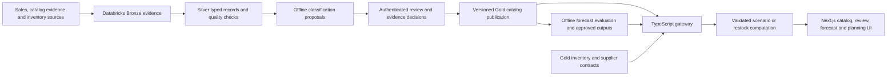

# AI-assisted product classification, monthly forecasting and restock planning

Prepared 3 October 2026. Accountable role: Architect. Status: implementation proposal; no feature activation, product approval, model publication, or warehouse write is performed by this document.

## 1. Outcome and current starting point

Help MedShield planners automatically classify pharmaceutical products, inspect reviewed therapeutic categories and condition associations, forecast product sales quantities for next month or the following months, and prepare an explainable restock plan.

### Explicit first-release requirement

The user clarified that classification **and monthly forecasting** are core functions. The first complete feature release must include both a reviewed product-classification workflow and supported SKU quantity forecasts; a classification-only milestone is an intermediate delivery.

- **Classification:** product description and reviewed attributes → proposed therapeutic category and separately reviewed condition associations.
- **Forecasting:** eligible historical SKU-unit sales → predicted fulfilled sales quantity for each future month. Default to **Next month**, with **Next 3 months** and **Next 6 months** views when their actual forecast leads are supported by validation.
- **Restocking:** supported forecasts plus verified operational inputs, or visible scenario assumptions → a reviewed draft order quantity. A forecast is distinct from a purchase recommendation.

Use separate classification and time-series models within one connected AI workflow. Their inputs, targets, versions and evaluations differ. Classification quality cannot establish forecasting accuracy. Sales history is sufficient to evaluate a sales-only quantity forecast after identity/unit/coverage acceptance; current inventory is a dependency for operational restocking, not for displaying an otherwise supported sales forecast.

Success is measured through classification quality and review effort first, forecast quality second, and fulfilled demand, stockouts and overstock after operational inventory data exists. Increased revenue or gross margin is an outcome to measure, not a guaranteed result of adding AI.

The current system already provides Databricks-backed sales reporting, source-label product ranking, forecast evaluation and a user-entered allocation scenario. The product review master has no approved identities. Legacy classification endpoints are disabled. Historical DOH/weather predictive joins remain unapproved, and live inventory/procurement inputs are missing. The current predictive release contract supports company monthly net-sales PHP; it does not establish a SKU-unit forecast contract.

Apply [CURRENT_STATE.md](CURRENT_STATE.md), [PRODUCT_CATALOG.md](PRODUCT_CATALOG.md), [PRODUCT_REVIEW_RULES.md](PRODUCT_REVIEW_RULES.md), [ARCHITECTURE.md](ARCHITECTURE.md), [API.md](API.md), and [BUSINESS_DEFINITIONS.md](BUSINESS_DEFINITIONS.md). The older [classification architecture](DISEASE_CATEGORY_CLASSIFICATION_ARCHITECTURE.md) is a target reference. Its illustrative title-based SKU, punctuation removal, keyword-to-disease, and planner-approval examples must not override the newer independent evidence gates.

Expected example: an unfamiliar invoice description enters a review queue; the system proposes an identity and category with supporting evidence. After separate identity, unit, category and association review and approved publication, its eligible observations can support a product forecast. A planner then prepares a stock-aware, pack-rounded draft order with an explanation and source dates.

Edge example: `250MG/5ML 60ML` must retain concentration and container volume separately. An unknown box count prevents a quantity conversion and numerical purchase recommendation. Category approval cannot resolve that missing identity or unit evidence.

## 2. Delivery sequence

| Phase | Implementation and primary owner | UI delivered | Exit evidence |
|---|---|---|---|
| 0. Freeze scope and input contract | Architect with Business Analyst: define first product cohort, therapeutic vocabulary, planning objective, existing permissions and missing inputs. Freeze the inspected sales release and preserve existing financial decisions. | Data readiness states and field requirements. | Versioned scope; explicit approval permissions; required fields and acceptance criteria agreed. |
| 1. Reviewed product foundation | Database Engineer with Data Analyst: extend existing product review preparation; collect catalog/packaging evidence; retain raw labels and source-record lineage. Add therapeutic and condition-association review contracts independently of existing catalog dimensions. | Product catalog, review statuses, source evidence detail. | Reviewed identity/unit evidence for the first cohort; unchanged transaction counts and financial measures; no guessed pack conversions. |
| 2. Classification suggestions | Data Analyst with Backend Engineer: exact approved alias matching, literal entity extraction, compatible-attribute candidate matching, then a trained text baseline when enough reviewed labels exist. Publish candidate suggestions with reason, method, model version and uncertainty. | Classification review queue, candidate alternatives, request-evidence/reject actions. | Unknown/conflicting names abstain; held-out SKU-family evaluation; proposals cannot approve catalog or condition associations. |
| 3. Review and catalog publication | Backend Engineer with Database Engineer: authenticated review workflow, scoped clinical evidence assessment, CEO business decision, versioned Databricks publication and audit. | Separate approval scopes, review history, pending-publication and superseded states. | Role checks, stale-edit protection, idempotency, source-to-Gold reconciliation and version-bound API/export validation. |
| 4. Product demand forecasts — first-release requirement | Data Analyst: introduce a separate SKU/territory/source-unit target contract; check observation coverage and stockout censoring; benchmark sales-only methods before testing disease/weather features. Publish validated monthly predictions with origin and actual lead metadata. Reuse offline predictive infrastructure without relabeling revenue as units. | Dedicated Demand forecast screen: Next month / Next 3 months / Next 6 months, observed-versus-forecast chart, target-month quantities, model evidence and unsupported-horizon state. | Rolling-origin evaluation per actual lead; accepted identity/units/coverage; correct calendar month targets; approved external joins before external features; business-reviewed quantity-model release. |
| 5. Inventory and restock decisions | Backend Engineer with Data Analyst: ingest stock snapshots, dated incoming orders, commitments, supplier lead times/caps, pack/MOQ, acquisition cost, budget and expiry information. Extend reviewed planning contracts. | Restock workspace, replenishment table, reason detail and draft export. | Freshness and unit checks; pack/MOQ/budget/supplier feasibility; time-phased shortage check; reproducible numerical results. |
| 6. Pilot and measured release | QA Engineer with Service Manager: shadow-run on the reviewed cohort, compare proposals with planner decisions and monitor data drift, errors and outcomes. | Review summary and measured planning outcomes. | Business acceptance and release receipt; rollback proof; baseline comparison over the agreed observation window. |

Build phases 0–4 as the first complete feature release: reviewed classification plus supported monthly SKU-unit forecasting. Begin with a next-month sales-only forecast on the first accepted product cohort, then enable longer views only for validated leads. Phase 5 adds operational restocking when stock/supplier inputs exist. Unsupported forecasts remain unavailable; manually entered demand may support a labeled scenario but cannot substitute for the required forecasting feature. Calendar estimates should follow the phase-0 data review because acquiring verified catalog and inventory evidence is a delivery dependency.

## 3. Architecture and processing boundaries



- Keep Databricks as the analytical system of record. The browser calls the authenticated TypeScript gateway. Offline Python prepares proposals and evaluates models; do not reactivate Flask as a parallel dashboard source.
- Record review events in a controlled, append-only Databricks review contract through a dedicated gateway write path. The existing reviewed CSV master remains authoritative preparation input until a separately documented migration establishes the review-event materialization contract; do not silently introduce a competing master. Approved events produce a new reviewed master/version and a reconciled Gold publication.
- Browser acknowledgements, successful SQL jobs and audit entries cannot confer business approval. An accepted review may be pending publication; the dashboard continues to display the pinned published catalog until the new release is reconciled and activated.
- Existing generic roles include an administrator override. Add a dedicated server-side CEO-linked business approval permission whose check does not inherit that override. Clinical assessment and operator publication are separate capabilities. Bind decisions to immutable proposal/input hashes, verify warehouse readback, and serialize publication before changing a release pointer.
- Supabase remains responsible for identity/application accounts and audit persistence. It supplies no analytical dashboard fallback. Server credentials stay in the gateway. When required warehouse outputs fail, return an unavailable state.
- Keep financial reporting available when classification or inventory outputs are unavailable. Preserve mixed medical, non-medical, service and unresolved source-label revenue under the existing financial eligibility rules.
- Existing dashboard runtime uses compiled scripts. Every new inline handler must be registered in `DASHBOARD_GLOBAL_HANDLERS` and bridged to `window`; prefer the existing listener patterns when practical. Preserve the scoped sidebar indicator and UTF-8 currency characters.

## 4. Proposed data contracts

These are proposed additions, not current tables. Logical names and schema versions are finalized before migration.

| Contract | Grain and key fields | Required controls |
|---|---|---|
| Existing reviewed product master | Stable `canonical_sku`, original alias/raw product key, item kind, literal strength/form/container/brand/manufacturer/model and sellable package/unit. Ingredient identity is a proposed separately reviewed enrichment; it is not a current master field. | Separate category, identity, unit and forecast eligibility; original financial/provenance fields preserved. A title or leading description token is not a SKU or verified ingredient key. |
| Classification proposal | Proposal ID, raw product key, input hash, candidate SKU and extracted attributes, proposed therapeutic labels, method/version, reason and optional calibrated probability. | `proposed`, `needs_evidence`, `rejected`, `superseded`; incompatible strength/form/pack blocks alias matching. Similarity/rule scores are not model probabilities. |
| Therapeutic assignment | SKU, vocabulary/code/version, therapeutic category, supporting references, review scope/status, effective dates. | One product may have multiple supported labels. Initial vocabulary must be versioned and clinically reviewed. |
| Condition association | SKU or reviewed ingredient/form identity, condition code/name, relationship type, evidence ID/source/version, clinical review and business decision. | Separate symptom-support, treatment, prevention, diagnostic or supply context; no condition inferred as a treatment merely from a keyword or sales season. Proposed associations cannot influence forecasts. |
| Review event | Actor/account, permission, target ID, dimension, prior revision, decision, reason, evidence, timestamp, request/idempotency ID. | CEO identity-linked business approval permission; scoped clinical assessment; append-only history; optimistic concurrency. |
| Stock snapshot and incoming order lines | SKU/location/unit/as-of, on-hand, commitments, quarantine/expired availability, lot expiry; incoming quantity and due date per order line. | Non-overlapping stock deductions; reviewed conversions; duplicate-line prevention; explicit freshness and completeness policy. Missing is not zero. |
| Supplier and planning policy | SKU/supplier/location, lead time and variation, order pack/MOQ, acquisition price/unit/currency, supplier limits, budget, service policy/review period. | Effective dates; observed facts separated from user assumptions. Do not mistake legacy `unit_cost`/CP selling price for acquisition cost. |
| Forecast and planning release | SKU/territory/unit, model origin, planning month/as-of, display start, displayed month count, target period, actual lead months, unit forecast, interval status, validated lead range, evaluation metrics, input/catalog/model versions, source availability timestamp, extraction time, freshness policy, plan assumptions and constraints. | Versioned SKU quantity schema distinct from company-revenue schema; display horizon 1/3/6 is not actual model lead; unsupported targets have null quantities and explicit blockers; immutable release/run references and evidence status. |

All new analytical API envelopes should expose `schema_version`, `release_id`, `dataset_id`, relevant catalog/model versions, `as_of`, `evidence_status`, `blockers`, and scope. Do not change the legacy `/api/products` array shape without a versioned consumer migration.

## 5. Classification and forecasting methods

1. Reuse an exact approved alias only when identity and packaging are compatible. Preserve source text, decimals, combinations, concentration denominators, form, model and container details.
2. Extract literal attributes and propose candidate matches. Unknown attributes remain unknown; they never act as wildcards. A conflict sends the record to review even when text similarity is high.
3. Train a simple text baseline on reviewed products when label coverage supports it. A candidate is TF-IDF character/word features with logistic regression; use multi-label output only if the approved taxonomy requires it. Character n-grams can accommodate spelling variants ([scikit-learn feature extraction](https://scikit-learn.org/stable/modules/feature_extraction.html)). This is an evaluation candidate, not a selected production model.
4. Evaluate on held-out SKU/ingredient families and novel brands, keeping aliases together across splits. Fit preprocessing only on training data; report per-class precision/recall/F1, accepted-suggestion coverage, errors and review effort. Select abstention thresholds using validation evidence. Do not use fixed keyword scores as accuracy or synthetic-data performance as operational proof ([cross-validation guidance](https://scikit-learn.org/stable/modules/cross_validation.html)).
5. Therapeutic categories can use a reviewed vocabulary informed by [WHO ATC](https://www.who.int/tools/atc-ddd-toolkit/atc-classification). Condition associations require separate evidence review; a taxonomy label alone does not establish an indication.
6. Forecast eligible observed fulfilled sales in verified units. Sales can be limited by stockouts, so unmet demand is not observable from invoice history alone. Retain missing months, returns, adjusted allocations and evidence exclusions explicitly.
7. Evaluate unit forecasts by rolling origin with leakage controls and matched evaluation periods. Compare with seasonal-naive/last-observation and suitable simple alternatives. Report MAE, bias and WAPE where its denominator is valid; report missing interval support rather than inventing certainty. Time-ordered evaluation prevents training on future observations ([TimeSeriesSplit guidance](https://scikit-learn.org/stable/modules/generated/sklearn.model_selection.TimeSeriesSplit.html)).
8. Test DOH/weather features only after territory/time joins and source availability are accepted. At each forecast origin, use only information available then; realized target-period disease/weather values cannot become future predictors. Freeze selection criteria before an untouched retrospective audit. Retain historical/proxy/partial-year labels. Keep external features only if their held-out improvement is repeatable; statistical association does not establish a causal restock rule.

### Monthly forecast calendar and publication contract

- Default **Next month** to the month after the selected planning month in Asia/Manila. Compute target periods with calendar arithmetic, including December → January. A 3/6-month selection displays successive future calendar months starting at that same target month.
- Store the last accepted observed period/model origin separately from the planning month and display start. Actual lead equals target month minus origin month; skipped periods remain forecast gaps and never become observed zeros.
- Example: planning month October 2026, accepted origin September 2026, display start November 2026. The 1-month view requires lead 2; 3 months November–January require leads 2–4; 6 months November–April require leads 2–7. A model validated only through lead 6 cannot supply an April quantity in this example.
- Real MedShield history currently ends in 2025. Do not portray it as a recent 2026 SKU history. Returning a November 2026 forecast requires an accepted release whose actual lead, data recency and SKU-unit coverage support that target; otherwise show unavailable with the specific dependency. The UI proposal uses explicitly synthetic 2026 history for demonstration only.
- Extend the API with a separately versioned SKU quantity channel, for example `sku_quantity_v1`. Retain current company net-sales/PHP contracts and existing 3/6/12 display semantics. Add 1/3/6 selectors to the new contract rather than weakening old validation or relabeling PHP as units.
- Each row carries `canonical_sku`, territory/location scope, verified `unit`, `origin_period`, `target_period`, `lead_months`, `forecast_units`, interval bounds/support, model/release references, and blockers. Each response identifies `planning_month`, `display_start`, `display_months`, training cutoff and validated lead range. Unsupported target quantities/intervals stay null, not fabricated or silently dropped.
- A classification change does not silently retrain or publish forecasts. A forecast run binds the reviewed catalog and observation release. Manual refresh creates a new versioned candidate run; retraining/publication follows the existing controlled job/review workflow.

An LLM is optional for explaining reviewed facts or extracting draft candidates. It is not required for the first release. Any provider integration requires a separate data-egress decision, minimum input payload and reference-backed output validation; product text is untrusted data. The initial pipeline can run without an external AI service.

## 6. Restocking logic and objective

The current gateway scenario greedily balances per-product fulfillment ratios under entered constraints; it does not prove a global optimum. Freeze the new restocking objective in phase 0. A proposed first policy is to maximize the mean per-product demand-fulfillment fraction under budget and supplier constraints, then minimize spend for equivalent fulfillment, using a solver that can prove the stated objective or report that it was not solved. This supports product availability. A gross-margin objective requires separately verified acquisition/selling-price assumptions; sales history alone cannot support net-profit optimization.

For a reviewed single-SKU scenario, sum forecast unit sales over the agreed lead-time plus review-period window, add the visible policy buffer, subtract usable uncommitted stock and incoming units due within that window, then round the positive shortfall up to reviewed order packs/MOQ. Display the assumptions. A fixed user buffer is a scenario input, not statistically validated safety stock.

The **Use in restock scenario** action carries one selected month's quantity and verified unit, with its source release/target month. Convert to a daily scenario average only using that month's actual calendar day count and an explicit uniform daily-allocation assumption; preserve the monthly total and do not round the daily rate before pack calculation. A multi-month display total cannot be treated as one month's demand. Editing demand or the review period changes the basis to a manual scenario assumption.

For the illustrative future-month scenario, entered stock/incoming amounts are assumptions at the selected target month's start; uniform demand carried into an added lead-time window is also a visible assumption. For an actual stock snapshot before that month, include intervening consumption and dated arrivals from the snapshot date. A November forecast cannot skip October depletion or justify October demand using November's daily average. Monthly forecasts alone do not establish precise stockout/order dates: those require an accepted daily allocation/depletion policy and adequate operational evidence. Scenario dates retain their assumption status.

Operational recommendations additionally need time-phased balance checks: an incoming shipment due after a projected shortage cannot remove the earlier shortage. Compute the latest order date from the projected depletion/reorder threshold and supplier lead time. Reject a plan that violates budget or supplier limits rather than silently truncating an allegedly feasible recommendation. Stockouts cannot be forecast from stale/unavailable inventory.

Only claim expiry-aware planning when lot expiry, usable stock and shelf-life constraints are available and tested. Otherwise show expiry analysis as unavailable. A recommendation prepares a draft for human review; no purchase order is issued by this feature.

## 7. UI proposal

Use the existing dashboard navigation and styling. Add a product workflow within the product area and extend the existing prescriptive planning area; avoid a separate app or a second filter bar with competing year selections.

### Product catalog

- Local tabs: **Catalog**, **Classification review**, **Demand forecast**, and a link/tab to **Restock planning**. Retain the global year/territory scope; populate year selectors from warehouse coverage, including future valid years with empty states. Forecast planning month and future target dates are explicit and independent of a descriptive historical-year filter.
- Search and filters: description/SKU, Medical/Non-Medical/Unclassified, therapeutic category, review state. Therapeutic filtering applies only to the appropriate reviewed medical scope.
- Table: original description/canonical product, item kind and sellable unit, therapeutic category, reviewed condition associations, independent review indicators, sales coverage and action.
- Detail panel: original aliases, extracted literal attributes, source evidence, original/adjusted/verified quantity coverage and review history. Keep unknowns visible.

### Classification review

- Queue ordered by positive financial contribution and exception severity, with count and coverage basis. Revenue rank does not establish clinical priority.
- Show original description beside proposed identity/category; candidate alternatives, reasons, method/model version and available evidence. Show a calibrated probability only for a calibrated model; otherwise name the score correctly.
- Independent scopes: identity/package/unit, product category, therapeutic assignment, condition association, forecast eligibility and transaction verification. Record clinical assessment separately from CEO business approval.
- Actions: **Save proposal**, **Request evidence**, **Reject proposal**, and **Approve reviewed scope** for accounts with the exact permission. Disable approval when required evidence is absent. Do not hide a rejection by deleting a source transaction.
- A submitted decision displays **Pending publication** until the new Gold catalog release is activated. Concurrent updates request a reload; repeated requests do not produce duplicate decisions.

### Demand forecast

- A dedicated product forecast workspace is part of the first release. Select a reviewed product, optional accepted territory scope, planning month and **Next month / Next 3 months / Next 6 months**. Default to next month.
- Show the product's reviewed therapeutic category/condition context, verified quantity unit, latest observed month, training cutoff and published model state. Classification and forecast approvals remain separate.
- Chart: actual observed quantities and visually distinct future forecasts, with calendar-month labels and quantity-unit axis. Keep any intervening missing month visible as a gap. Show an interval only when the released model supports it.
- Table: target month, predicted units, actual lead, interval support, evidence status and blockers. Show per-month values as well as the selected-range total; unavailable months cannot contribute guessed amounts.
- Evidence: selected method, dataset/catalog/model versions, evaluation period and per-lead quality metrics. No fabricated accuracy percentage or outbreak score. An unpublished or unsupported forecast has an explicit unavailable state.
- Action: **Use in restock scenario** for a selected supported product/month, carrying exact monthly units and source dates. An illustrative forecast stays labeled illustrative after transfer and cannot become an approved operational demand input.

### Restock planning

- Scope: location/territory, eligible product, planning horizon/review period and data-as-of. Mode badge: **Scenario** until verified operational contracts and an approved forecast exist.
- Inputs: forecast/demand basis, usable stock, dated incoming orders, commitments, lead time, buffer/service policy, pack/MOQ, acquisition cost, budget and supplier capacity. User-entered values retain an assumptions label.
- Table: product/category, planning status, forecast units, inventory position, latest order date, order packs/units, estimated acquisition spend and reason. Condition context is supplementary evidence rather than a clinical urgency score.
- Detail: observed sales/forecast, interval support, projected stock balance, binding constraints and exact versions. Separate unavailable data from recorded zero.
- Actions: **Calculate scenario**, **Review draft**, **Export draft CSV**. Operational order submission is outside this scope.

### States and accessibility

Loading, no results, no reviewed medical products, missing unit evidence, insufficient history, unpublished forecast, stale stock, unsupported horizon, infeasible budget, warehouse unavailable and permission denied all require specific messages and recovery actions. Preserve accessible labels, keyboard navigation, visible focus, table pagination and responsive layouts at 320/375/768/1024/1440px. Never substitute demonstration values into a live unavailable state.

The conversation mockup uses clearly labeled synthetic examples and local simulated actions. It is design evidence, not an implementation, real classification, clinical decision or procurement record.

## 8. Integration map, verification and first backlog

### Affected implementation locations

| Existing location | Planned change |
|---|---|
| `databricks/medshield_project/product_review_rules.py`, `product_catalog.py`, `references/product_master_review.csv` | Preserve literal review preparation and stable identities; add versioned contracts/materialization for therapeutic and association evidence. |
| `databricks/medshield_project/03_sales_gold.py` and SQL bridges | Publish independently reviewed catalog enrichment without changing facts or financial eligibility. Add reviewed proposal/read views under a controlled release. |
| `services/analytics_service/predictive/` | Add an explicitly versioned SKU-unit target rather than changing company revenue meanings; prepare/evaluate classifier and demand models offline. |
| `backend/src/catalogContract.ts`, `databricksDashboard.ts`, `server.ts` | Typed catalog envelopes, authenticated proposal/review routes, permission checks, concurrency, pinned release reads and publication state. |
| `backend/src/predictiveRelease.ts`, `predictivePublication.ts`, `predictiveCoverage.ts` | Extend model contracts only after SKU-unit evidence gates exist; preserve legacy consumers. |
| `frontend/services/api/descriptive-products-runtime.ts`, `prescriptive-planning-runtime.ts`, `dashboard-engine.ts`, `frontend/lib/medshieldReference.ts` | Catalog/review controls, typed data access, planning states, existing runtime-handler bridge and responsive styles. Prefer focused new modules where these files would become too large. |
| Existing backend, Databricks, service and Playwright tests | Add meaningful contract/evidence/permission/forecast/constraint regressions. |

Proposed new routes: `GET /api/catalog/products` (metadata envelope), `GET /api/catalog/review-queue`, `GET /api/catalog/proposals/:id`, `POST /api/catalog/proposals/:id/decisions`, `GET /api/catalog/demand-forecasts?sku=...&planning_month=YYYY-MM&display_months=1|3|6`, and a separately authorized publication operation. These names are proposals. The forecast route reads the new pinned SKU-unit release; it does not invoke an LLM or local-file fallback to fabricate a response. Reuse `/api/sales/planning-shortlist` and `/api/sales/planning-solve` compatibly for scenarios; add a versioned operational contract only after stock/forecast publication. Do not enable disabled legacy classifier/procurement routes merely to fill the UI.

### Acceptance checks for the working feature

1. **Evidence preservation:** unchanged source records/financial totals; conflicting strengths/concentrations/forms/packages stay separate; RAW groups survive unknown identity.
2. **Approval separation:** category approval never approves identity, unit, therapeutic/condition evidence, forecasting or original transaction verification. Only the CEO-linked permission records business acceptance.
3. **API safety:** invalid filters/body, unauthorized roles, duplicate requests and stale revisions have deterministic outcomes; account restrictions and server-side evidence checks cannot be bypassed by editing browser state.
4. **Analytical provenance:** UI/API/export agree on pinned input/catalog/model versions; incomplete warehouse queries fail; candidate/scenario labels remain visible.
5. **Classification evidence:** held-out families remain isolated; unsupported classes/attributes abstain; per-class performance and review effort are reproducible on real reviewed records.
6. **Forecast evidence and calendar:** SKU-unit contracts reject unknown conversions, absent coverage and unsupported actual leads; next-month and 3/6-month targets survive year rollover; skipped observations remain gaps; source recency and training cutoff are visible; rolling-origin/per-lead evaluation and approved external joins are proven; sales-only baseline remains the benchmark. Company revenue contracts remain compatible. Monthly-to-daily scenario transfer uses the correct 28/29/30/31-day count and conserves monthly quantities.
7. **Restock mathematics:** zero, missing and negative values are handled correctly; no double subtraction of commitments; dated arrivals/expiry, pack/MOQ, budget and supplier constraints pass feasible/infeasible boundary cases.
8. **User journey:** proposal → evidence request/review → pending publication → released catalog → supported forecast → scenario/draft export. Verify keyboard use, loading/error/empty states and desktop/mobile fit.
9. **Release:** shadow-run comparison, explicit business acceptance, version-bound activation, staged rollback proof and monitoring thresholds. Admin/operator privileges do not imply business approval.

Existing verification commands to extend after implementation (not run as evidence of this proposal):

```powershell
# Repository root
python -m unittest discover -s databricks/medshield_project/tests
python -m unittest discover -s services/tests

# backend/
node --import tsx --test tests/*.test.ts
node node_modules/typescript/bin/tsc --noEmit

# frontend/
node node_modules/typescript/bin/tsc --noEmit --incremental false
node node_modules/@playwright/test/cli.js test e2e/prescriptive-planning.spec.ts --workers=1
```

New classifier/review/operational test files must be added before their paths are used. Run focused checks for changed contracts first. Cloud publication checks are separate from local tests. Do not run `next build` against the active `next dev` cache.

First implementation backlog: freeze first reviewed product cohort → add independent therapeutic/condition evidence schema → add controlled proposal generation → add authenticated review permission/concurrency contract → implement catalog and review screens → reconcile and publish a first reviewed catalog → add SKU-unit forecast contracts and next-month/per-lead evaluation → publish an accepted forecast release and Demand forecast screen → first classification-and-forecast feature acceptance → acquire and validate inventory/supplier inputs → extend restock planning → pilot outcomes.

## Proposal verification record

Repository instructions, current-state/catalog/API/architecture/definitions and existing implementation boundaries were inspected. Current tracked changes and both running development services were inspected and preserved. This delivery adds a proposal document and a separate conversation UI mockup; no application feature, existing product master, service, approval or Databricks output was modified. UI interaction and layout verification is reported with the delivery, separately from future feature acceptance.

The proposal received focused independent consistency reviews against the actual master header, gateway computation, and quantity/calendar forecast boundaries. All seven local documentation links resolve. The revised four-screen prototype passed JavaScript syntax and duplicate-ID checks, navigation and separate assessment gates, pending-product forecasting/planning restrictions, pack rounding/acquisition spend, zero-order and invalid-input cases, and sample-save behavior. Forecast-specific browser checks verify 1/3/6 displayed months, November–April targets across the year change, leads 2–7, an unobserved October gap, single-month scenario transfer, February's 28-day quantity conservation, preserved stock assumptions and manual-demand provenance reset. All four screens had zero measured horizontal overflow at 320, 375, 768, 1024 and 1440px. Desktop/mobile and dark-theme forecast screenshots were visually inspected; no browser runtime errors occurred. These checks validate the local proposal, not application integration, trained-model accuracy, clinical validity or operational readiness.
