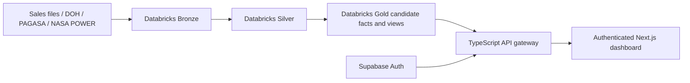

# MedShield Architecture

## Runtime layers

- **Frontend:** Next.js App Router and TypeScript UI in `frontend/`.
- **API gateway:** Express and TypeScript in `backend/`; it owns authentication checks, validation, caching, and every dashboard query.
- **Analytical system of record:** Databricks Unity Catalog, primarily `workspace.medshield_gold`.
- **Identity and audit:** Supabase Auth, linked application accounts, and audit persistence. Supabase does not supply dashboard measures.
- **Offline analytics:** Python jobs, model experiments, and tests under `services/`. They are not started by the gateway and are not dashboard runtime sources.

## Data and request flow

1. Sales, official external files, and provider observations enter controlled Databricks ingestion paths.
2. Bronze preserves source evidence. Silver parses, assesses, and separates accepted/rejected rows. Gold publishes candidate facts and aggregates.
3. SQL bridge views expose stable application shapes after Gold completes.
4. The gateway uses server-only Databricks credentials and SQL Statement Execution APIs.
5. The frontend calls only the gateway. It does not query Databricks, Supabase analytics, NASA, or local files directly.
6. If Databricks or a required Gold object is unavailable, the gateway returns an explicit error and the frontend shows an unavailable state.

There is no browser JSON, Python snapshot, Supabase analytics, seeded analytical, or local-file fallback. Audit logging may use a local file if Supabase audit persistence is unavailable; that exception never supplies dashboard measures.

## Active analytical contracts

- `workspace.medshield_gold.sales_restart_fact_candidate`
- `workspace.medshield_gold.vw_dashboard_monthly_sales_candidate`
- `workspace.medshield_gold.vw_dashboard_yearly_sales_candidate`
- `workspace.medshield_gold.vw_dashboard_area_yearly_candidate`
- `workspace.medshield_gold.sales_restart_business_product_yearly_candidate`
- `workspace.medshield_gold.vw_dss_external_signals_candidate`
- `workspace.medshield_gold.vw_weather_nasa_power_monthly_candidate`

The gateway also derives bounded buyer-sector, forecasting-baseline, prioritization, and scenario responses from those views. Derived classification must retain its mapping basis and must not be described as source-recorded ownership.

## Publication gates

- Gold financial objects remain candidates and API metadata reports `candidate_only: true`.
- The checksum-bound replacement snapshot currently reconciles 37,728 accepted transactions across 2017-2025, but named business approval remains open.
- Buyer-sector and geographic labels come from controlled mapping rules and references; owner approval remains required.
- DOH/PAGASA territory mappings are not approved for forecasting. External regression therefore returns `blocked`.
- PAGASA observations and NASA POWER proxy observations are visible as historical evidence with separate provider labels.
- Inventory, lead-time, supplier, expiry, and approved predictive outputs must be published before they can support operational recommendations.

## Boundary rules

- Never send `DATABRICKS_TOKEN`, `DATABRICKS_SQL_WAREHOUSE_ID`, or Supabase server secrets to the browser.
- Keep direct Databricks access and NASA POWER refresh orchestration in the TypeScript gateway.
- Do not replace a failed Databricks query with bundled, local, mock, or seeded values.
- Treat mapped buyer/geography fields as derived unless their source explicitly recorded them.
- Treat user-entered planning inputs as scenario assumptions.
- Treat `PASS_CANDIDATE` as technical pipeline evidence, not publication approval.

See [CURRENT_STATE.md](CURRENT_STATE.md), [API.md](API.md), and [DATABASE.md](DATABASE.md).
