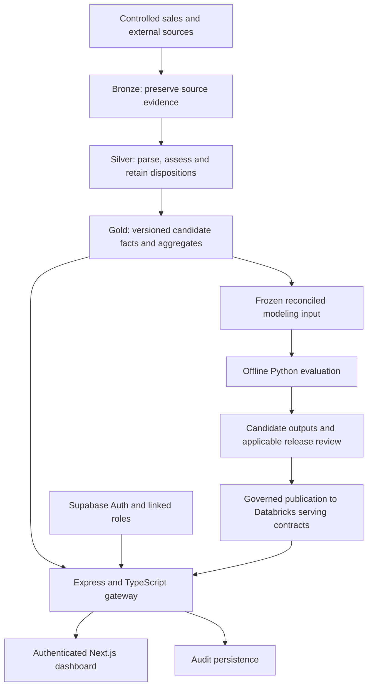

# MedShield Capstone Completion Workflow

## Current study and output closure — 20 October 2026

Adrian explicitly confirms **2017–2025 as the current study**, including the
earlier gathered data. The former 2021–2025/default-versus-context history
selector is superseded and removed. **2026 actuals are pending client
confirmation**; future predictions are not 2026 observations. Retain early-year
partial coverage. The retained 2020–2025 model/STL subset is a method-specific
window, not the whole study period, and has not been retrained by this change.

The next outcome is to settle one consistent output packet, not redesign the
implemented analytical screens:

| Output | Existing supported result | Remaining bounded action and owner |
|---|---|---|
| Descriptive | 2017–2025 net sales, supported gross profit/margin, products/areas, coverage, tables and CSV; fixed Overall plus selected-sector charts | Frontend/Analyst: verify the expanded nine-year chart/KPI/CSV population, retain independent sales/profit eligibility and early partial years; client/project lead reviews the demonstrated financial scope. |
| Diagnostic | Reconciled 2024–2025 sector contribution and sector → month → product → supported raw-area investigation | Analyst/Writer: retain checked Government contribution, source-allocation and proposed-mapping limitations; integrate the evidence, without treating contributions as proven causes. |
| Predictive evaluation | Existing company-PHP research and working buyer benchmarks, historical errors/bias and source/lead evidence | Analyst: present one fixed same-case comparison and the retained selection rationale, actual origin/window/leads and limitations. Do not keep selecting/tuning from already inspected audit results. |
| Predictive future output | Stored company-PHP candidate projections; buyer monthly future points unavailable without their published contract | Frontend/Writer: distinguish historical backtests from stored candidate projections and unsupported future windows. Missing actuals mean future accuracy is unmeasured; do not infer medicine-unit demand or activate procurement. |
| Paper | Updated methodology guide and working Chapters 4–5 | Writer: align working Chapters 1–3 dates with the owner-confirmed 2017–2025 study, then assemble consistent methods/results/conclusions and check Word/PDF figures, tables and citations. Preserve archived sources. |

Client follow-up is limited to genuinely new inputs: availability/latest covered
month of 2026 sales and the acceptable peso/percentage forecast error for the
intended decision. Complete submission of the existing COO-provided records is
already recorded; do not ask again. If 2026 actuals arrive, preserve the existing
frozen predictions/model identity, validate the new data and first score eligible
previously unobserved forecast targets before any later retraining. More years
alone do not resolve quantity, territory, source or business acceptance gaps.

## Sector diagnostic deliverable — 19 October 2026

The requested sector-filtered overview, reconciled year-contribution table,
chronological margin chart/value table and source-preserving nested investigation
are implemented. Use the [checked findings and limitations](../outputs/sector_diagnostic_20261019/FINDINGS.md)
and [implementation/verification record](../outputs/sector_diagnostic_20261019/README.md)
for this bounded outcome, rather than treating the earlier design/QA notes as
still-unimplemented requirements. The original default study view is now
2017–2025, following Adrian’s explicit 20 October scope confirmation. Current mappings were reviewed
and retained as proposed, without inferring private ownership from geography.

The methodology guide and working Chapters 4–5 now include the method, actual
sector/month/product/raw-area results and bounded conclusion. Government
dominates the recorded financial increase, while adjusted-source allocation,
generic account/geography labels and differing margin eligibility constrain
interpretation. User can refresh and inspect the scoped dashboard. Complete
paper/Word assembly and actual source, mapping, business, model, operational and
academic acceptance retain their existing owners and gates.

Reviewed: **19 October 2026, Asia/Manila**. This guide connects system delivery to the paper using current repository evidence. The system/paper flow below is a design and writing handoff checked against repository sources; it is not a fresh runtime or warehouse assessment. Dated experiments, original paper objectives and actual decisions retain their own authority.

## System logic and paper flow — 19 October 2026

### Business decision and scope

The business goal is to help MedShield planners understand recorded sales, identify products and territories needing review, evaluate future sales evidence, and compare replenishment choices under explicit constraints. Reduced expiry, fewer stockouts and better purchasing remain outcomes to measure when their required inputs and evaluation exist.

Use one reasoning chain throughout the system and paper:

**Business question → eligible data → suitable method → checked result → planner interpretation → bounded action → evidence in the paper.**

The current supported question is: **What do the supplied recorded sales show, how well do company-PHP forecasting methods perform historically, and what allocation is feasible under entered assumptions?** The original O1–O5 commitments also include territory medicine quantities, specific predictive methods, governed workflows and operational outcomes. Keep those commitments in the [objective/evidence register](OBJECTIVE_EVIDENCE_REGISTER.md) until fulfilled or explicitly amended by the actual decision owners.

The current user-confirmed study and recorded-sales reporting scope is **2017–2025**. The retained company monthly STL/modeling window is **2020–2025**, a separately disclosed analytical subset. Original supplied Chapters 1–3 still contain earlier dates; reconcile their working text during manuscript assembly without altering archived source documents. Future-year software support does not establish future actual observations. Adrian's confirmation that the COO-provided exports are the complete recorded-sales submission is already recorded in [Current State](CURRENT_STATE.md#recorded-sales-completeness-confirmation-and-unit-method--17-october-2026); do not ask for it again. No-record months and historical physical-unit evidence remain separate issues.

### Data processing and request flow

The offline/publication branch describes the model lifecycle, not approval of the current research models. Stored research evidence is served only through the gateway's documented source-bound contract, with its research label; it is not an analytical fallback. External sources retain their own provider, period and join status. Dashboard requests never fit models. Supabase supplies identity/roles/audit; Databricks supplies analytical measures. Direct browser sales upload remains HTTP 409. Required source failure produces an unavailable state.

Boundary references: [architecture](ARCHITECTURE.md), [API](API.md), [database](DATABASE.md), [security](SECURITY.md), [Databricks guide](../databricks/medshield_project/README.md) and [predictive operations](PREDICTIVE_OPERATIONS.md).

### Planner journey and page responsibilities

This is the recommended decision sequence using existing page responsibilities. It does not claim an implemented cross-page wizard or automatic transfer of forecast values into planning inputs.

| Step / page | Planner's question | Logic and output | Next decision |
|---|---|---|---|
| 1. Login and Overview | What evidence can I use? | Authenticate; show source period, candidate/research status and coverage. Select period, buyer, product and geography where applicable. | Continue within the supported population; investigate unavailable or unresolved scope. |
| 2. Sales Diagnostics / source transactions | What changed, and where? | Reconcile revenue, same-population gross margin, matched-period YoY and supported seasonality. Drill into source records, original/adjusted evidence and unknown months. | Identify the contribution or exception worth investigating. Diagnostic contribution is not proof of cause. |
| 3. Product Prioritization | Which labels drive recorded commercial value? | Compute Pareto and deterministic ABC from the defined positive-contribution population before display truncation. Retain signed adjustments separately. | Shortlist labels for commercial/source review; do not infer medicine units, stock urgency or dead stock. |
| 4. Area Prioritization | Where is commercial activity concentrated? | Rank mapped geographic areas; show buyer composition, unknown geography, coverage and the documented commercial-score basis. | Select a supported territory for review. Buyer sector is a filter/dimension, not a geographic territory. |
| 5. Forecast validation / research | Is a forecast useful for this target and date? | Identify target/unit, origin, actual calendar leads, comparison cases and historical errors. Present only supported points; disclose research status. | Use evidence for the stated research/planning question or retain unavailable points and exact blockers. |
| 6. Weather / external evidence | What historical context is available? | Separate official observations and provider proxies. External regression stays blocked until approved geography/time and issue-time feature contracts exist. | Consider an evaluated external-feature experiment only when supported; context alone does not establish demand uplift. |
| 7. Prescriptive Planning | What is feasible under these assumptions? | Use a source-bound shortlist and explicitly entered demand, stock, pack, cost, supplier, reserve and budget assumptions. Validate inputs and report feasible, infeasible or not solved. | Compare scenarios and seek human review; current bounded greedy allocation does not establish global optimality or execute orders. |
| 8. Evidence/export and review | Can another person reproduce this decision? | Export the actual selected population, units, period and provenance; retain source/model identity and applicable review decisions. | Use the same checked evidence in Chapter 4 and its exact limitations in Chapter 5. |

These are analytical responsibilities, not a new count of original modules. See the [dashboard design explainer](logic/DASHBOARD_DESIGN_EXPLAINER.md) and [business definitions](BUSINESS_DEFINITIONS.md) for exact behavior.

### Retained sector diagnosis and chart QA — 19 October 2026

The user requests a buyer-sector diagnosis of the sales increase and a QA review of the secondary sales/profit scatter. Keep this ordered outcome alongside the wider completion sequence:

1. Apply All/Government/Private/Internal/Unknown consistently across the sales/gross-profit trend, summaries, supporting view, coverage, table and CSV. Government and Private are the main comparison; keep Internal identifiable and empty Unknown selections truthful.
2. Review geographic labels currently routed to Private while implementation proceeds with the existing disclosed mapping. No silent ownership reclassification or invented Unknown samples.
3. Compare equivalent 2024/2025 periods within the current 2017–2025 study; retain partial coverage for earlier years. Reconcile sector contributions to the overall peso change, then investigate months, products and supported areas/accounts; preserve signed and original/adjusted evidence.
4. Verify the shared source/filter/population and missing/partial states before integrating methods, findings and limitations into Chapters 3–5. Contributions do not prove causes.

[Focused scatter QA and repair specification](../outputs/scatter_chart_qa_20261019/QA_REPORT.md) finds tested API/chart values correct but point identity, partial-period visibility and keyboard-equivalent detail inadequate. Each dot in the reviewed yearly view represents a year, not a buyer or sector. Recommended next presentation: retain the sector-scoped totals trend and use the secondary view for a chronological gross-margin percentage chart with an accessible value/coverage table. Use the same margin-eligible profit/revenue population; do not turn the scatter's independent totals into a margin rate. This recommendation is not an implemented replacement or accepted scope amendment.

### Rules for selecting the supported analysis

Readiness is specific to an output. A usable financial report does not require physical-unit approval; a category decision does not approve a quantity forecast. The rules below summarize existing contracts rather than adding a new schema or approval state machine.

| Requested output | Required evidence and rule | If evidence is insufficient |
|---|---|---|
| Recorded revenue / gross margin | Eligible Gold financial rows and consistent filters. Margin uses gross profit and revenue from the same margin-eligible records. A zero denominator has no available rate. | Keep unknown amounts/rates null with a reason. Show coverage; do not substitute company net profit. |
| Quantity profile | Preserve recorded Qty and original/adjusted provenance. Research-supported presentation annotations remain distinct from historical-unit approval. | Label source Qty/unverified unit; no automatic box-to-tablet conversion or mixed-unit physical total. |
| SKU/territory quantity forecast | Separate identity, category, item-kind, unit and forecast-suitability decisions, plus supported historical quantities, coverage, geography, target/origin and time-ordered evaluation. | Retain the exact blockers. Continue independently eligible financial reporting/research. |
| Company-PHP research forecast | Frozen financial target, origin-local preparation, common calendar cases, baseline comparison and disclosed MAE/RMSE/WAPE/bias. Review suitability for the intended decision. | Keep research status and unavailable future errors. A selected model is not automatically useful or operationally accepted. |
| Disease/weather forecast extension | Approved territory/time keys, provider provenance, features available at issue time and a comparable sales-only baseline. | Show historical context or an explicitly entered scenario. Do not apply an assumed positive multiplier. |
| Operational replenishment | Accepted demand evidence and verified inventory position, supplier/lead-time, costs, service policy, pack constraints and expiry inputs where required. | Offer only the supported entered scenario or identify the missing input. Do not convert a scenario into a procurement instruction. |

Per-product rules and their undeployed/offline boundaries are in the [product analytical policy](PRODUCT_ANALYTICS_POLICY.md). Current independent-state software is documented in the [approval bridge packet](../outputs/product_approval_bridge_20261017/README.md); software readiness is separate from actual source-owner evidence and governed integration.

**Concrete example:** A planner selects Quezon and a source product label. Its financial rows may support recorded net-sales contribution even if Qty's historical unit remains unknown. Product research can provide a presentation reference while retaining that uncertainty. A physical-quantity forecast stays gated; a planning example can still run with explicitly entered compatible assumptions. The paper reports recorded financial contribution and scenario feasibility, with no claim of verified physical demand or prevented expiry.

**Calendar edge case:** If the accepted origin is December 2025, January–December 2027 are leads 13–24. A 1–12-month evaluation does not cover those dates. The separate [longer-horizon experiment](../outputs/forecast_2027_experiment_20261017/REVIEW.md) provides exploratory research evidence with its own limitations, not an active dashboard release or verified 2027 actuals. Missing 2026 records cannot be filled with forecasts and then treated as observed training data.

### Paper logic: one question, method, result and conclusion per objective

Use the [confirmed source and revision guide](PAPER_REVISION_GUIDE.md), the [working Chapters 4–5](chapters/MedShield_Chapter_4_5_Revised_20261016.md), and the original AC-O1–AC-O5 contracts. The table below is a writing map; it does not rewrite objectives or establish new results.

| Original objective | Method section must specify | Chapter 4 must demonstrate | Chapter 5 must answer |
|---|---|---|---|
| O1: regional sales baseline, YoY and STL | Study/extra-history scope; financial/quantity meaning; geography and period comparability; actual decomposition grain. | Source-bound sales/coverage, matched YoY and actual company monthly STL, identifying the remaining original territorial/frequency gap. | What historical visibility is established, for which population, and which original clauses remain open? |
| O2: product/territory/account priorities and XGBoost ABC | Deterministic ABC/Pareto rules; account/SKU identity; reconciled temporal/held-out/new-label classifier task and leakage controls if retained. | Recomputed selected-population contributions/ranks. Classifier results require their own actual held-out evaluation; observed ABC is a separate result. | Which commercial priorities are supported, and which account/SKU/classifier claims are still unproven? |
| O3: territory medicine demand, DII/RSI and urgency | Quantity target/unit/geography/origin/leads; baselines; external availability; defined urgency truth. Describe supporting PHP research separately. | Actual model comparison and errors with source/run identity. Report company-PHP research without relabelling it medicine-demand or accepted external forecasting. | Is the intended forecast decision supported, how large are its errors, and what remains missing at the original target? |
| O4: EOQ/ROP/weighted allocation and expiry target | Operational input provenance; objective/constraints; actual solver; assumptions and outcome-measurement design. | Checked scenario inputs, feasibility/constraints and sensitivity. EOQ/ROP, optimality and real expiry outcomes need their own evidence. | What can a planner compare now, and has operational benefit actually been measured? |
| O5: integrated modules, governed CSV workflow, warnings and matching | Actual runtime/security boundaries; controlled ingestion; failure/retry/publication; official-warning and recommendation evaluation where retained. | Same-release user tasks, API/table/CSV consistency, denied/unavailable states and implemented workflow limits. | Which integrated workflows are demonstrated and which original warning/matching/ingestion requirements remain open? |

Chapter sequence:

1. **Chapter 1:** business problem → original general/specific objectives → intended decisions, scope and limits. Keep proposed amendments visibly proposed.
2. **Chapter 2:** evidence and literature justifying the chosen data/methods; distinguish reviewed alternatives from methods actually evaluated or deployed.
3. **Chapter 3:** CRISP-DM overall lifecycle, with SEMMA inside analytical development; then data preparation, architecture, method contracts, validation and outcome-evaluation design. Follow the [methodology guide](CHAPTER_3_METHODOLOGY_GUIDE.md).
4. **Chapter 4:** source/quality → descriptive and diagnostic findings → forecast comparisons → scenario checks → integrated-system evaluation. Use the actual institution/draft numbering and the [evidence plan](CHAPTER_4_5_EVIDENCE_PLAN.md); this is an argument order, not authority to renumber sections blindly.
5. **Chapter 5:** answer O1–O5 individually using Chapter 4 evidence; state achieved scope, error/coverage limits, unmeasured outcomes and next recommendations. A screenshot establishes a visible workflow, not forecast accuracy or reduced wastage.

For each consequential claim, retain: **objective → manuscript location → source/population/period/unit → formula or method → implementation/output → actual check and date → limitation → next owner**. Reuse existing evidence packets through the register. Evidence labels (observed, derived, proxy, forecast, scenario) and acceptance status (candidate, reviewed, approved where actually recorded) describe different properties and must both survive into figures and captions.

### Ordered next work and completion checks

| Order | Accountable owner / concrete deliverable | Finish evidence |
|---|---|---|
| 1. Take existing descriptive evidence to review | Project lead coordinates the source owner, designated business approver and adviser using the [D9/D10 closure packet](../outputs/descriptive_closure_20261017/START_HERE.md). | Attributable decisions on the demonstrated reporting scope and original historical-unit requirement, or actual amendment. Existing tests/research cannot sign these decisions. No extra forecast tuning prerequisite. |
| 2. Assemble the working manuscript | Technical Writer performs T02–T04 using the existing source PDFs, revised chapters and later dated findings. Preparation can proceed while reviews are pending. | Named editable working source, source manifest, complete chapter structure, evidence links and explicit unresolved wording. Whole-paper rendering/academic acceptance remains a later check. |
| 3. Prepare research annotations if system integration is selected | Data/Backend owner follows the [Databricks handoff](../outputs/descriptive_closure_20261017/DATABRICKS_UPDATE_HANDOFF.md). | Current release rediscovered; versioned candidate carries research basis separately from historical-unit approval; source Qty/finance unchanged; API/chart/CSV parity and rollback checked before activation. |
| 4. Resolve one supported physical pilot | Source/catalog owner supplies available identity/unit/date/geography evidence from the existing queue; analyst freezes a target only after checking it. | A supported series and evaluation contract, or precise remaining blockers. No repeated requests for unavailable receipts or invented unit conversions. |
| 5. Extend retained original methods and operations | Assigned model/operations/engineering owner works from AC-O1–AC-O5 and each actual upstream dependency. | Required unit/external/classifier/scenario/ingestion results and applicable measured outcome evidence, or actual scope decisions. A new model family alone earns no objective acceptance. |

Consolidated review-sheet fields are already prepared across the [scope packet](../outputs/scope_reconciliation_20261016/README.md), [descriptive decisions](../outputs/descriptive_closure_20261017/review-decisions.json), [product research/review](../outputs/descriptive_closure_20261017/UNIT_REVIEW_DECISIONS.md) and [pilot sheet](../outputs/pilot_evidence_step3_20261017/README.md). Reuse those records for identity/unit/effective dates, geography/coverage, forecast purpose/error costs, and operational inputs; do not create a competing approval register. Available research interpretations stay attributed and historically unverified where appropriate.

This flow is ready for implementation/writing handoff when (1) every proposed output has a source and input gate, (2) every original objective has a method/result/conclusion mapping without silent replacement, (3) missing, signed, partial and unsupported-lead cases have defined behavior, and (4) each next outcome has an owner and observable finish evidence. The 19 October checks establish document/link and source consistency only; no application test, live query, model fit, publication, manuscript assembly or acceptance is implied.

## Practical user workflow — 17 October 2026

Use this sequence with the [40-checkpoint delivery tracker](ANALYTICS_COMPLETION_ASSESSMENT_20261017.md).
The tracker is 23/40 (57.5%) at its dated snapshot; steps below do not earn points
until their actual checkpoint exits are met. The original objective register
still owns full-study acceptance. This practical sequence is not another rubric.

| Order | Your action | Agent/engineering action | Finish evidence |
|---|---|---|---|
| 1. Confirm deliverable | Review the existing original-versus-implemented scope packet with the adviser/client; record any actual amendment. Keep original scope if no amendment occurs. | Prepare exact evidence/gap options using the objective register and existing scope packet; do not wait for approval to prepare reviewable work. | Attributed decision for required target, geography, horizon and intended use; unresolved original objectives stay visible. |
| 2. Preserve verified sources | Keep the nine canonical exports; add future annual files through controlled ingestion. No need to obtain unavailable delivery receipts again. | Reuse the completed nine-year audit and shared product queue; rerun only for changed sources or dependent contracts. | Current file/dataset identity and reconciled totals; audit already completed for the existing snapshot. |
| 3. Resolve a useful product batch | For prioritized products, provide only what is actually known about historical identity, unit, territory and completeness, with source/date. State unavailable evidence explicitly. | Rank the existing queue by useful contribution/history, record independent statuses and effective dates, retain adjusted provenance and signed entries. Never ask for the same unavailable records indefinitely. | Supported series for the intended physical target, or a documented unresolved gate. User reporting grouping remains distinct from documentary physical equivalence. |
| 4. Build supported analytical inputs | Review readable units, periods and purpose; select no tablet conversion without pack evidence. | Prepare reconciled monthly inputs, unknown-month handling and separate positive/signed quantities. Continue financially eligible PHP research independently where supported. External region/time joins must preserve populations and issue-time availability. | Unique month/series keys, conserved totals, missing-versus-zero checks and accepted evidence status. No quantity fallback from PHP. |
| 5. Evaluate predictive and explanatory methods | Define the decision that forecasts support and costs of over/underforecasting; review errors in both absolute units and percent. No arbitrary universal acceptable-error threshold. | Freeze target, candidate settings and time splits; compare baselines and supported models on identical cases, with MAE/RMSE/WAPE/bias and appropriate intervals. Evaluate retained classifiers/urgency and external models separately. | Reproducible comparable evaluations, explicit failed fits/leads and feature provenance. Previously inspected history stays retrospective; future accuracy is not invented. |
| 6. Supply operational inputs | Obtain actual stock/on-order/commitments, suppliers, lead times, expiry/lot records, ordering/holding costs, budget/capacity and service policy. | Prepare validation/import and scenario workflows while awaiting inputs; then implement EOQ/ROP/weighted allocation and validate the agreed optimization objective. | Reviewed compatible operational inputs and independently checked outputs/constraints; scenario-only behavior stays labelled when inputs are entered rather than verified. |
| 7. Integrate through Databricks | Provide the authorized operator/reviewer for governed deployment when prepared changes are ready. | Prepare version-bound candidates and rollback, publish through the runbook, then verify Gold → gateway → dashboard/table/CSV. Verify annual ingest/retry/correction/turnover and retained warning/matching functionality separately. | Same-release source/model/output identities, numerical agreement, denied/unavailable states and retained original-objective evidence. No local analytical fallback. |
| 8. Demonstrate and accept | Test real user tasks; client reviews usefulness and error tolerance, adviser/panel reviews retained study scope/method. Record actual decisions, not proxy signatures. | Assemble evidence and run regression/security/usability checks appropriate to the changes; retain initial failures and corrected checks. | Intended-scope technical checks plus actual named business/academic decisions. Passing tests alone is not acceptance. |
| 9. Measure outcomes | If original operational claims are retained, arrange the real pilot and comparable stockout/expiry/cost measurements. | Define measurement window/baseline and calculate measured results. Keep simulated benefits separate. | Real outcome evidence for the original claim, or an explicitly accepted scope amendment. This cannot be completed instantly in software. |
| 10. Close system and paper together | Review final Chapters 1–5 and handover with adviser/client. | Link each result to its objective/source/model/API/graph, integrate current findings and limits, render/review manuscript and verify deployment/turnover documentation. | Consistent final manuscript, reproducible evidence, completed required exits and actual review records. Update only earned tracker points. |

**Current continuation (19 October):** use the existing consolidated review
records and ordered next work above. The source audit, completeness confirmation,
first research batch, unit-review handoff and longer-horizon research now have
dated evidence in Current State; do not restart them from this older sequence.
User/source owners supply only available factual decisions. Manuscript preparation
can proceed while specific input and acceptance gates remain pending.

If the client is absent, draft the decision sheet and review packet, implement
reversible independent work and disclose unresolved gates. Do not record client
approval, verified physical units, adequate future accuracy or measured inventory
benefit on their behalf. A different bounded prototype may be completed under an
explicitly amended scope, but it does not retrospectively fulfill original O1–O5.

## Source authority and canonical references

| Source | Owns |
|---|---|
| [Objective/evidence register](OBJECTIVE_EVIDENCE_REGISTER.md) | Original O1–O5, AC-O1–AC-O5, exact gaps and attributed business/academic decisions |
| [Current State](CURRENT_STATE.md) | Dated implementation, source/model identity, readiness and open gates |
| [Requirements](REQUIREMENTS.md), [business definitions](BUSINESS_DEFINITIONS.md) | Functional commitments and metric/data meaning |
| [Architecture](ARCHITECTURE.md), [decisions](DECISIONS.md), [API](API.md), [database](DATABASE.md), [security](SECURITY.md) | Runtime boundaries, contracts and access responsibilities |
| [Latest post-defense Chapters 1–3](../references/CapstonePaper_1.pdf), PDF pp11–12 | User confirmed latest source on 16 October; bytes match the supplied post-defense PDF. Original objectives remain unchanged and traceable until fulfilled or explicitly amended |
| [Supplied Chapters 4–5 draft](../references/chapters/GROUP%209_MedShield_CP2_Chapter%204_5.pdf) and [revised working text](chapters/MedShield_Chapter_4_5_Revised_20261016.md) | Preserved source and complete section-by-section revision; older PRIVATE_SUMMER reference is no longer the latest-source label |
| [Paper revision guide](PAPER_REVISION_GUIDE.md), [Chapter 3 guide](CHAPTER_3_METHODOLOGY_GUIDE.md), [Chapter 4/5 plan](CHAPTER_4_5_EVIDENCE_PLAN.md) | Writing corrections and evidence assembly; newer scoped entries supersede older generic status rows |

[Detailed remaining-work checklist](REMAINING_WORK_DETAILED_CHECKLIST.md) remains a work inventory. Check its items against the dated sources before treating them as missing or complete. Obsidian is the linked working view described in [project memory](PROJECT_MEMORY.md); it is not another approval register.

## One delivery loop

**North Star → original objective → agreed definition/data contract → system or analytical deliverable → actual verification → manuscript claim/figure/table → applicable review.**

1. Select one bounded outcome and one accountable role using `.agents`; read its required skills. Review current diff, running tasks and relevant source contracts.
2. Record exact files, dependencies and numbered observable acceptance checks. One active outcome per owner; independent work may proceed in parallel.
3. Implement the smallest maintainable change, following the existing architecture.
4. Run the relevant checks and bind results to the checked source/revision, dataset/policy/table or model/run identity.
5. Update affected canonical facts, graph/export evidence and manuscript text. Complete the per-turn memory record and next-owner handoff.
6. Close only the assigned outcome after its checks pass. Keep original-objective, business-publication, operational and academic acceptance separate.

Use `assessing → ready → executing → verifying → done`, with `needs-fix` for failed verification and `blocked` for a named dependency. Track implementation, verification, paper integration and actual acceptance as separate dimensions. A captured prompt or completed discussion cannot close a task.

## Immediate completion sequence

| Order | Owner / deliverable | Exit evidence |
|---|---|---|
| 1. Reconcile scope | Business Analyst prepares original-versus-implemented O1–O5 packet | Every original criterion, actual capability, exact gap, feasible implementation or proposed amendment, evidence and decision owner represented |
| 2. Assemble working paper | Technical Writer uses the relevant supplied paper and repository inserts | Named working source, recorded baseline/source manifest, complete chapter structure and explicit unresolved claims; no extra user file is a prerequisite for preparation |
| 3. Assemble Chapter 4 evidence | Analyst plus implementation owners | Source-bound data-quality, descriptive, dashboard/export, predictive and bounded scenario evidence; inherited checks labelled |
| 4. Repair system findings | Assigned engineering/Security/Database owners | Re-check the current disposition of the [10 October QA findings](../outputs/system_qa_20261010/QA_REPORT.md), repair affected dependencies/migrations/validator/recovery contracts, then retain actual scoped checks |
| 5. Demonstrate integration | Orchestrator and QA | Same-release authenticated workflows, filters/exports, unavailable/recovery and audit behavior with pinned identities and residual risks |
| 6. Resolve retained objective gaps | Assigned data/catalog/model/inventory owners | Applicable AC-O1–AC-O5 evidence or an actual academic amendment; dependent activation remains gated |
| 7. Finish complete manuscript | Technical Writer and document QA | Integrated chapters, institutional numbering/citations, cross-reference review, complete rendered Word/PDF and inspection of every page |
| 8. Record formal decisions | Project lead, CEO, adviser/panel | Actual client usefulness and academic scope/review decisions, correction log and accountable next actions |

Scope packet, manuscript assembly and evidence preparation can proceed in parallel. A proposed scope amendment can be drafted without waiting for its approval; it remains proposed until the actual decision. Production hosting is a separate release matter and need not delay bounded research writing.

## Map the objectives without replacing them

| Original objective | Existing evidence to carry forward | Main remaining difference |
|---|---|---|
| O1: regional performance, YoY, STL | Company historical financial reporting and company monthly STL | Original study/territory/unit/decomposition scope and same-release acceptance |
| O2: territory/account/SKU priority, Pareto and XGBoost ABC | Source-label Pareto, observed deterministic ABC and mapped-area rankings | Approved sellable/account identities and future classification if retained |
| O3: territorial medicine demand, DII/RSI and urgency | Company monthly recorded net-sales/PHP research comparisons | Quantity/territory target, true calendar leads, origin-safe external joins, urgency truth and reviewed publication |
| O4: EOQ/ROP/weighted allocation, expiry wastage ≤5% | Entered commercial planning scenarios | Operational inputs, agreed method and measured outcome evidence |
| O5: five governed modules, CSV workflow, official alerts and matching | Module areas, controlled ingestion, gateway reporting and exports | Complete submission/retry/correction/publication, current acceptance and evaluated official-warning/matching scope |

These are summaries. The register owns exact contracts. Company-PHP forecasts do not fulfill medicine-quantity O3; scenarios do not prove reduced wastage. Current 2017–2025 study/reporting and the retained 2020–2025 STL/modeling subset need explicit explanation; working manuscript dates must follow the user’s 20 October direction. No defensible whole-capstone percentage is defined.

## Paper assembly from existing files

No inspected canonical record designates a complete current editable manuscript. Use the current supplied PDF as the manuscript reference, preserve original commitments, and assemble a named working source from relevant repository materials rather than selecting an older Word file by editability alone.

Use the [10 October predictive Markdown draft](chapters/MedShield_Predictive_Chapter_4_5_Research_Draft_20261010.md), matching [Word insert](chapters/MedShield_Predictive_Chapter_4_5_Research_Draft_20261010.docx) and [verification packet](../outputs/predictive_chapters_20261010/README.md) together with the [15 October findings supplement](chapters/MedShield_Predictive_Findings_Update_20261015.md) and its [receipt](../outputs/predictive_findings_20261015/verification.json). These are bounded inserts, not a complete accepted manuscript. Existing system/earlier chapter Word drafts require reconciliation with current logic before reuse.

- Chapters 1–2: problem, original objectives, study scope, selected methods and literature; label proposed amendments and future work.
- Chapter 3: CRISP-DM/SEMMA, pipeline/architecture, metric populations, target/grain, temporal evaluation, provenance, scenario assumptions and governance.
- Chapter 4: data quality, descriptive findings, system behavior, executed QA, predictive comparisons and tested scenarios. Use the [descriptive checklist](../outputs/descriptive_activation_20261009/CHAPTER4_CHECKLIST.md).
- Chapter 5: answer each objective at its supported scope, explain measured results and limits, and distinguish recommendations from demonstrated outcomes.
- Complete paper: merge chapters, reconcile captions/tables/citations and inspect the complete rendered artifacts. Formal review is a separate step.

## Evidence and current constraints

Every consequential claim/figure/table needs objective, manuscript location, supported claim, evidence type, period/population/unit/coverage, source identity, actual check/date/result, limitation and next owner. Link existing receipts instead of copying changing metrics into multiple trackers. Label observed, derived, proxy, forecast and scenario evidence.

The 15 October findings-writing step is complete within its documented scope. Full manuscript integration, Word/PDF formatting and formal review remain open. Preserve the original versus later trials, development versus retrospective audit, supported cumulative leads and genuine future projection timing. The proposed research error goal is unachieved and separate from unset business limits.

Sales files are the only available source evidence reported by the user. `Date Delivered` is the recorded basis; original receipts are unavailable. Research writing proceeds with unverified physical events, independent completeness, original SKU quantities and unusual-month causes disclosed. Do not keep asking for unavailable receipts.

Runtime remains controlled sources → Databricks Bronze/Silver/Gold → serving bridges → Express/TypeScript gateway → authenticated Next.js dashboard. Supabase owns identity/roles/audit. Offline predictive evaluation uses frozen reconciled analytical inputs; serving requires governed publication. Required analytical failures return explicit unavailable states. The sales upload endpoint returns HTTP 409; use controlled Databricks ingestion.

External mapping/as-of/model gates, SKU/pack/unit identity and inventory/supplier/lead-time/expiry inputs remain required for their dependent claims. Retain original/adjusted source provenance; allocation reconciliation is not proof of original SKU demand. Follow current architecture/API entries for historical weather providers and publication state. Official live warnings, procurement execution and measured inventory benefit require their own evidence and decisions.
