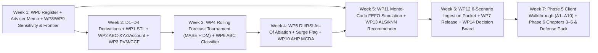

# MedShield Detailed Capstone Implementation Plan: Sales + DOH + Weather Data Path

**Date:** 30 October 2026 (Asia/Manila) · **Status:** Proposed execution plan (not completion evidence)  
**Execution:** [30 October implementation status and remaining gates](SALES_EXTERNAL_IMPLEMENTATION_STATUS.md). Package implementation, verified scope and full acceptance are tracked separately; this plan is not completion evidence.
**Baseline Coverage:** **12.5 / 33** original clauses (**37.9%**), per [OBJECTIVE_EVIDENCE_REGISTER.md](OBJECTIVE_EVIDENCE_REGISTER.md#original-objective-coverage-reassessed--30-october-2026) (and retained assessment packet `medshield1/medshield/outputs/objective_progress_20261030/README.md`)  
**Requirements Authority:** Original SO1–SO5 commitments in [CapstonePaper_1.pdf](../references/CapstonePaper_1.pdf), pp. 11–12 (wording unchanged unless the adviser formally records an amendment)  
**Canonical Boundaries:** [DECISIONS.md](DECISIONS.md) (Decisions 001–009) · [BUSINESS_DEFINITIONS.md](BUSINESS_DEFINITIONS.md) · [ARCHITECTURE.md](ARCHITECTURE.md) · [CAPSTONE_COMPLETION_WORKFLOW.md](CAPSTONE_COMPLETION_WORKFLOW.md) · [SYSTEM_COMPLETION_PLAN.md](SYSTEM_COMPLETION_PLAN.md) · [CLIENT_ACCEPTANCE_WALKTHROUGH.md](CLIENT_ACCEPTANCE_WALKTHROUGH.md)

> [!IMPORTANT]
> **Data Reality & Evidence Governance.** The only internal company record is the **sales ledger** (2017–2026 through September in Databricks Gold; 2017–2025 CSVs in `data/medshield/dataset_csv/` and 2017–2026 CSVs in `databricks_updated_2/medshield_project_csv/`). As verified in the 30 October 2026 operating-input readiness audit ([OBJECTIVE_EVIDENCE_REGISTER.md](OBJECTIVE_EVIDENCE_REGISTER.md#operating-input-source-discovery-completed--30-october-2026)), there is **no verified company stock-on-hand, batch/lot expiry, supplier lead-time, ordering-cost, holding-cost, write-off, or stable account-ID record**. External public data is available: DOH disease surveillance, PAGASA station weather, NASA POWER / Open-Meteo gridded proxies, and a reference client list.  
> Every figure, API field, UI badge, CSV column, and manuscript claim produced under this plan **must** carry an explicit provenance label: **`Observed`**, **`Derived`**, **`Proxy`**, **`Assumed`**, **`Forecast`**, or **`Simulated`**, and must obey the terminology restrictions in [BUSINESS_DEFINITIONS.md](BUSINESS_DEFINITIONS.md#terms-that-must-not-be-used-yet).

---

## 0. Architectural Non-Negotiables & Operating Rules

All work packages (WP0–WP14) must comply with the repository's non-negotiable architectural and governance boundaries ([DECISIONS.md](DECISIONS.md)):

1. **Analytical System of Record (Decision 002 & 004):** Every dashboard analytical measure is served from **Databricks Unity Catalog Gold** (`workspace.medshield.*`, current itemized candidate dataset `e87cae21986db32bcade298d69e652236be9db65f2685db51355003f1439ff10`, fact `Delta0`, policy `original_source_layers_v1_candidate_only`) or from a TypeScript gateway calculation whose inputs came from Gold. When a required source is unavailable, **fail closed** with an explicit error and UI unavailable state—never substitute Supabase tables, local CSVs, Python snapshots, or mock values.
2. **Offline Python Modeling Boundary (Decision 007):** Python jobs under `services/analytics_service/` prepare, train, evaluate, and solve models **offline**, writing versioned, SHA-256-bound artifacts. Dashboard HTTP requests never start Flask services or fit models synchronously.
3. **Candidate Gates vs. Approval (Decision 005 & 006):** `PASS_CANDIDATE` and passing unit/browser tests prove technical correctness only. Financial release, SKU/unit identity, geographic mapping, external-join readiness, model promotion, procurement execution, client acceptance, and academic scope amendments remain separate named human decisions.
4. **Active Databricks Workspace (Decision 008):** All local Databricks scripts, CSV staging, category releases, and tests live in [databricks_updated_2/](../databricks_updated_2/README.md). Retain `databricks_updated/` and `databricks/` as immutable historical evidence. Direct browser sales upload (`POST /api/sales/upload`) remains permanently `HTTP 409 DATABRICKS_INGESTION_REQUIRED`.
5. **Financial Scope Separation (Decision 009):** The main financial overview supports `Exclude Contracts` (default), `Contracts Only`, and `Include Contracts — unreconciled`. Itemized product, area, diagnostic contribution, unit demand, and model contracts remain strictly itemized-only (`Exclude Contracts`).
6. **Dashboard Runtime Sandbox:** `frontend/src/data/medshieldReference.ts` (`MEDSHIELD_STYLE`, `MEDSHIELD_MARKUP`, `MEDSHIELD_SCRIPT`) is compiled by `frontend/src/lib/dashboard-engine.ts`. Every inline `onclick` handler in markup must be registered in `DASHBOARD_GLOBAL_HANDLERS` and bridged to `window`. Always emit real UTF-8 characters (`₱`, `±`, `–`, `—`), never escaped literals (`\u20b1`). Never run `npm run build` while `next dev` is running.

---

## 1. Grounded Data Inventory & Codebase Baseline

### 1.1 Internal & External Data Sources in This Repository

| Source | Exact Repository Location | Coverage & Grain | Key Fields | Evidence Label |
|---|---|---|---|---|
| **Sales ledger (2017–2026 Sep)** | `databricks_updated_2/medshield_project_csv/medshield_data_2017.csv` … `2026.csv`; `data/medshield/dataset_csv/` (2017–2025); Databricks Gold `Delta0` (40,171 itemized rows; 39,286 technically eligible; ₱638,015,351.53 net) | Transaction / delivery line item; 2026 observed Jan–Sep | `Area`, `DR Number`, `Date Delivered`, `Product`, `Qty`, `CP` (selling price), `Total CP`, `Disc`, `Net CP` (net sales), `TP/UNIT` (acquisition cost), `Total TP`, `Net Income` (gross margin amount), `%` | **Observed** |
| **DOH disease surveillance** | `datasources/raw/doh/DOH_Request_Daily_Breakdown_Weekly_Summary_2021_2025.xlsx`, `[#DOH-313647129213] Weekly Reported Cases 2021-2025 (1).xlsx`; `data/DOH 2021-2025/`; prepared monthly JSON `data/medshield/processed/regression_external_monthly.json` | Weekly/monthly onset counts by region/province (2018–2026 candidates; 2021–2025 raw workbooks) | Reported non-discarded surveillance cases: Dengue, Leptospirosis, Cholera, Typhoid Fever, ILI, SARI, ABD, Rotavirus, HFMD, Measles | **Observed (external)** |
| **PAGASA daily station weather** | `data/PAGASA 2017-2024/2017-2020/` & `2021-2024/` (~55 stations incl. Ambulong, Alabat, Calapan, Coron, Cuyo, Daet, Infanta, Juban, Legazpi, Masbate, Puerto Princesa, Romblon, San Jose, Sangley Point, Tanay, Tayabas, Virac Synop); `datasources/raw/pagasa/` | Daily station observations (2017–2024; 2025+ absent in official files) | Rainfall (`mm`), temperature (`°C`), relative humidity (`%`), PAR tropical cyclone track summaries (`PAR_0km_2021_2024.xlsx`) | **Observed (external)** |
| **NASA POWER / Open-Meteo** | `backend/src/nasaPowerWeather.ts`, `backend/src/openMeteoWeather.ts`, `backend/src/weatherProviders.ts`, `backend/src/weatherAreas.ts` | Daily gridded coordinates by territory (2017–2026+) | Coordinate-derived daily rainfall (`mm`), temperature, humidity | **Proxy (external)** |
| **Client & area reference files** | `data/medshield/reference_loc/ClientList_extracted.txt`; `databricks_updated_2/medshield_reference_csv/area_classification_mapping.csv`, `product_master_review.csv`, `transaction_evidence_review.csv` | Reference tables | Client names/locations, 9 confirmed territory mappings, buyer sector rules (`Government`, `Private`, `Internal`, `Unknown`), product classification proposals | **Reference → Derived** |

### 1.2 What Exists in Code Today vs. What Remains to Build

| Domain | Already Implemented & Verified in Codebase | Remaining Gap Covered by This Plan |
|---|---|---|
| **Descriptive & STL (SO1)** | `backend/src/regionalSalesReview.ts`, `regionalStlReview.ts`, `originalStl.ts`, `so1Financial.ts`, `so1Diagnostics.ts`, `services/analytics_service/regional_stl.py`. Reconciled 2017–2026 (Sep) net sales & gross margin; 9 confirmed delivery labels; CALABARZON 2026 matching-month YoY (+2.21%). | Extend transaction-linked delivery attribution where supported by `ClientList_extracted.txt` (D2/D4) while keeping unresolved labels explicit; formalize seasonal/trend strength ($F_s, F_t$) summary table and adviser granularity memo if daily/weekly STL was expected (WP1). |
| **Product/Area & ABC (SO2)** | `backend/src/areaPriorityReview.ts`, `descriptiveMetrics.ts`, `catalogContract.ts`, `services/analytics_service/product_priority.py`, `abc_protocol.py`, `abc_evaluation.py` (frozen XGBoost depth-2/3 vs. `prior_abc` / `majority` across 4 history cohorts). | Complete ABC × XYZ 9-cell matrix on `Net CP` and monthly `Qty` CV; derived account key (D2) Pareto/inactive-6m review; calibrate and surface held-out `abc_evaluation.py` confusion matrix and low-history cohort limits in UI/export (WP2, WP6). |
| **Diagnostics (SO1/SO2/SO3)** | `backend/src/salesDiagnostics.ts`, `historicalComparison.ts`, `sectorTrend.ts`. Reconciled sector → month → product → raw-area contribution drilldowns and transaction ledger inspection. | Formal Price-Volume-Mix (PVM) decomposition on unit-consistent cohorts; STL residual anomaly log ($|z| > 3$) with DR drilldown; lagged cross-correlation (CCF, lags 0–3m) against DOH cases and rainfall labeled as association-only (WP3). |
| **Forecasting & External Drivers (SO3)** | `services/analytics_service/predictive/models.py` (`last_value`, `seasonal_naive`, `mean_3`, `mean_6`, `ets_none`, `ets_damped`, 9 `prophet` configs, `sarima_ar_seasonal`, `sarima_airline`, `ridge_direct`, `ridge_recursive`), `metrics.py` (MAE, RMSE, WAPE, bias, empirical 80/95% intervals), `bupiright_unit_candidate.py` (18-month HOSPITAL ampoule pilot), `unit_prospective_issue.py`, `external_regression.py` (DOH + PAGASA/NASA POWER OLS lags 1,2,3,6,8,12), `backend/src/predictiveResearch.ts`, `rollingResearch.ts`, `forecastEvidence.ts`, `predictivePublication.ts`, `predictiveRelease.ts`. | Add **MASE** and Diebold-Mariano ($p$-value) to `metrics.py`; formalize **DII** (Disease Intensity Index) and **RSI** (Rainfall Seasonality Index) with 2-week publication-lag as-of joins in `external_regression.py`; define forward surge urgency flag (> p90) and consequence table (error in days of TP value); execute prospective issue window when eligible (WP4, WP5, WP7). |
| **Prescriptive Planning (SO4)** | `backend/src/inventoryPolicyScenario.ts` (entered-input EOQ/ROP with pack-cost rounding & shelf-capacity check), `inventoryFeasibility.ts`, `weightedPlanning.ts` (`allocateWeighted` exact BigInt branch-and-bound with LP relaxation bound), `datedPlanReview.ts`, `datedPlanSelection.ts` (`selectDatedPlan` finite-domain dated receipt optimizer), `services/analytics_service/prescriptive_planning.py` (`scipy.optimize.milp` + `pulp>=2.8.0`). Verified in browser (`policy_weighted_browser_20261030`). | Create formal `docs/ASSUMPTIONS_REGISTER.md` + `config/planning_assumptions.json` (WP0); add sensitivity tornado/heatmap over literature ranges (A1–A5) and compare EOQ vs. historical DR order frequency (WP8); add budget frontier and shadow-price analysis (WP9); add AHP pairwise consistency check ($\mathrm{CR} < 0.10$) and $\pm 20\%$ weight Spearman $\rho$ stability (WP10); build offline Monte-Carlo FEFO/ROP backtest simulation over 2019–2025 actual monthly demand to evaluate simulated turnover and wastage $\le 5\%$ under the adviser amendment (WP11). |
| **Integration, Alerts & Recommender (SO5)** | `databricks_updated_2/` Bronze/Silver/Gold + 200 passing local tests; `backend/src/databricksYearlySync.ts`; `POST /api/sales/upload` returns 409; Data Source reload/provenance panel verified (`source_recheck_20261030`); rule-based product/area follow-up actions (`recommendation_clarity_20261030`); A1–A6 operator walkthrough passed (`client_acceptance_20261029`). | Package 6-scenario controlled-ingestion fault/retry/rollback verification packet (WP12); implement offline collaborative filtering (ALS + item-kNN on derived account D2 × product implicit matrix with 6-month temporal holdout, Precision@10/Recall@10/NDCG@10 vs. popularity baseline) (WP13); build historical DOH-derived surge signal ($\mathrm{DII} > 1.5$) + PAGASA PAR cyclone track (`PAR_0km_2021_2024.xlsx`) retrospective event evaluation and regional Decision Board summary (WP14). |

---

## 2. Full 33-Clause Objective Map, Current Score, and Target Closure Path

Current baseline: **12.5 / 33 (37.9%)** from [OBJECTIVE_EVIDENCE_REGISTER.md](OBJECTIVE_EVIDENCE_REGISTER.md#original-objective-coverage-reassessed--30-october-2026).  
Scoring rubric: `1.0` = demonstrated within accepted scope, `0.5` = partial / method-only / synthetic-input evidence, `0.0` = not yet demonstrated.

| Clause | Original Requirement (SO1–SO5) | Now | Target (Sales + External Path) | Delivering WP & Exact Closure Mechanism | Remaining External Gate |
|---|---|---:|---:|---|---|
| **O1.01** | 2021–2025 sales baseline (expanded to 2017–2026 Sep) | 1.0 | **1.0** | Retain reconciled Gold `Delta0` financial/trend/export parity (`so1Financial.ts`). | None (retain parity) |
| **O1.02** | CALABARZON, MIMAROPA, and Bicol territory scope | 0.5 | **0.5–1.0** | **WP1 + D4:** Extend transaction-linked delivery attribution via reviewed `ClientList_extracted.txt` + DR join; keep unallocated/channel rows explicit and non-inflating. | Source/account owner sign-off on extended mappings |
| **O1.03** | Year-over-year per territory | 0.5 | **1.0** | **WP1:** Matched-calendar-month YoY across all confirmed territories; missing months stay `unavailable` (never `0`); full API/UI/CSV parity. | QA verification |
| **O1.04** | STL decomposition as analytical baseline | 0.5 | **1.0** | **WP1:** Exact reconstruction check ($Y = T + S + R$), seasonal/trend strength ($F_s, F_t$) table across regions, plus adviser memo if monthly vs. finer grain needs sign-off. | Adviser granularity confirmation (if required) |
| **O1.05** | Sales Diagnostic module | 0.5 | **1.0\*** | **WP1 + WP3:** Reconciled PVM + anomaly drilldown + A1 client walkthrough task. | Client task A1 acceptance |
| **O2.01** | Service territory identification | 0.5 | **1.0** | **WP2 + D4:** Complete reviewed `area_classification_mapping.csv` separating `territory`, `customer_type`, and `business_line` with raw-label lineage. | Source/catalog reviewer acceptance |
| **O2.02** | Client account identification | 0.0 | **0.5** | **WP2 + D2:** Deterministic + reviewed fuzzy join (`DR Number` + `Area` + `ClientList_extracted.txt`) producing `derived_account_key` with confidence flags and non-inflation check. Cannot score `1.0` without source-recorded account IDs unless amended. | Source owner / Adviser amendment |
| **O2.03** | Sales volume, revenue contribution, and demand growth | 0.5 | **1.0** | **WP2:** Separate `Net CP` (₱), paired `margin_pct`, and presentation-scoped `Qty` with matched-month YoY and 12m rolling growth. | Catalog/source owner review |
| **O2.04** | Revenue-driving SKUs and slow movers | 0.5 | **0.5–1.0** | **WP2 + D1:** Parsed presentation/pack catalog + ABC-XYZ matrix; label low-frequency items as *slow-moving sales candidates* ("absence of sale $\neq$ stock on hand"). | Inventory/catalog owner or Adviser amendment |
| **O2.05** | 80/20 Pareto analysis | 0.5 | **1.0** | **WP2:** Positive-contribution ABC (`<80%` A, `<95%` B, `≥95%` C) computed before Top-N filtering, with returns stratum kept separate and unit-incompatible sums prevented. | BI/QA parity check |
| **O2.06** | XGBoost ABC predictive classifier | 0.5 | **1.0** | **WP6:** Execute frozen `abc_evaluation.py` (`xgb_depth_2`, `xgb_depth_3` vs. `prior_abc` and `majority`) on family-disjoint split using strictly prior-period features; report per-class P/R/F1, macro-F1, and low-history cohort behavior. | Adviser/model review of honest champion/baseline result |
| **O2.07** | Product and Area Prioritization modules | 0.5 | **1.0\*** | **WP2 + WP10:** Integrated commercial review + follow-up actions + A2/A3 client walkthrough tasks. | Client tasks A2 & A3 acceptance |
| **O3.01** | Territory-level pharmaceutical demand | 0.5 | **1.0** | **WP4 + D1/D3:** Reviewed medicine presentation × territory monthly `Qty` cohort alongside retained `BUPIRIGHT` HOSPITAL ampoule pilot. | Catalog/unit scope confirmation |
| **O3.02** | December 2026 and onwards forecast | 0.5 | **1.0** | **WP4 + WP7:** Multi-horizon (leads 1, 3, 6) territorial unit & therapeutic-class evaluation + registered prospective issuance (`unit_prospective_issue.py`) covering Dec 2026+ from Sep/Oct 2026 origin. | Model owner review |
| **O3.03** | Weighted scoring for product urgency & visibility | 0.0 | **0.5–1.0** | **WP5 + WP10:** Define observable forward surge target ($\text{Qty}_{t+1} > p_{90}$ of class history) and evaluate urgency score precision/recall vs. naive baseline (labeled *demand priority / surge urgency*, not inventory urgency). | Business/adviser review |
| **O3.04** | Facebook Prophet & baseline tournament | 0.5 | **1.0** | **WP4:** Rolling-origin tournament in `services/analytics_service/predictive/models.py` comparing `last_value`, `seasonal_naive`, `mean_3/6`, `ets`, `sarima`, `prophet`, and `ridge`/tree challengers on identical common keys with MAE, RMSE, **MASE**, WAPE, bias, and Diebold-Mariano test. | Model owner review |
| **O3.05** | DII disease external regressor | 0.0 | **1.0** | **WP5:** Compute $\mathrm{DII}_{d,r,t}$ from DOH surveillance with 2-week publication lag (training-only scaling); report ablation ($\Delta\text{MASE}$, $\Delta\text{MAE}$) on common folds vs. sales-only baseline. | External-join review |
| **O3.06** | RSI rainfall external regressor | 0.0 | **1.0** | **WP5:** Compute $\mathrm{RSI}_{r,t}$ from PAGASA (2017–2024 official) and NASA POWER (2017–2026 proxy, separately labeled) with leak-free as-of joins and ablation table. | External-join / Adviser review |
| **O3.07** | XGBoost / ML urgency & consequence evaluation | 0.0 | **1.0** | **WP4 + WP5:** Evaluate tree/regularized challenger on surge classification/regression with decision-consequence translation (forecast error expressed in days of mean demand and `TP/UNIT` peso exposure; zero invented stockouts). | Model/business review |
| **O3.08** | Forecast Modeling dashboard integration | 0.5 | **1.0\*** | **WP7:** Version-bound artifact readback (`predictivePublication.ts`, `predictiveRelease.ts`) through gateway → UI → CSV with explicit unavailable states and A4 client task. | Client task A4 acceptance |
| **O4.01** | Optimize procurement decisions (objective & constraints) | 0.5 | **1.0** | **WP0 + WP9:** Formalize objective, constraints, and literature-backed assumptions register (`ASSUMPTIONS_REGISTER.md`) alongside stock-only baseline comparison. | Procurement/adviser review |
| **O4.02** | Reduce expired-stock losses and improve turnover | 0.0 | **0.5–1.0†** | **WP11:** 1,000-run Monte-Carlo FEFO + ROP backtest over 2019–2025 observed monthly `Qty` demand comparing Naive ($P_0$), Seasonal-Naive EOQ/ROP ($P_1$), and Champion + DII EOQ/ROP ($P_2$) on turnover and expired-TP wastage, all labeled **`Simulated`**. | †Adviser amendment for simulated outcome evaluation |
| **O4.03** | Expiry-driven wastage $\le 5\%$ of coverage baseline | 0.0 | **0.5–1.0†** | **WP11:** Evaluate whether $P_2$ achieves simulated wastage $\le 5\%$ with 95% confidence intervals across shelf-life/lead-time sensitivity grids (A3–A6). | †Adviser amendment + client review |
| **O4.04** | Economic Order Quantity (EOQ) | 0.5 | **0.5–1.0†** | **WP8:** Bind `inventoryPolicyScenario.ts` to observed `TP/UNIT`, observed/forecast annual `Qty` ($D_i$), and literature range $S, h$ (A1–A2); compare against historical DR order frequency and generate sensitivity tornado/heatmap. | †Adviser amendment (or verified company cost basis) |
| **O4.05** | Reorder Point (ROP) | 0.5 | **0.5–1.0†** | **WP8:** Bind ROP and safety stock $SS_i = z\sqrt{L\sigma_{d,i}^2 + \bar{d}_i^2\sigma_L^2}$ to observed demand variability $\sigma_{d,i}$ and literature lead-time ranges (A3–A5). | †Adviser amendment (or verified lead-time/stock basis) |
| **O4.06** | Linear programming / MILP allocation | 0.5 | **1.0** | **WP9:** Reconcile `weightedPlanning.ts` (exact branch-and-bound), `datedPlanSelection.ts`, and `prescriptive_planning.py` (`scipy.optimize.milp` / `pulp` HiGHS) with 5 hand-solvable optimality/infeasibility checks, shadow-price analysis, and budget frontier. | QA verification |
| **O4.07** | MCDA weighted criteria (revenue, growth, outbreak risk) | 0.5 | **1.0** | **WP10:** Connect observed revenue rank, matched-month demand growth, and DII outbreak signal via AHP pairwise matrix ($\mathrm{CR} < 0.10$), min-max normalization on training/historical bounds, and $\pm 20\%$ weight sensitivity ($\text{Spearman }\rho$). | Analyst/adviser review |
| **O4.08** | Prescriptive Planning module | 0.5 | **1.0\*** | **WP8 + WP9:** Complete browser/CSV parity (`policy_weighted_browser_20261030` + sensitivity summary) and A5 client acceptance walkthrough. | Client task A5 acceptance |
| **O5.01** | Five named analytical modules integrated | 0.5 | **1.0\*** | **WP14 + Phase 5:** Authenticated end-to-end walkthrough across Sales Diagnostics, Product Prioritization, Area Prioritization, Forecast Modeling, and Prescriptive Planning (A1–A6). | Client tasks A1–A6 acceptance |
| **O5.02** | Evidence-based procurement/inventory for Dec 2026+ | 0.5 | **0.5–1.0†** | **WP14:** Regional Decision Board combining Dec 2026+ forecast leads, surge flags, and assumption-labeled EOQ/ROP/MILP scenarios. | †Adviser amendment + client review |
| **O5.03** | Controlled CSV ingestion & validation workflow | 0.5 | **1.0** | **WP12:** End-to-end verification packet for `databricks_updated_2` Bronze → Silver → Gold candidate isolation, retry, full-period correction, rollback, and UI Data Source reload (`POST /api/sales/upload` remains 409). | Operator/QA sign-off |
| **O5.04** | Early-warning surge / weather signal | 0.0 | **0.5–1.0†** | **WP14:** Dual retrospective evaluation: (a) PAGASA PAR tropical cyclone track history (`PAR_0km_2021_2024.xlsx`) + station rainfall extremes, and (b) DOH surveillance surge trigger ($\mathrm{DII} > 1.5$ for 2 consecutive periods), with explicit unavailable state for live official bulletins and honest precision/recall/lead-time scoring over 2019–2025. | †Adviser amendment for DOH/historical-PAR signal scope |
| **O5.05** | Collaborative filtering recommendations | 0.0 | **1.0** | **WP13:** Offline ALS + cosine item-kNN recommender on derived account (`D2`) × product implicit interaction matrix (order count & log-`Net CP` weighting), 6-month temporal holdout, excluding discontinued/internal items, evaluated on Precision@10, Recall@10, NDCG@10, and catalog coverage vs. popularity baseline. | Analyst/QA verification |

*\* Requires attributable client representative task acceptance (`CLIENT_ACCEPTANCE_WALKTHROUGH.md`).*  
*† Full `1.0` point on outcome/operational clauses (`O4.02–O4.05`, `O5.02`, `O5.04`) requires the recorded Adviser Amendment Memo (§10); without the amendment, rigorous scenario/simulation delivery secures `0.5` method/scenario credit while keeping limitations transparent for defense.*

**Projected Coverage:** **25.5–27.5 / 33 (77%–83%)** under strict original wording; **30.5–32.5 / 33 (92%–98%)** once client walkthrough tasks (A1–A6) and the §10 Adviser Amendment are recorded.

---

## 3. WP0: Assumptions, Derivations, and Terminology Governance Register (Week 1)

**Accountable Role:** Business Analyst + Data Analyst  
**Required Skills:** `.skills/business-analysis-frameworks.md`, `.skills/analytics-frameworks.md`, `.skills/documentation-standards.md`  
**Deliverable Files:**
- `docs/ASSUMPTIONS_REGISTER.md` (human-readable register with full academic citations for Chapter 2/3)
- `config/planning_assumptions.json` (machine-readable parameter schema consumed by offline scripts in WP8–WP11 and validated by gateway tests)

### 3.1 Assumed Operational Parameters (`A1`–`A9`, Label: `Assumed`)

Every prescriptive calculation or simulation that uses an `A*` parameter must include `assumption_ids: ["A1", ...]` in its JSON/CSV output and display `"Scenario – assumed inputs"` in the UI.

| ID | Parameter | Symbol | Base Value | Sensitivity Grid | Basis & Literature Anchor (for Ch. 2 & Ch. 3) |
|---|---|---|---|---|---|
| **A1** | Annual holding cost % of unit acquisition cost (`TP/UNIT`) | $h$ | **25% / yr** | $\{15\%, 20\%, 25\%, 30\%, 35\%\}$ | Silver, Pyke & Thomas (2017) *Inventory and Production Management in Supply Chains* (capital + cold/ambient pharma storage + insurance + obsolescence risk). |
| **A2** | Fixed ordering / administrative cost per PO | $S$ | **₱1,500 / PO** | $\{₱500, ₱1,000, ₱1,500, ₱3,000, ₱5,000\}$ | Philippine distributor PO processing, receiving, and local freight documentation overhead estimate. |
| **A3** | Mean supplier replenishment lead time | $L$ | **14 days** | $\{7, 10, 14, 21, 30\}\text{ days}$ | Regional pharmaceutical distribution lead times across Luzon / Southern Tagalog / Bicol corridors. |
| **A4** | Lead-time standard deviation | $\sigma_L$ | **3 days** | $\{0, 2, 3, 5, 7\}\text{ days}$ | Allowance for port/weather/dispatch variability across CALABARZON, MIMAROPA (island ferry routes), and Bicol. |
| **A5** | Cycle service level target | $\mathrm{CSL}$ ($z$) | **95%** ($z = 1.645$) | $\{90\% (1.282), 95\% (1.645), 98\% (2.054), 99\% (2.326)\}$ | WHO / public-health essential-medicine availability benchmark. |
| **A6** | Remaining shelf life upon distributor receipt | $\mathrm{SL}_0$ | **365 days (12m)** & **730 days (24m)** | $\{180, 365, 540, 730, 1095\}\text{ days}$ | Standard Philippine FDA-registered pharmaceutical remaining shelf-life acceptance window ($\ge 12\text{–}24\text{ months}$). |
| **A7** | Simulation initial stock seed (at Jan 2019 start) | $I_0$ | **$1.0 \times \bar{d}_i$** (1 month mean demand) | $\{0.5\times, 1.0\times, 1.5\times, 2.0\times\}$ | Warm-start seed for WP11 Monte-Carlo backtest; first 6 months treated as burn-in or reported separately. |
| **A8** | Cyclic procurement budget ceiling | $B$ | **100% of historical mean monthly `Total TP`** | $\{70\%, 85\%, 100\%, 115\%, 130\%\}$ | Derived from observed company acquisition spend (`Total TP`), parameterized for budget-frontier stress testing. |
| **A9** | Cycle storage / handling capacity ceiling | $\mathrm{Cap}$ | **$p_{95}$ of historical monthly unit volume** | $\{75\%, 100\%, 125\%\}$ | Derived from observed peak monthly throughput per presentation cohort. |

### 3.2 Deterministic & Reviewed Derivations (`D1`–`D4`, Label: `Derived`)

| ID | Derivation | Input Sources | Method & Code Owner | Confidence Levels & Guardrails |
|---|---|---|---|---|
| **D1** | **Presentation, Dosage Form & Pack Multiplier** | Raw `Product` string, `databricks_updated_2/medshield_reference_csv/product_master_review.csv` | Regex + curated lookup in `databricks_updated_2/medshield_project/product_review_rules.py` and `backend/src/catalogContract.ts`. | `confirmed_user` (e.g., `BUPIRIGHT` 4mL = 1 ampoule), `literal_title_proposal` (e.g., `100'S`, `BOX OF 10`), `unresolved_presentation`. **Never sum `Qty` across incompatible presentations** without explicit unit scope. |
| **D2** | **Derived Account Key (`derived_account_key`)** | `Area`, `DR Number`, `data/medshield/reference_loc/ClientList_extracted.txt`, `transaction_evidence_review.csv` | Normalize raw strings (strip punctuation, LGU/Hospital tokens); exact match first, then Jaro-Winkler / token-set ratio $\ge 0.90$ reviewed in a static CSV mapping table. | `exact_reference_match`, `reviewed_alias_match`, `area_channel_fallback`, `unmatched`. Enforce **non-inflating 1:1 transaction join** ($\sum \text{Net CP}$ before join $\equiv \sum \text{Net CP}$ after join to ₱0.01). |
| **D3** | **Product → Therapeutic Class → Climate-Sensitive Disease Link** | `databricks_updated_2/category_releases/category_b160d6aad4376d64/accepted_product_master.csv`, WHO ATC reference | Map verified `Medical` items to therapeutic subgroup (anti-infectives, fluid/electrolytes, antipyretics/analgesics, respiratory, anesthesia/critical care) and link only clinically supported classes to DOH signals (Dengue, Leptospirosis, Typhoid, ABD/Cholera, ILI/SARI). | Non-medical supplies (`likely_non_medical_product_candidates.csv`) and `Unclassified` items are strictly excluded from disease-demand joins. |
| **D4** | **Raw Area → Territory / Buyer Cluster Map** | `databricks_updated_2/medshield_reference_csv/area_classification_mapping.csv` | Separate `area_type = territory` (CALABARZON, MIMAROPA, Bicol provinces/cities) from `customer_type` (`HOSPITAL`, `GOVERNMENT`, `PHARMA`) and `business_line` (`ADMIN`, `SUPPLIES`). | Retain the 9 confirmed delivery labels as `confirmed_territory`; keep generic channel labels in `unallocated_geography` so regional totals never fabricate geographic precision. |

---

## 4. Phase 1: Descriptive and Diagnostic Analytics (Week 2)

### WP1: Regional Sales Baseline, Coverage Matrix, and STL Decomposition (`O1.01–O1.05`)
- **Accountable Role:** Data Analyst + Backend Engineer  
- **Required Skills:** `.skills/analytics-frameworks.md`, `.skills/backend-standards.md`, `.skills/testing-standards.md`  
- **Target Code & Files:**
  - Existing: `backend/src/regionalSalesReview.ts`, `backend/src/regionalStlReview.ts`, `backend/src/originalStl.ts`, `backend/src/so1Financial.ts`, `services/analytics_service/regional_stl.py`, `databricks_updated_2/medshield_project/original_stl_candidate.py`
  - Evidence Output: `outputs/wp1_regional_stl_<YYYYMMDD>/`
- **Analytical Specification:**
  1. **Population & Grain:** Itemized eligible records (`Exclude Contracts` by default; `Include Contracts — unreconciled` reported in parallel financial scope table per Decision 009) across 2017–2026 (through Sep 2026).
  2. **Matched-Month YoY:** For any comparison between year $y-1$ and year $y$ (especially 2025 vs. 2026 Jan–Sep), restrict both numerator and baseline to the **exact intersection of observed calendar months** $M_{y-1} \cap M_y$:
     $$\text{YoY}_{r,y}^{\text{matched}} = \frac{\sum_{m \in M_{y-1} \cap M_y} \text{NetSales}_{r,y,m} - \sum_{m \in M_{y-1} \cap M_y} \text{NetSales}_{r,y-1,m}}{\sum_{m \in M_{y-1} \cap M_y} \text{NetSales}_{r,y-1,m}} \times 100$$
     Missing regional months remain `null` (`unavailable`), never `0`.
  3. **STL Decomposition:** Seasonal-Trend decomposition using Loess (`period = 12`, `robust = True`) on continuous monthly series with $\ge 24$ observed months:
     - Identity check: $\max_t |Y_t - (T_t + S_t + R_t)| < 10^{-6}$.
     - Trend strength: $F_t = \max\left(0, 1 - \frac{\mathrm{Var}(R)}{\mathrm{Var}(T + R)}\right)$.
     - Seasonal strength: $F_s = \max\left(0, 1 - \frac{\mathrm{Var}(R)}{\mathrm{Var}(S + R)}\right)$.
- **Required Tables & Figures:**
  - `T1.1_regional_annual_summary.csv`: Year × Region (`CALABARZON`, `MIMAROPA`, `Bicol`, `Unallocated/Channel`) with `Net CP` (₱), `Gross Margin` (₱), paired `Margin %`, matched-month YoY %, multi-year CAGR, and regional share %.
  - `T1.2_calendar_coverage_matrix.csv`: Year × Month × Region observation count, eligible row count, and status (`observed`, `no_recorded_sales`, `future_unobserved`).
  - `T1.3_stl_strength_and_peaks.csv`: Series ID, window, $n$ months, $F_t$, $F_s$, peak month, trough month, seasonal swing (₱ and %), reconstruction max error.
  - `F1.1_regional_monthly_trends.png`, `F1.2_stl_decomposition_panels.png`, `F1.3_seasonal_index_heatmap.png`.
- **Verification & Acceptance Criteria:**
  - `npx tsx --test backend/tests/regionalSalesReview.test.ts backend/tests/regionalStlReview.test.ts backend/tests/originalStl.test.ts` passes 100%.
  - `python -m unittest services/tests/test_regional_stl.py services/tests/test_so1_baseline.py -v` passes 100%.
  - `verify.py` independently sums source rows, checks CALABARZON 2026 Jan–Sep YoY (`+2.21%` on retained `Delta0`), verifies STL reconstruction $< 10^{-6}$, and confirms API JSON = UI table = exported CSV.

---

### WP2: Product, Area, and Derived-Account Prioritization (`O2.01–O2.05, O2.07`)
- **Accountable Role:** Data Analyst + BI Specialist + Backend Engineer  
- **Required Skills:** `.skills/analytics-frameworks.md`, `.skills/business-analysis-frameworks.md`, `.skills/backend-standards.md`  
- **Target Code & Files:**
  - Existing: `backend/src/areaPriorityReview.ts`, `backend/src/descriptiveMetrics.ts`, `backend/src/catalogContract.ts`, `services/analytics_service/product_priority.py`, `services/analytics_service/commercial_case_review.py`
  - New/Extended: offline derivation script `services/analytics_service/jobs/build_account_and_abc_xyz_review.py`
  - Evidence Output: `outputs/wp2_product_area_account_priority_<YYYYMMDD>/`
- **Analytical Specification:**
  1. **Deterministic ABC Classification ([BUSINESS_DEFINITIONS.md](BUSINESS_DEFINITIONS.md)):** Rank products/areas by positive `Net CP` before any Top-N display cut. Let cumulative share before item $i$ be $C_{i-1}$:
     - Class **A**: $C_{i-1} < 0.80$
     - Class **B**: $0.80 \le C_{i-1} < 0.95$
     - Class **C**: $C_{i-1} \ge 0.95$
     - Items with $\text{Net CP} \le 0$ are labeled `Unclassified`; negative adjustments (`returns_value` stratum) are reported separately.
  2. **XYZ Demand Variability Classification (within consistent presentation `D1`):** For items with $\ge 6$ observed months in the analysis window, compute coefficient of variation across observed active months (and separately across calendar months with explicit zero-fill sensitivity flag):
     $$\mathrm{CV}_i = \frac{\sigma(\text{Qty}_{i,m})}{\mu(\text{Qty}_{i,m})}$$
     - **X**: $\mathrm{CV}_i < 0.50$ (stable)
     - **Y**: $0.50 \le \mathrm{CV}_i < 1.00$ (seasonal / moderate variability)
     - **Z**: $\mathrm{CV}_i \ge 1.00$ (erratic / lumpy)
     - $< 6$ observed months: `Insufficient_History` (never forced into X/Y/Z).
  3. **9-Cell ABC-XYZ Policy Matrix:** Map each cell (`AX` … `CZ`) to a review recommendation (e.g., `AX`: automated continuous ROP review; `AZ`: order-on-confirmed-demand / executive contract review; `CZ`: candidate for catalog rationalization review).
  4. **Derived Account Key (`D2`) Pareto & Inactivity Review:** Using the non-inflating `D2` mapping, compute account-level revenue Pareto and flag accounts with $\ge 3$ historical orders that have $0$ orders in the last 6 closed months (`inactive_review_candidate`).
- **Required Tables & Figures:**
  - `T2.1_abc_xyz_matrix_summary.csv` (9 cells + `Insufficient_History` + `Unclassified`: SKU count, `Net CP` ₱, share %, mean `Margin %`, recommended review policy).
  - `T2.2_top_bottom_products_and_areas.csv` (Top 20 contributors, Top 20 matched-month declines, slow-moving sales candidates with `"absence_not_stock_on_hand"` flag).
  - `T2.3_derived_account_pareto_and_inactivity.csv` (Account key, match confidence, active months, total `Net CP`, last order month, inactivity flag).
  - `T2.4_mapping_and_data_quality_audit.csv` (Confirmed vs. unallocated area share, matched vs. unmatched client reference rows, negative adjustment stratum ₱).
  - `F2.1_product_pareto_curve.png`, `F2.2_growth_share_margin_bubble.png`.
- **Verification & Acceptance Criteria:**
  - Total `Net CP` across all ABC classes + `Unclassified` equals the exact eligible itemized total (`₱638,015,351.53` on full `Delta0` or selected period total) to `₱0.01`.
  - Zero cross-presentation unit summation when `D1` unit is unresolved.
  - `npx tsx --test backend/tests/areaPriorityReview.test.ts backend/tests/descriptive-metrics.test.ts backend/tests/catalog-contract.test.ts` passes.

---

### WP3: Diagnostic Drivers: Price-Volume-Mix, Anomalies, and External Cross-Correlation (`O1.05, SO2, SO3`)
- **Accountable Role:** Data Analyst + Backend Engineer  
- **Required Skills:** `.skills/analytics-frameworks.md`, `.skills/backend-standards.md`  
- **Target Code & Files:**
  - Existing: `backend/src/salesDiagnostics.ts`, `backend/src/historicalComparison.ts`, `backend/src/sectorTrend.ts`
  - New/Extended: `services/analytics_service/jobs/run_diagnostic_drivers.py`
  - Evidence Output: `outputs/wp3_diagnostic_drivers_<YYYYMMDD>/`
- **Analytical Specification:**
  1. **Exact 3-Way Price-Volume-Mix / Interaction Decomposition (on unit-consistent items $i \in \mathcal{U}$):** Between matched baseline period $0$ and comparison period $1$, with $P_{i,t} = \text{NetCP}_{i,t} / \text{Qty}_{i,t}$:
     $$\Delta \text{Rev}_i = \underbrace{(Q_{i,1} - Q_{i,0}) P_{i,0}}_{\text{Volume effect}} + \underbrace{(P_{i,1} - P_{i,0}) Q_{i,0}}_{\text{Price effect}} + \underbrace{(Q_{i,1} - Q_{i,0})(P_{i,1} - P_{i,0})}_{\text{Interaction / Mix}}; \quad \text{plus }\Delta\text{Rev}_{\text{entry/exit}}\text{ for items with }Q_{i,0}=0\text{ or }Q_{i,1}=0$$
     Items without consistent positive `Qty` in both periods are bucketed into `New_In_Period`, `Absent_In_Period`, or `Adjustment_Only` so that the sum across all buckets reconciles **100%** of total $\Delta \text{Net CP}$.
  2. **STL Residual Anomaly Log:** Flag series-months where robust STL residual $|z_t| = |R_t - \mathrm{median}(R)| / (1.4826 \cdot \mathrm{MAD}(R)) > 3.0$, and join to the top 5 underlying `DR Number` transactions from Gold `Delta0`.
  3. **Lagged Cross-Correlation (CCF) with DOH & Rainfall:** For each `D3` therapeutic class and confirmed territory, compute Pearson $r$ and Spearman $\rho$ between monthly `Qty` (or pre-whitened STL residual $R_t$) and DOH disease cases / rainfall at lags $\ell \in \{0, 1, 2, 3\}$ months, with $95\%$ confidence bands $\pm 1.96/\sqrt{N}$ and Benjamini-Hochberg FDR $q$-values for multiplicity control (per `.skills/analytics-frameworks.md`). Explicitly label as **exploratory association, not proof of causation**.
- **Required Tables & Figures:**
  - `T3.1_pvm_waterfall_reconciliation.csv`, `T3.2_stl_residual_anomaly_dr_log.csv`, `T3.3_ccf_disease_rainfall_associations.csv`.
  - `F3.1_sector_product_contribution_waterfall.png`, `F3.2_lagged_ccf_panels.png`.
- **Verification & Acceptance Criteria:**
  - `npx tsx --test backend/tests/sales-diagnostics.test.ts backend/tests/historical-comparison.test.ts` passes.
  - `verify.py` confirms exact additive reconciliation ($\sum \text{buckets} = \Delta \text{Net CP}$ within `₱0.01`) and verifies FDR $q$-value calculation.

---

## 5. Phase 2: Predictive Analytics & External Regressors (Weeks 3–4)

### WP4: Multi-Horizon Forecasting Tournament (`O3.01, O3.02, O3.04, O3.07`)
- **Accountable Role:** Data Analyst / Model Owner + Backend Engineer  
- **Required Skills:** `.skills/analytics-frameworks.md`, `.skills/coding-standards.md`, `.skills/testing-standards.md`  
- **Target Code & Files:**
  - Existing: `services/analytics_service/predictive/models.py`, `services/analytics_service/predictive/metrics.py`, `services/analytics_service/predictive/engine.py`, `services/analytics_service/predictive/rolling_experiment.py`, `services/analytics_service/bupiright_baselines.py`, `backend/src/predictiveResearch.ts`, `backend/src/rollingResearch.ts`, `backend/src/forecastEvidence.ts`
  - Evidence Output: `outputs/wp4_forecast_tournament_<YYYYMMDD>/`
- **Analytical Specification:**
  1. **Targets & Cohorts:**
     - **Target A (Unit pilot, confirmed):** `BUPIRIGHT` 4mL `HOSPITAL` channel net recorded ampoules (18-month continuous window `2025-04` to `2026-09`, plus full history).
     - **Target B (Territorial therapeutic-class unit cohort, `D1`+`D3`+`D4`):** Monthly recorded `Qty` by confirmed territory (`CALABARZON`, `MIMAROPA`, `Bicol`) × reviewed presentation-consistent therapeutic class for series meeting the minimum observation gate ($\ge 24$ training months).
     - **Target C (Company & buyer-sector PHP baseline, retained):** Monthly eligible `Net CP` (₱) over `2020-01` to `2026-09`.
  2. **Candidate Model Grid (`models.py`):**
     - **Transparent Baselines:** `last_value` (random-walk naive), `seasonal_naive` ($y_{t-12}$), `mean_3`, `mean_6`.
     - **Statistical Time-Series:** `ets_none`, `ets_damped`, `sarima_ar_seasonal` $(1,0,0)(1,0,0)_{12}$, `sarima_airline` $(0,1,1)(0,1,1)_{12}$.
     - **Prophet Grid (`O3.04`):** `prophet_cp{0.01,0.05,0.1}_sp{0.1,1.0,10.0}` (fit strictly on origin-available history).
     - **ML / Regularized Lag & Exogenous Challengers (`O3.07`):** `ridge_direct`, `ridge_recursive`, and gradient-boosted tree challenger (`xgboost` / histogram GBDT using `lag_features`: lags $0,1,2,5,11$, rolling means $3,6,12$, Fourier $\sin/\cos$ month encoding).
  3. **Rolling-Origin Protocol & Metrics (`metrics.py`):**
     - Evaluate all models on the **exact intersection of common `(series_id, origin_period, target_period, lead_months)` keys** at leads $\ell \in \{1, 3, 6\}$ months.
     - Add **MASE** (scaled by in-sample training seasonal-naive MAE for $m=12$, or training lag-1 MAE when training length $< 13$) and two-sided **Diebold-Mariano (DM)** test statistic with Harvey-Leybourne-Newbold small-sample adjustment against `seasonal_naive`:
       $$\mathrm{MASE}_{M,\ell} = \frac{\frac{1}{|K_\ell|}\sum_{k \in K_\ell} |y_k - \hat{y}_{M,k}|}{\frac{1}{T_{\text{train}}-m}\sum_{t=m+1}^{T_{\text{train}}} |y_t - y_{t-m}|}$$
     - **Frozen Champion Selection Rule:** A challenger is promoted over `seasonal_naive` at lead $\ell$ **if and only if** on the development validation folds: (i) $\mathrm{MASE} < 1.0$, (ii) common-case MAE is strictly lower than `seasonal_naive` and `last_value`, and (iii) $|\text{normalized\_bias}| \le 5.0\%$. Otherwise, record an **honest `NO_PROMOTION_RETAIN_BASELINE` result** (which fully satisfies `O3.04` under the rubric).
  4. **Decision-Consequence Translation (`O3.07`):** Express each model's lead-$\ell$ MAE in (a) equivalent **days of mean demand** ($\text{MAE} / (\bar{d}_{\text{monthly}} / 30.44)$) and (b) **acquisition-cost exposure in pesos** ($\text{MAE} \times \text{median}(\text{TP/UNIT})$), without inventing historical stockout labels.
- **Required Tables & Figures:**
  - `T4.1_rolling_tournament_leaderboard.csv` (Model, target, lead $\ell \in \{1,3,6\}$, common $n$, MAE, RMSE, MASE, WAPE %, normalized bias %, 80%/95% empirical interval coverage).
  - `T4.2_diebold_mariano_vs_seasonal_naive.csv` (Model, lead, DM statistic, HLN-adjusted $p$-value, promotion decision).
  - `T4.3_error_consequence_translation.csv` (Series, lead, champion vs. baseline MAE in units, days of demand, and `TP` ₱ exposure).
  - `F4.1_mase_by_lead_chart.png`, `F4.2_actual_vs_forecast_fan_chart.png`.
- **Verification & Acceptance Criteria:**
  - `python -m unittest discover -s services/tests -p "test_predictive*.py" -v` and `npx tsx --test backend/tests/predictiveResearch.test.ts backend/tests/rollingResearch.test.ts backend/tests/forecastEvidence.test.ts` pass.
  - Zero data leakage check: modifying target actuals after `origin_period` produces byte-identical predictions from `origin_period`.

---

### WP5: External Drivers (DII & RSI), As-Of Joins, and Surge Urgency Scoring (`O3.03, O3.05, O3.06, O3.07`)
- **Accountable Role:** Data Analyst + Database Engineer + Backend Engineer  
- **Required Skills:** `.skills/analytics-frameworks.md`, `.skills/database-standards.md`, `.skills/backend-standards.md`  
- **Target Code & Files:**
  - Existing: `services/analytics_service/external_regression.py`, `services/analytics_service/jobs/prepare_external_sources.py`, `services/analytics_service/jobs/prepare_regression_sources.py`, `backend/src/externalContext.ts`, `backend/src/nasaPowerWeather.ts`, `backend/src/weatherProviders.ts`
  - Evidence Output: `outputs/wp5_external_dii_rsi_ablation_<YYYYMMDD>/`
- **Analytical Specification:**
  1. **Disease Intensity Index (`DII`, `O3.05`):** For disease $d \in \{\text{Dengue}, \text{Leptospirosis}, \text{Typhoid Fever}, \text{Cholera/ABD}, \text{ILI/SARI}\}$, territory $r$, and month $t$, using **only years strictly prior to or up to forecast origin $t_0$**:
     $$\mathrm{DII}_{d,r,t \mid t_0} = \frac{\text{cases}_{d,r,t}}{\max\left(1.0,\; \mathrm{median}\{\text{cases}_{d,r,t'} : \mathrm{month}(t') = \mathrm{month}(t),\; t' \le t_0\}\right)}$$
  2. **Rainfall Seasonality Index (`RSI`, `O3.06`):** Separately computed for (a) **Official PAGASA station monthly rainfall** (2017–2024, `ANALYSIS_READY_RAINFALL`) and (b) **NASA POWER gridded proxy rainfall** (2017–2026, labeled `Proxy`), standardized using **training-window-only** calendar-month mean and standard deviation:
     $$\mathrm{RSI}_{r,t \mid t_0} = \frac{\text{rain}_{r,t} - \mu_{r,\mathrm{month}(t) \mid t_0}}{\max\left(\epsilon,\; \sigma_{r,\mathrm{month}(t) \mid t_0}\right)}$$
  3. **Issue-Time / Publication-Lag Discipline:** At forecast origin month $t_0$, DOH surveillance is subject to a 1-month reporting lag constraint in monthly models (only $\mathrm{DII}_{d,r,t_0-1}, \mathrm{DII}_{d,r,t_0-2}, \dots$ are admissible at origin $t_0$ unless issue date is $\ge 15$ days after month close). Missing external months remain `null` (never `0`).
  4. **Forward Surge Urgency Target (`O3.03` & `O3.07`):** Define an observable demand-surge event for therapeutic class $c$ in territory $r$ at target month $t+\ell$:
     $$\text{Surge}_{c,r,t+\ell} = \mathbb{I}\left(\text{Qty}_{c,r,t+\ell} > P_{90}\{\text{Qty}_{c,r,\tau} : \tau \le t\}\right)$$
     Train regularized logistic / XGBoost urgency score on origin-known lag + $\mathrm{DII}$ + $\mathrm{RSI}$ features and compare Precision, Recall, F1, PR-AUC, and Brier score against a seasonal-month frequency baseline.
- **Required Tables & Figures:**
  - `T5.1_external_feature_dictionary_and_lags.csv` (Feature, provider, coverage, publication lag, join status, missingness %).
  - `T5.2_dii_rsi_ablation_comparison.csv` (Sales-only vs. +DII vs. +RSI vs. +DII+RSI on common folds: $\Delta\text{MAE}$, $\Delta\text{MASE}$, $\Delta\text{WAPE}$, DM $p$-value).
  - `T5.3_surge_urgency_evaluation.csv` (Precision, Recall, F1, PR-AUC vs. seasonal baseline; threshold selected on validation folds only).
  - `F5.1_dii_rsi_vs_therapeutic_demand_overlay.png`, `F5.2_feature_importance_and_ablation.png`.
- **Verification & Acceptance Criteria:**
  - `python -m unittest services/tests/test_external_regression.py services/tests/test_prepare_external_sources.py services/tests/test_weather_provider_reliability.py -v` passes.
  - `npx tsx --test backend/tests/external-context.test.ts backend/tests/nasaPowerWeather.test.ts backend/tests/weatherProviders.test.ts` passes.

---

### WP6: Held-Out Product ABC Classification (`O2.06`)
- **Accountable Role:** Data Analyst / Model Owner  
- **Required Skills:** `.skills/analytics-frameworks.md`, `.skills/testing-standards.md`  
- **Target Code & Files:**
  - Existing: `services/analytics_service/abc_protocol.py`, `services/analytics_service/abc_evaluation.py`, `services/tests/test_abc_protocol.py`, `services/tests/test_abc_evaluation.py`
  - Evidence Output: `outputs/wp6_abc_classifier_evaluation_<YYYYMMDD>/`
- **Analytical Specification:**
  - Execute the frozen protocol (`PROTOCOL_SHA = 8a31987c...`) comparing `majority`, `prior_abc`, `xgb_depth_2`, and `xgb_depth_3` on predicting next-year ABC class (`A`, `B`, `C`) from strictly prior-year features (order count, active months, quantity dispersion, price tier, prior share—**never same-period revenue**), keeping product families disjoint between train/validation/test splits.
  - Report results across all 4 history cohorts (`no_prior_observation`, `prior_ineligible_only`, `low_history_1_to_6_observed_months`, `more_than_6_observed_months`) and enforce the frozen validation selection rule (`macro_f1` gain $\ge 0.02$ with `A` recall guard).
- **Required Tables & Figures:**
  - `T6.1_abc_classifier_per_class_metrics.csv`, `T6.2_cohort_breakdown_metrics.csv`, `F6.1_confusion_matrices.png`, `F6.2_reliability_calibration_curve.png`.
- **Verification:** `python -m unittest services/tests/test_abc_protocol.py services/tests/test_abc_evaluation.py -v` passes with exact SHA-256 verification.

---

### WP7: Version-Bound Forecast Publication & Prospective Issuance (`O3.02, O3.08`)
- **Accountable Role:** Backend Engineer + Frontend Engineer + Operator  
- **Required Skills:** `.skills/backend-standards.md`, `.skills/frontend-standards.md`, `.skills/testing-standards.md`  
- **Target Code & Files:**
  - Existing: `backend/src/predictivePublication.ts`, `backend/src/predictiveRelease.ts`, `services/analytics_service/predictive/release.py`, `services/analytics_service/unit_prospective_issue.py`, `services/analytics_service/unit_gold_extraction.py`
  - Evidence Output: `outputs/wp7_forecast_publication_parity_<YYYYMMDD>/`
- **Specification & Verification:**
  - Bind published candidate artifacts by `dataset_id`, `model_version`, `origin_period`, `training_window`, and `sha256` manifest.
  - Verify that the Forecast Modeling panel displays exact lead bounds, historical error metrics, consistency checks (`forecast_robustness_20261029`), and explicit unavailable states for unapproved/unissued scopes (`npx tsx --test backend/tests/predictiveRelease.test.ts backend/tests/predictiveCandidate.test.ts backend/tests/forecastGateway.test.ts`).

---

## 6. Phase 3: Prescriptive Analytics & Simulation (Weeks 1, 4, 5)

### WP8: EOQ & Reorder Point Scenario Engine with Sensitivity Analysis (`O4.04, O4.05, O4.08`)
- **Accountable Role:** Data Analyst + Backend Engineer  
- **Required Skills:** `.skills/analytics-frameworks.md`, `.skills/backend-standards.md`  
- **Target Code & Files:**
  - Existing: `backend/src/inventoryPolicyScenario.ts`, `backend/src/inventoryFeasibility.ts`, `backend/src/planningInputs.ts`
  - New Offline Sensitivity Script: `services/analytics_service/jobs/run_eoq_rop_sensitivity.py`
  - Evidence Output: `outputs/wp8_eoq_rop_sensitivity_<YYYYMMDD>/`
- **Analytical Specification:**
  1. **Continuous & Pack-Rounded EOQ (`inventoryPolicyScenario.ts`):** For product $i$ with annual unit demand $D_i$ (`Observed` historical annualized or `Forecast`), observed unit acquisition cost $\mathrm{TP}_i$ (`Observed`), ordering cost $S$ (`A2`), and annual holding cost fraction $h$ (`A1`, so unit holding cost is $H_i = h \cdot \mathrm{TP}_i$):
     $$\mathrm{EOQ}_i = \sqrt{\frac{2 D_i S}{h \cdot \mathrm{TP}_i}}, \quad q_i^* = \arg\min_{q \in \{\max(1,\lfloor\mathrm{EOQ}_i/p_i\rfloor),\; \max(1,\lceil\mathrm{EOQ}_i/p_i\rceil)\}} \left(\frac{D_i}{q p_i} S + \frac{q p_i}{2} h \mathrm{TP}_i\right)$$
  2. **Safety Stock & Reorder Point:** Under daily mean demand $\bar{d}_i = D_i / 365$, daily demand variance $\sigma_{d,i}^2$, lead time $L$ (`A3`), lead-time SD $\sigma_L$ (`A4`), and service factor $z$ (`A5`):
     $$\mathrm{SS}_i = \left\lceil z \sqrt{L \sigma_{d,i}^2 + \bar{d}_i^2 \sigma_L^2} \right\rceil, \quad \mathrm{ROP}_i = \left\lceil \frac{D_i \cdot L}{365} \right\rceil + \mathrm{SS}_i$$
  3. **Shelf-Life Feasibility Guard (`inventoryFeasibility.ts`):** Flag whenever $q_i^* p_i > \bar{d}_i \cdot (\mathrm{SL}_0 - L)$ (`eoq_lot_exceeds_gross_shelf_capacity = true`).
  4. **Historical Order-Pattern Comparison:** Compare the scenario annual ordering + cycle holding cost under $q_i^*$ against the historical empirical DR delivery frequency $N_{i,\text{DR}}$ (average units per DR delivery $\bar{Q}_{i,\text{DR}} = D_i / N_{i,\text{DR}}$) across the sensitivity grid `A1`–`A5`.
- **Required Tables & Figures:**
  - `T8.1_eoq_rop_product_scenarios.csv` (All fields labeled `Observed` vs. `Assumed [A1-A5]`).
  - `T8.2_eoq_vs_historical_dr_frequency.csv`.
  - `F8.1_eoq_rop_tornado_sensitivity.png`, `F8.2_total_cost_heatmap_lead_vs_holding.png`.
- **Verification:** `npx tsx --test backend/tests/inventoryPolicyScenario.test.ts backend/tests/inventoryFeasibility.test.ts` plus independent Python arithmetic check in `verify.py`.

---

### WP9: Integer-Pack LP/MILP Allocation & Budget Frontier (`O4.01, O4.06, O4.08`)
- **Accountable Role:** Operations Analyst + Backend Engineer  
- **Required Skills:** `.skills/analytics-frameworks.md`, `.skills/backend-standards.md`, `.skills/testing-standards.md`  
- **Target Code & Files:**
  - Existing: `backend/src/weightedPlanning.ts` (`allocateWeighted`), `backend/src/datedPlanSelection.ts` (`selectDatedPlan`), `backend/src/planningScenario.ts`, `services/analytics_service/prescriptive_planning.py` (`scipy.optimize.milp` & `pulp` HiGHS)
  - New Offline Frontier Script: `services/analytics_service/jobs/run_milp_frontier_and_hand_checks.py`
  - Evidence Output: `outputs/wp9_milp_allocation_frontier_<YYYYMMDD>/`
- **Analytical Specification:**
  1. **Formulation:** Decision variables are integer packs purchased $k_{i} \in \mathbb{Z}_{\ge 0}$ and fulfilled units $f_i = \min\left(\hat{d}_i,\; \text{avail}_i + p_i k_i\right)$:
     $$\max_{k_i \in \mathbb{Z}_{\ge 0}} \sum_{i=1}^n w_i \frac{\min(\hat{d}_i,\; \text{avail}_i + p_i k_i)}{\hat{d}_i}$$
     subject to:
     - Budget (`A8`): $\sum_i c_i k_i \le B$ (in exact integer cents)
     - Capacity (`A9`): $\sum_i p_i k_i \le \mathrm{Cap}$
     - Supplier cap: $k_i \le k_{i,\max}$
     - Minimum fulfillment floor: $\text{avail}_i + p_i k_i \ge \lceil \alpha_{\min} \hat{d}_i \rceil$
     - Dated expiry feasibility (`selectDatedPlan`): batch depletion under FEFO must yield $0$ additional expired units before consumption.
  2. **5 Hand-Solvable Verification Cases:** Construct 5 small, closed-form test cases (1) unconstrained exact fill, (2) binding budget knapsack with fractional pack remainder, (3) binding supplier cap forcing second-best allocation, (4) minimum fulfillment floor infeasibility (`INFEASIBLE`), and (5) dated batch expiry conflict rejecting an oversized lot. Verify that `allocateWeighted` (TypeScript BigInt branch-and-bound), `scipy.optimize.milp`, and `pulp` (HiGHS) return identical optimal objective values and pack vectors.
  3. **Budget Frontier & Shadow Value:** Sweep budget $B$ from $50\%$ to $150\%$ of historical monthly `Total TP` (`A8` grid), recording weighted fill rate %, marginal fill-rate gain per ₱10,000 ($\Delta\text{Fill}/\Delta B$, discrete shadow value), and comparison against the balanced greedy allocator.
- **Required Tables & Figures:**
  - `T9.1_milp_allocation_and_solver_parity.csv`, `T9.2_five_hand_solvable_proof_cases.csv`, `T9.3_budget_frontier_and_shadow_value.csv`.
  - `F9.1_weighted_fill_rate_vs_budget_frontier.png`.
- **Verification:** `npx tsx --test backend/tests/weightedPlanning.test.ts backend/tests/datedPlanSelection.test.ts backend/tests/datedPlanReview.test.ts backend/tests/planningScenario.test.ts` and `python -m unittest services/tests/test_prescriptive_planning.py -v`.

---

### WP10: Multi-Criteria Decision Analysis (AHP + Outbreak Linkage) & Weight Sensitivity (`O4.07, O3.03`)
- **Accountable Role:** Data Analyst + Business Analyst  
- **Required Skills:** `.skills/analytics-frameworks.md`, `.skills/business-analysis-frameworks.md`  
- **Target Code & Files:**
  - Existing: `services/analytics_service/commercial_mcda.py`, `backend/src/weightedPlanning.ts`
  - New/Extended: `services/analytics_service/jobs/run_ahp_mcda_sensitivity.py`
  - Evidence Output: `outputs/wp10_ahp_mcda_sensitivity_<YYYYMMDD>/`
- **Analytical Specification:**
  1. **Criteria & Normalization:** Connect the three original `O4.07` criteria using strictly observed/derived historical bounds:
     - $C_1$ **Revenue contribution (`Observed`):** Min-max normalized log positive `Net CP` over the trailing 12 closed months $\in [0, 100]$.
     - $C_2$ **Demand growth (`Observed`):** Min-max normalized Winsorized ($[p_5, p_{95}]$) matched-month YoY growth $\in [0, 100]$.
     - $C_3$ **Outbreak / disease-surge risk (`Observed/Derived` via WP5):** Territory × therapeutic-class $\mathrm{DII}$ signal scaled to $[0, 100]$ (0 for non-disease-linked products; explicit `pending_external_join` flag when unapproved).
  2. **AHP Pairwise Matrix & Consistency Check:** Given pairwise comparison matrix $A = [a_{jk}]_{3\times 3}$, compute principal eigenvalue $\lambda_{\max}$ and right eigenvector $w$ ($\sum w_j = 100$):
     $$\mathrm{CI} = \frac{\lambda_{\max} - n}{n - 1}, \quad \mathrm{CR} = \frac{\mathrm{CI}}{\mathrm{RI}_n} \quad (\mathrm{RI}_3 = 0.58)$$
     Require $\mathrm{CR} < 0.10$ (reject inconsistent weight matrices).
  3. **Rank Stability Sensitivity:** Perturb each criterion weight by $\pm 20\%$ (renormalizing to 100) across a 25-point simplex grid and compute **Spearman rank correlation $\rho$** and Top-10 overlap % against the baseline ranking.
- **Required Tables & Figures:**
  - `T10.1_ahp_matrix_and_consistency.csv`, `T10.2_mcda_priority_ranking.csv`, `T10.3_weight_perturbation_spearman.csv`.
  - `F10.1_ranking_stability_tornado.png`.
- **Verification:** `python -m unittest services/tests/test_commercial_mcda.py -v` + `verify.py` checking $\mathrm{CR} < 0.10$ and Spearman $\rho \ge 0.85$.

---

### WP11: Monte-Carlo FEFO Inventory Simulation for Turnover and Wastage (`O4.02, O4.03`)
- **Accountable Role:** Data Analyst + Operations Analyst  
- **Required Skills:** `.skills/analytics-frameworks.md`, `.skills/testing-standards.md`  
- **Target Code & Files:**
  - Existing building blocks: `outputs/supply_timeline_20261029/` (FEFO unit-token depletion logic), `backend/src/datedPlanReview.ts`
  - New Offline Simulation Module: `services/analytics_service/inventory_simulation.py` and `services/tests/test_inventory_simulation.py`
  - Evidence Output: `outputs/wp11_fefo_wastage_turnover_simulation_<YYYYMMDD>/`
- **Analytical Specification (All outputs labeled `Simulated — Actual Demand + Assumed A1–A7`):**
  1. **Simulation Window & Demand Input:** Historical backtest over **2019-01 to 2025-12** (84 months) on the top Medical presentation-consistent (`D1`) products plus the confirmed `BUPIRIGHT` ampoule cohort. Monthly demand $D_{i,m}$ is taken from **actual observed `Qty`**; within-month daily demand is disaggregation-sampled via Dirichlet-Multinomial ($N_{\text{runs}} = 1,000$ seeded Monte-Carlo replications, `seed = 20261030`) with stochastic lead times $L \sim \max(1, \mathcal{N}(\mu_L = \text{A3}, \sigma_L = \text{A4}))$ and batch shelf-life $\mathrm{SL}_0 = \text{A6}$.
  2. **Depletion Rule:** Strict **FEFO (First-Expired, First-Out)** lot-level daily tracking (`supply_timeline` conservation law: $\text{Opening} + \text{Receipts} - \text{Consumed} - \text{Expired} \equiv \text{Closing}$).
  3. **Three Policies Compared on Identical Demand Paths:**
     - **$P_0$ (Naive / Order-Last-Month Baseline):** Order last month's demand every 30 days with FIFO/unconstrained lot sizing.
     - **$P_1$ (Classical EOQ/ROP + Seasonal-Naive Forecast):** Continuous review $(\mathrm{ROP}_i, q_i^*)$ parameterized by trailing 12-month seasonal-naive demand and `A1`–`A5`, with FEFO issue.
     - **$P_2$ (Forecast-Driven FEFO + Shelf-Capped EOQ/ROP + DII Uplift):** Continuous review $(\mathrm{ROP}_{i,t}, q_{i,t}^*)$ driven by the WP4 champion forecast, capped by `inventoryFeasibility` gross shelf-life demand capacity ($\mathrm{SL}_0 - L$), with FEFO issue.
  4. **Primary KPIs (Evaluated against `O4.02` & `O4.03`):**
     - **Inventory Turnover Ratio (`O4.02`):** $\mathrm{Turnover} = \frac{\text{Annual Fulfilled COGS (at TP/UNIT)}}{\text{Mean Daily On-Hand Inventory Value (at TP/UNIT)}}$
     - **Expiry-Driven Wastage % (`O4.03` target $\le 5.0\%$):** $\mathrm{Wastage\,\%} = \frac{\sum \text{Expired Units} \times \mathrm{TP/UNIT}}{\sum (\text{Initial} + \text{Received Units}) \times \mathrm{TP/UNIT}} \times 100$
     - **Unit Fill Rate %:** $\frac{\sum \text{Fulfilled Units}}{\sum \text{Actual Demand Units}} \times 100$ and **Stockout Days / Year**.
- **Required Tables & Figures:**
  - `T11.1_policy_comparison_kpis_95ci.csv` ($P_0, P_1, P_2$ mean, median, 2.5th/97.5th percentiles for Wastage %, Turnover, Fill Rate %, Stockout Days, and Total Cost ₱).
  - `T11.2_sensitivity_grid_shelf_life_lead_time.csv` (Wastage % across $\mathrm{SL}_0 \in \{180, 365, 730\}$ days × $L \in \{7, 14, 30\}$ days, testing the $\le 5\%$ boundary).
  - `F11.1_simulated_inventory_trajectories.png`, `F11.2_wastage_distribution_boxplot.png`, `F11.3_expiry_risk_heatmap.png`.
- **Verification & Acceptance Criteria:**
  - `python -m unittest services/tests/test_inventory_simulation.py -v` verifies exact unit conservation ($\text{Opening} + \text{Receipts} - \text{Consumed} - \text{Expired} - \text{Closing} = 0$ for every lot, day, and run) and deterministic reproducibility under `seed = 20261030`.

---

## 7. Phase 4: System Integration, Controlled Ingestion, Recommender, and Early Warning (Weeks 5–6)

### WP12: Controlled Databricks Ingestion & Fault/Recovery Runbook (`O5.03`)
- **Accountable Role:** Database Engineer + Backend Engineer + QA Engineer  
- **Required Skills:** `.skills/database-standards.md`, `.skills/backend-standards.md`, `.skills/testing-standards.md`  
- **Target Code & Files:**
  - Existing: `databricks_updated_2/medshield_project/original_layers.py`, `original_source_intake.py`, `sales_csv_assessment.py`, `verify_local_sources.py`, `backend/src/databricksYearlySync.ts`, `backend/src/server.ts`
  - Evidence Output: `outputs/wp12_controlled_ingestion_6scenarios_<YYYYMMDD>/`
- **6 Mandatory Verification Scenarios:**
  1. **Bounded Valid CSV Intake:** Valid yearly CSV passes Bronze → Silver (`PASS_CANDIDATE`) with exact SHA-256 manifest and conservation of signed `Net CP`.
  2. **Malformed / Missing Header or Multiline Guard:** File with missing required column or unclosed multiline quote fails closed in Silver assessment without mutating Gold (`test_standalone_csv_assessment.py`).
  3. **Candidate Isolation:** Unpromoted Silver/Gold candidate remains isolated from production serving until version-bound pointer activation.
  4. **Idempotent Retry:** Re-running intake on an identical file SHA-256 produces zero duplicate rows.
  5. **Full-Period Correction & Rollback:** Replacing a period CSV recomputes only the candidate partition and supports instant version rollback to prior `Delta0` state.
  6. **Direct Browser Upload Rejection & UI Reload:** `POST /api/sales/upload` returns `HTTP 409 DATABRICKS_INGESTION_REQUIRED`; UI Data Source reload button (`source_recheck_20261030`) refreshes provenance cleanly.
- **Verification:** Run full 200-test local suite in `databricks_updated_2/medshield_project/tests/` + `npx tsx --test backend/tests/http-boundaries.test.ts backend/tests/role-matrix.test.ts`.

---

### WP13: Collaborative-Filtering Account × Product Recommender (`O5.05`)
- **Accountable Role:** Data Analyst / Model Owner + Backend Engineer  
- **Required Skills:** `.skills/analytics-frameworks.md`, `.skills/coding-standards.md`, `.skills/testing-standards.md`  
- **Target Code & Files:**
  - New Offline Module: `services/analytics_service/collaborative_recommender.py` and `services/tests/test_collaborative_recommender.py`
  - Evidence Output: `outputs/wp13_collaborative_filtering_eval_<YYYYMMDD>/`
- **Analytical Specification:**
  1. **Interaction Matrix Construction:**
     - **Entities:** Derived accounts $u \in \mathcal{A}$ (`D2`, restricted to accounts with $\ge 2$ distinct products ordered in training history; area-channel fallbacks reported in a separate cohort) × eligible Medical products $i \in \mathcal{I}$ (`D3`, excluding `INTERNAL`, `SUPPLIES`, negative-only adjustment labels, and items discontinued $> 12$ months before origin).
     - **Implicit Confidence Weighting (Hu, Koren & Volinsky 2008):** Binary preference $p_{ui} = \mathbb{I}(r_{ui} > 0)$ with confidence $c_{ui} = 1 + \alpha \log\left(1 + \text{OrderCount}_{ui} \cdot \log(1 + \max(0, \text{NetCP}_{ui}))\right)$ fitted **only on the training window**.
  2. **Models Compared:**
     - **Baseline 1 (`global_popularity`):** Rank unseen products by training account-order frequency.
     - **Baseline 2 (`territory_popularity`):** Rank unseen products by popularity within the account's territory/sector (`D4`).
     - **Model 1 (`item_knn_cosine`):** Item-item cosine similarity on TF-IDF / BM25-weighted account-product matrix ($k \in \{10, 20\}$, shrinkage $\beta = 10$).
     - **Model 2 (`implicit_als`):** Alternating Least Squares matrix factorization ($d \in \{8, 16\}$ latent factors, $\lambda = 0.1$, 15 iterations, pure NumPy/SciPy solver for zero external C-dependency fragility).
  3. **Temporal Holdout Protocol:**
     - **Training window:** `2017-01` through `2026-03` (or `2025-06` for 2025 fold).
     - **Holdout test window:** Last 6 observed months (`2026-04` through `2026-09`), evaluating top-$K$ ($K=10$) unseen repeat/new product adoptions per active account.
     - **Metrics:** $\text{Precision@10}$, $\text{Recall@10}$, $\text{NDCG@10}$, $\text{HitRate@10}$, and $\text{Catalog Coverage \%}$ with bootstrap 95% confidence intervals.
- **Required Tables & Figures:**
  - `T13.1_recommender_holdout_leaderboard.csv` (`global_popularity`, `territory_popularity`, `item_knn_cosine`, `implicit_als` across all metrics).
  - `T13.2_sample_account_recommendations_with_evidence.csv` (Top-5 recommendations for 10 representative accounts, showing neighbor products that triggered the recommendation and historical co-purchase counts).
  - `F13.1_ndcg_and_recall_at_k_curve.png`.
- **Verification:** `python -m unittest services/tests/test_collaborative_recommender.py -v` (verifies zero test-window leakage, cold-start fallback to `territory_popularity`, and exclusion of discontinued/non-medical items).

---

### WP14: Early-Warning Surge Signal & Regional Decision Board (`O5.01, O5.02, O5.04, O2.07`)
- **Accountable Role:** BI Specialist + Backend Engineer + Frontend Engineer  
- **Required Skills:** `.skills/analytics-frameworks.md`, `.skills/frontend-standards.md`, `.skills/backend-standards.md`  
- **Target Code & Files:**
  - Existing: `backend/src/externalContext.ts`, `backend/src/weatherProviders.ts`, `datasources/raw/pagasa/PAR_0km_2021_2024.xlsx`
  - New Offline Evaluation Script: `services/analytics_service/jobs/evaluate_early_warning_signals.py`
  - Evidence Output: `outputs/wp14_early_warning_and_decision_board_<YYYYMMDD>/`
- **Analytical Specification (`O5.04` Dual-Signal Honesty Contract):**
  1. **Live Official Bulletin Boundary ([BUSINESS_DEFINITIONS.md](BUSINESS_DEFINITIONS.md)):** PAGASA does not provide an unauthenticated machine-readable live Signal-2 public API feed in this workspace. Therefore, the live official-bulletin status banner **must fail closed** with an explicit `OFFICIAL_LIVE_BULLETIN_UNAVAILABLE` state, rather than spoofing or inferring an official warning from NASA POWER rainfall.
  2. **Historical Event Evaluation (2019–2025) on Two Verified External Sources:**
     - **Signal Path A (PAGASA Historical Tropical Cyclone Track & Station Extreme Rainfall):** Using `datasources/raw/pagasa/PAR_0km_2021_2024.xlsx` and PAGASA station daily rainfall $> P_{95}$ in CALABARZON / MIMAROPA / Bicol stations.
     - **Signal Path B (DOH Surveillance Surge Signal):** Triggered when $\mathrm{DII}_{d,r,t} > 1.5$ (cases exceed $1.5\times$ historical seasonal median).
     - Evaluate both signals as early indicators of next-month therapeutic-class demand surges ($\text{Qty}_{c,r,t+1} > P_{90}$), reporting event **Precision**, **Recall**, **False-Alarm Rate**, and **Mean Lead Time (months/weeks)** before peak sales.
  3. **Integrated Regional Decision Board (`O5.01, O5.02`):** Consolidate per region (`CALABARZON`, `MIMAROPA`, `Bicol`) on a single review view/export: (i) matched-month sales & STL seasonal index (WP1), (ii) top priority products & follow-up actions (WP2), (iii) 1/3/6-month demand forecast & error bounds (WP4/WP7), (iv) historical DOH/PAGASA surge indicator status (WP5/WP14), (v) scenario EOQ/ROP & MILP budget allocation (WP8/WP9), and (vi) top account cross-sell recommendations (WP13).
- **Required Tables & Figures:**
  - `T14.1_historical_early_warning_evaluation.csv`, `T14.2_regional_decision_board_packet.csv`, `F14.1_surge_signal_timeline_vs_demand.png`.

---

## 8. Phase 5: Client Acceptance Walkthrough & Usability Protocol (Week 7)

**Accountable Role:** Business Analyst + QA Engineer (Facilitator); **Decision Owner:** Attributable MedShield Client Representative  
**Canonical Procedure:** [docs/CLIENT_ACCEPTANCE_WALKTHROUGH.md](CLIENT_ACCEPTANCE_WALKTHROUGH.md)  
**Record File:** `outputs/client_acceptance_20261029/review-record.json` (currently `not_run` for client; operator self-review `outputs/client_acceptance_20261029/operator/README.md` already passed 30,348 assertions across 9 CSVs).

1. **Core 6 Walkthrough Tasks (`A1`–`A6` in `CLIENT_ACCEPTANCE_WALKTHROUGH.md`):**
   - **A1 (SO1 · Sales Diagnostics):** Verify CALABARZON 2026 Jan–Sep matched-month comparison (`+2.21%`), explain why MIMAROPA/Bicol 2026 comparison is `unavailable` (not zero), and export regional findings CSV.
   - **A2 (SO2 · Product Prioritization):** Inspect `Medical` Jan–Sep 2026 contributors, declines, and supported gross margin; export CSV and verify that sales priority is not interpreted as stock on hand.
   - **A3 (SO2 · Area Prioritization):** Inspect confirmed regions vs. `unallocated` channel labels and export area findings CSV.
   - **A4 (SO3 · Forecast Modeling):** Review `BUPIRIGHT` `HOSPITAL` ampoule lead-1 (MAE `13.17`) and lead-3 (MAE `9.75`) evaluations, leave-one-out consistency panel, and research status.
   - **A5 (SO4 · Prescriptive Planning):** Run the 5-product synthetic scenario (`SPEEDA`, `SHARJVAX`, `SEROALBUMIN`, `SHARJVAX 1500IU/0.7ML`, `MONOWEL 1G IV`; budget ₱25 → spends ₱24, fulfillment `23.20% → 33.07%`), test infeasible constraints (`budget 0 / minimum 100`), and review EOQ/ROP/weighted tabs.
   - **A6 (SO5 · Draft & Controlled Source Workflow):** Save/load planning draft preserving blanks/zeros, verify cleared results on reload, and inspect Data Source candidate provenance (`e87cae…` / `Delta0`).
2. **Extended Scenario Tasks (`A7`–`A10` for New WP5/WP11/WP13/WP14 Outputs):**
   - **A7:** Inspect DII/RSI external driver ablation and surge urgency flags (WP5).
   - **A8:** Review simulated FEFO wastage ($\le 5\%$ test) and turnover comparison table (WP11).
   - **A9:** Inspect account × product collaborative-filtering recommendations and neighbor evidence (WP13).
   - **A10:** Complete the System Usability Scale (SUS, 10 items, target score $\ge 68$) and sign the attributable acceptance record (`accepted_with_scope` / `changes_requested`).
3. **Strict Rule:** Engineering/operator QA must **never** mark `review-record.json` as client-accepted; only an actual session with a named MedShield client representative can transition tasks from `not_run`.

---

## 9. Phase 6: Capstone Manuscript Integration (Chapters 3, 4, 5 & Appendices — Week 7)

**Accountable Role:** Technical Writer + Data Analyst  
**Required Skills:** `.skills/documentation-standards.md`, `.skills/analytics-frameworks.md`  
**Canonical Guides:** [docs/CHAPTER_3_METHODOLOGY_GUIDE.md](CHAPTER_3_METHODOLOGY_GUIDE.md), [docs/CHAPTER_4_5_EVIDENCE_PLAN.md](CHAPTER_4_5_EVIDENCE_PLAN.md), [docs/PAPER_REVISION_GUIDE.md](PAPER_REVISION_GUIDE.md)

1. **Chapter 3 Alignment:** Ensure every equation in WP1–WP14 (matched-month YoY, STL $F_t/F_s$, ABC-XYZ, 3-way PVM, MASE, Diebold-Mariano, $\mathrm{DII}_{d,r,t\mid t_0}$, $\mathrm{RSI}_{r,t\mid t_0}$, pack-rounded EOQ/ROP, integer-pack MILP, AHP $\mathrm{CR}$, FEFO Monte-Carlo conservation, implicit ALS/item-kNN) matches the exact implemented code and `config/planning_assumptions.json`.
2. **Chapter 4 Organization (by Specific Objective SO1–SO5):**
   - For each SO: **Business Question → Eligible Data & Coverage → Method & Provenance Labels (`Observed`/`Derived`/`Proxy`/`Assumed`/`Forecast`/`Simulated`) → Numbered Tables (`T1.1`–`T14.2`) & Figures (`F1.1`–`F14.1`) → Planner Decision Interpretation & Limitations**.
3. **Chapter 5 Summary, Conclusions & Recommendations:**
   - State supported empirical findings without overclaiming operational benefits where inputs are simulated/assumed.
   - Recommend post-capstone ERP/WMS capture of dated physical stock, batch expiry, supplier lead times, PO ordering costs, and stable customer/SKU master IDs to transition WP8–WP11 from scenario/simulation mode to live operational control.
4. **Appendices:**
   - **Appendix A:** Full Assumptions & Derivations Register (`docs/ASSUMPTIONS_REGISTER.md`, `A1–A9`, `D1–D4`).
   - **Appendix B:** Claim-to-Evidence Traceability Matrix (`Manuscript Section / Table` → `outputs/<wp>_<date>/README.md` → `SHA-256` → `python -X utf8 outputs/<wp>_<date>/verify.py`).

---

## 10. Adviser Scope-Refinement & Evaluation Amendment Memo (Week 1 Deliverable)

Because the company's internal records consist solely of the sales ledger ([OBJECTIVE_EVIDENCE_REGISTER.md](OBJECTIVE_EVIDENCE_REGISTER.md#operating-input-source-discovery-completed--30-october-2026)), prepare a 2-page formal **Adviser Scope-Refinement Memo** (`docs/ADVISER_AMENDMENT_MEMO_20261030.md`) for signature in Week 1 requesting approval of the following evaluation rules:

1. **SO4 Prescriptive & Outcome Clauses (`O4.02, O4.03, O4.04, O4.05` and `O5.02`):** Evaluate EOQ, ROP, turnover improvement, and the $\le 5\%$ expiry-wastage target through **literature-parameterized scenario analysis (`WP8–WP9`) and a 1,000-run Monte-Carlo FEFO backtest simulation (`WP11`) driven by actual observed 2019–2025 monthly sales demand and observed `TP/UNIT` acquisition costs**, with all assumed parameters (`A1–A9`) explicitly registered and sensitivity-tested. Live physical warehouse measurement is designated as post-deployment future work.
2. **SO2 Account & Slow-Mover Clauses (`O2.02, O2.04`):** Evaluate account prioritization and collaborative filtering (`O5.05`) using the deterministic + reviewed reference client join (`D2`, non-inflating) and evaluate slow movers as *low-frequency sales candidates* with explicit disclosure that absence of recorded sales is not a physical stock count.
3. **SO5 Early-Warning Clause (`O5.04`):** Evaluate early warning through **retrospective event detection combining official PAGASA PAR tropical cyclone track records (`PAR_0km_2021_2024.xlsx`), PAGASA station rainfall extremes, and DOH disease surveillance surge signals ($\mathrm{DII} > 1.5$)**, while keeping the live dashboard banner in an explicit fail-closed `unavailable` state when no official real-time bulletin feed is connected.

> **Governance Rule:** No clause score in `OBJECTIVE_EVIDENCE_REGISTER.md` is upgraded on the basis of this memo until the adviser's recorded approval is saved in `outputs/`.

---

## 11. 7-Week Execution Schedule, Dependencies, and Commands

| Week | Work Packages | Key Commands to Execute & Record | Exit Deliverable |
|---|---|---|---|
| **Week 1** | **WP0** Assumptions Register, **§10** Adviser Memo, **WP8** EOQ/ROP sensitivity, **WP9** MILP frontier & 5 hand checks | `npx tsx --test backend/tests/inventoryPolicyScenario.test.ts backend/tests/weightedPlanning.test.ts backend/tests/datedPlanSelection.test.ts` `python -m unittest services/tests/test_prescriptive_planning.py -v` | `docs/ASSUMPTIONS_REGISTER.md`, `config/planning_assumptions.json`, `docs/ADVISER_AMENDMENT_MEMO_20261030.md`, `outputs/wp8_*/`, `outputs/wp9_*/` |
| **Week 2** | **D1–D4** derivations, **WP1** Regional STL ($F_t, F_s$), **WP2** ABC-XYZ & Derived Account Pareto, **WP3** PVM & CCF | `npx tsx --test backend/tests/regionalSalesReview.test.ts backend/tests/regionalStlReview.test.ts backend/tests/areaPriorityReview.test.ts backend/tests/sales-diagnostics.test.ts` `python -m unittest services/tests/test_regional_stl.py services/tests/test_product_priority.py -v` | `outputs/wp1_*/`, `outputs/wp2_*/`, `outputs/wp3_*/` |
| **Week 3** | **WP4** Rolling Forecast Tournament (MASE + DM + consequence table), **WP6** Frozen XGBoost ABC evaluation | `python -m unittest discover -s services/tests -p "test_predictive*.py" -v` `python -m unittest services/tests/test_abc_protocol.py services/tests/test_abc_evaluation.py -v` | `outputs/wp4_*/`, `outputs/wp6_*/` |
| **Week 4** | **WP5** DII & RSI as-of joins + ablation + surge urgency flag, **WP10** AHP consistency ($\mathrm{CR}<0.10$) & Spearman sensitivity | `python -m unittest services/tests/test_external_regression.py services/tests/test_commercial_mcda.py -v` `npx tsx --test backend/tests/external-context.test.ts backend/tests/weatherProviders.test.ts` | `outputs/wp5_*/`, `outputs/wp10_*/` |
| **Week 5** | **WP11** 1,000-run Monte-Carlo FEFO wastage & turnover simulation, **WP13** ALS + item-kNN recommender evaluation | `python -m unittest services/tests/test_inventory_simulation.py services/tests/test_collaborative_recommender.py -v` | `outputs/wp11_*/`, `outputs/wp13_*/` |
| **Week 6** | **WP12** 6-scenario controlled Databricks ingestion packet, **WP7** forecast publication parity, **WP14** Early-Warning & Regional Decision Board | `python -m unittest discover -s databricks_updated_2/medshield_project/tests -p "test_*.py" -v` `npx tsx --test backend/tests/predictiveRelease.test.ts backend/tests/http-boundaries.test.ts` | `outputs/wp12_*/`, `outputs/wp7_*/`, `outputs/wp14_*/` |
| **Week 7** | **Phase 5** Client Acceptance (`A1–A10` + SUS), **Phase 6** Chapters 3–5 assembly, Appendix traceability & defense pack | `python -X utf8 outputs/objective_progress_<date>/verify.py` + full typecheck (`npm --prefix backend run build`, `npm --prefix frontend run typecheck`) | Signed `review-record.json`, updated `OBJECTIVE_EVIDENCE_REGISTER.md`, final Chapters 3–5 packet |

---

## 12. Strict Definition of Done (Per Work Package)

A work package (`WP0`–`WP14`) transitions from `executing` to `done` **only** when all 6 criteria below are satisfied:

1. **Self-Contained Evidence Packet:** `outputs/<wp>_<YYYYMMDD>/` exists containing `README.md`, machine-readable `results.json`, all numbered CSV tables (`T*`) and figures (`F*`), `verification.json`, and an executable `verify.py`.
2. **Independent Verification Script Passes:** Running `python -X utf8 outputs/<wp>_<YYYYMMDD>/verify.py` from the repository root exits with code `0`, verifying SHA-256 hashes of input sources/code, independent arithmetic recomputation (not calling the implementation function against itself), conservation laws, and non-null assertions.
3. **API = UI = CSV Parity:** Where a WP surfaces in the dashboard, backend unit tests (`npx tsx --test ...`) and compiled/browser checks confirm that API JSON payloads, rendered UI tables/badges, and exported CSV files agree on population, period, numbers, and provenance labels.
4. **Provenance & Assumption Labelling:** Every output table and JSON payload carries explicit `evidence_label` (`Observed`, `Derived`, `Proxy`, `Assumed`, `Forecast`, `Simulated`), `dataset_id`, `policy_version`, and applicable `assumption_ids` (`A1–A9`, `D1–D4`). Prohibited terms in [BUSINESS_DEFINITIONS.md](BUSINESS_DEFINITIONS.md#terms-that-must-not-be-used-yet) (`Net profit`, `Expense-optimized EOQ`, `Inventory urgency`, `Dead stock`, `Official disease/PAGASA alert`) are never emitted.
5. **Honest Rubric Accounting:** `docs/OBJECTIVE_EVIDENCE_REGISTER.md` is updated with the new evidence link; clauses requiring client walkthrough sign-off (`*`) or adviser amendment (`†`) are **never self-approved** by engineering checks.
6. **Manuscript-Ready Draft:** The corresponding Chapter 4 subsection paragraph (with exact `T*`/`F*` references, numbers, and limitation wording) and Obsidian turn/traceability record are updated.
