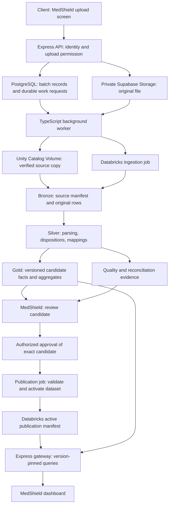

# MedShield Sales Data Pipeline Specification

Date: 26 September 2026  
Status: Proposed implementation specification; not a deployed or executable pipeline.  
Accountable documentation role: Technical Writer, with architecture responsibilities performed in the same review.  
Audience: MedShield developers, client administrators, data reviewers, and turnover support personnel.

## Confirmed source constraint — 27 September 2026

The client export has a document/DR number but no stable line-item ID. Therefore
transaction-key append/correction processing below is not enabled for this source.
A complete source-period replacement contract must be agreed before ingestion is
activated. Preserve DR numbers and source row numbers as lineage; neither proves
unique item identity. Repeated identical-looking lines must not be collapsed.
The historical restart now lives in `databricks/medshield_project`.

## 1. Outcome and scope

Client staff must be able to submit new sales data, understand processing results, and publish an approved dataset entirely through MedShield. Routine operation must not require opening Databricks, editing notebooks, running SQL, or using developer credentials.

The first release handles transaction-level sales CSV uploads. It preserves historical evidence, supports additional months and years, prevents repeated submissions from increasing totals, and records corrections and publication decisions. Excel users export the agreed template as UTF-8 CSV. Direct XLSX import is a later enhancement requiring its own parser and validation.

Example: a September 2026 submission adds valid September transactions while preserving earlier months. Resubmitting the same file returns the existing submission. A corrected September export requires an explicit correction or period-replacement review.

DOH, PAGASA, and NASA POWER retain separate ingestion paths and source-specific validation. Sales ingestion does not automatically approve medical classifications, disease/weather joins, forecasting models, or procurement recommendations.

## 2. Verified repository baseline

| Existing component | Observed behavior | Implementation implication |
|---|---|---|
| [Backend upload route](../backend/src/server.ts) | `/api/sales/upload` returns HTTP 409 with `DATABRICKS_INGESTION_REQUIRED` | A client upload integration must be implemented |
| [Frontend upload helper](../frontend/services/api/upload-pipeline.ts) | Describes earlier local and warehouse persistence results | Replace its contract and messages when implementing the new workflow |
| [Sales restart pipeline](../databricks/sales_restart/README.md) | Controlled historical rebuild with reviewed 2025 replacement evidence | Preserve the baseline and its provenance; introduce a separate batch path |
| [Bronze notebook](../databricks/sales_restart/01_sales_bronze.py) | Requires historical source years and checks the 2025 source checksum | Do not reuse historical snapshot requirements for every new upload |
| [Gold notebook](../databricks/sales_restart/03_sales_gold.py) | Writes candidate tables with overwrite operations | Introduce isolated dataset versions before client-triggered publication |
| [Existing job](../databricks/resources/medshield_cleaning.job.yml) | Executes the older `databricks/notebooks` workflow | Create a production job for the intended batch workflow |
| [Architecture](ARCHITECTURE.md) | Gateway queries Databricks; analytical outputs retain candidate labels | Maintain the warehouse boundary and approval gates |
| [Data-store responsibilities](DATABASE.md) | Supabase owns identity and audit, not dashboard measures | Document the proposed extension for upload metadata and queue state |

These observations are from a read-only source review. No live cloud configuration or end-to-end ingestion run was verified for this document. Existing user changes in the working tree were preserved.

## 3. Architecture



The worker belongs to the backend application boundary. Browser requests go through the gateway. Files and analytical records must not become publicly accessible. Dashboard measures continue to come exclusively from Databricks.

## 4. Tool inventory

| Component | Selected tool | Responsibility | Adoption |
|---|---|---|---|
| Client interface | Next.js, React, TypeScript | Upload, preview, progress, review, history | Existing stack; new screens and behavior |
| Gateway | Express and TypeScript | Permission checks, upload API, approval API, analytical queries | Existing stack; new endpoints |
| Request contracts | Zod | Validate submission metadata and API inputs | Proposed dependency |
| Authentication | Supabase Auth | Authenticate client users | Existing integration |
| File storage | Supabase Storage private bucket | Preserve original submissions and protected error exports | Proposed ingestion integration |
| Control records | Supabase PostgreSQL | Batches, attempts, events, approvals, durable work requests | Proposed tables |
| Orchestration worker | Node.js/TypeScript process | Transfer, submit, monitor, reconcile, retry | Proposed backend process |
| File hashing | Node.js `crypto` and Python `hashlib` | SHA-256 integrity checks | Standard libraries |
| File landing | Unity Catalog Volume and Databricks Files API | Store verified processing inputs | Proposed volume and integration |
| Workflow execution | Databricks Lakeflow Jobs and Jobs API | Dependent tasks, run history, execution limits | New job configuration |
| Transformations | Python, PySpark, Spark SQL | Validation, reconciliation, eligibility, aggregation | Existing processing stack; new batch modules |
| Data storage | Delta tables and Unity Catalog | Versioned Bronze, Silver, Gold, audit evidence | Existing platform; additional objects |
| Dashboard access | Databricks SQL Statement Execution API | Query published dataset through backend | Existing integration; version-aware queries |
| Deployment | GitHub Actions and Databricks bundle configuration | Validate and deploy application and job revisions | Repository integration to implement |
| Verification | Python unittest, Node test runner, Playwright | Transformation, API, recovery, and browser tests | Extend repository test coverage |
| Monitoring | Structured backend logs and Databricks job history | Correlate failures using batch ID and run ID | New ingestion instrumentation |

The backend and worker require supervised server/container deployment. The worker must not depend on an open browser or on a web request remaining active. Choose the hosting provider after confirming the client's budget and operating account; this specification does not assert that a production host is configured.

## 5. Source contract

Proposed template version: `sales_csv_v1`. Final required fields and definitions need agreement against representative client exports.

| Field | Proposed rule |
|---|---|
| `source_system` | Required stable source identifier |
| `transaction_id` | Required for transaction-key ingestion; preserve leading zeros |
| `line_id` | Required for transaction-key ingestion; identifies each invoice line |
| `transaction_date` | Required for dated sales; ISO `YYYY-MM-DD` |
| `product_code` | Stable source code where available; stored as text |
| `product_name` | Original product label, preserved alongside mapped identity |
| `quantity` | Decimal with documented meaning and return convention |
| `unit_of_measure` | Source unit; no inferred pack conversion |
| `net_sales_amount` | Decimal PHP value using the agreed accounting definition |
| `customer_code` | Source identifier where available; no invented identity |
| `area_code` or `area_name` | Source geography, assessed against approved mappings |
| `transaction_type` | Agreed enumeration for sales, returns, and corrections |

Use decimal arithmetic for financial values. Do not infer net sales from quantity and price when tax, discounts, or returns make that interpretation invalid. Configure the accepted date range without a fixed final year; explicitly review future-dated or implausible transactions.

If stable transaction/line identifiers do not exist, use a separately agreed complete-period replacement contract. Do not fabricate transaction keys or silently collapse identical-looking sales. Missing data must retain its missing status; no dates, units, or geography are invented.

## 6. Submission and processing sequence

1. **Authorize:** validate the session and upload capability. Validate file type, content structure, configured size limit, and submission metadata.
2. **Receive:** create a batch ID and stream the original file into a unique private path. Record byte count and server-calculated SHA-256. Do not trust a browser-provided checksum alone.
3. **Register:** after storage verification, commit the batch's received state and durable processing request together in PostgreSQL. Reconcile abandoned receiving records and orphan objects after interrupted uploads.
4. **Acknowledge:** return HTTP 202 with the batch ID and status URL. This means processing was accepted, not that sales were published.
5. **Claim:** the worker claims the work item using a lease. It records attempt state before making external calls.
6. **Transfer:** copy the source to a batch-specific Unity Catalog volume path and verify integrity. Do not overwrite a different source at the same path.
7. **Submit:** call the Jobs API using a stable idempotency token for that execution attempt. Save the returned run ID. Reconcile an uncertain submission before launching another run.
8. **Process:** run Bronze, Silver, quality checks, candidate Gold, and final reconciliation in dependency order.
9. **Report:** persist job references and summarized status; obtain detailed quality evidence from Databricks. Expose progress through the gateway.
10. **Review:** show counts, rejected rows, pending mappings, financial deltas, affected periods, and publication eligibility.
11. **Approve:** bind the reviewer's decision to the exact candidate, its base publication, mapping versions, and report identity.
12. **Publish:** run a separate publication task, verify all required outputs, activate the dataset, and record the publication event.

Proposed parameters include `batch_id`, `source_uri`, `source_sha256`, `schema_version`, `submission_mode`, `base_dataset_id`, and `policy_version`. Resolve source paths and allowed scopes server-side; clients cannot select arbitrary notebooks, SQL, catalog objects, or file locations.

## 7. Layer contracts

| Layer | Required contents | Integrity rule |
|---|---|---|
| Landing | Original file and ingestion manifest | Source remains immutable; a correction creates a new batch |
| Bronze | Batch ID, file hash, source row number, original values | Every source record has traceable provenance |
| Silver | Typed values, business key, disposition, reason codes, mapping versions | Every parsed source record receives an explicit disposition |
| Quality | Counts, totals, duplicates, unresolved mappings, changed records | Explain differences between submitted and publishable values |
| Candidate Gold | Versioned sales facts and aggregates with eligibility flags | Candidate creation does not change the active dataset |
| Publication manifest | Dataset ID, prior version, approval reference, policy and source identities | Activate only a complete and approved version |

An ingestion job is proposed as:

```text
verify_source -> bronze_ingest -> silver_assess -> quality_gate
             -> build_candidate_gold -> reconcile_candidate
```

The publication job is proposed as:

```text
verify_approval -> verify_base_version -> verify_candidate_outputs
                -> activate_publication -> record_completion
```

These are task contracts, not installed jobs. Reuse approved transformation rules from the restart code after isolating historical-only assumptions. Preserve the historical 2025 estimated-allocation flag and checksum evidence. Do not label adjusted data as original observations.

## 8. Validation and row dispositions

| Condition | Required result |
|---|---|
| Unreadable CSV or missing required headers | Reject file with actionable message |
| Invalid date or amount | Record row number and reason; block unreviewed inclusion |
| Exact repeated file | Return prior batch; do not increase sales |
| Repeated business key with identical payload | Mark already ingested |
| Repeated business key with changed payload | Treat as correction requiring review |
| Conflicting duplicates within the same file | Quarantine affected records for resolution |
| Unrecognized product or area | Preserve source values; keep mapping pending |
| Missing geography on otherwise valid sales | Retain permitted financial evidence; disable unsupported geographic eligibility |
| Unapproved medical classification | Do not enable medicine-demand eligibility |
| Return or negative quantity/amount | Apply the documented return policy; do not universally reject or normalize signs |
| Unexplained reconciliation difference | Block publication |
| Missing observation period | Keep unknown unless source evidence establishes zero activity |

Example mutually exclusive dispositions: accepted-new, accepted-correction, already-ingested, needs-review, rejected. Warnings are additional flags and must not inflate row counts. For parsed data records, the disposition counts must sum to the input record count. Account separately for headers, blank lines, and malformed records.

Publication of a partially accepted file requires an explicit policy and reviewer acknowledgement of exclusions; it must never silently imply that all submitted sales were included. Mapping gaps can restrict analytical eligibility without necessarily invalidating an otherwise reconciled financial record.

## 9. Duplicate, correction, and replacement policy

Use `(source_system, transaction_id, line_id)` as the proposed business key, subject to confirmation that identifiers are unique in the client's system. Extend the key with a company/branch namespace when required. A file hash is an integrity and exact-upload check, not a transaction identity.

| Mode | Behavior | Required review |
|---|---|---|
| Add transactions | Add new keys and identify overlaps | Counts, covered dates, totals, exclusions |
| Correct transactions | Apply proposed changes to identified existing keys in a new version | Old/new values and net effect |
| Replace declared period | Replace the complete agreed source/date scope in a new version | Scope completeness, removals, additions, totals |

Never delete unmatched historical records because they are absent from a monthly incremental file. Resolve duplicate source keys before using Delta MERGE. File renaming, row reordering, repeated requests, and processing retries must not duplicate business transactions.

The historical restart remains available as a controlled rebuild path. Its candidate baseline must satisfy existing approval requirements before being adopted as the initial approved operational dataset.

## 10. Publication consistency and recovery

Write new facts and aggregate outputs under an isolated `dataset_id`. Finish and validate all objects before updating a single active-publication record in Databricks. Do not assume writes to multiple Delta tables are one atomic transaction.

Serialize publication and compare the candidate's expected base dataset with the active version immediately before activation. If the base changed, rebuild/reconcile the candidate and obtain a new approval where its contents changed. Shared enforcement is required across every publishing path.

The gateway resolves a dataset ID for a dashboard refresh, pins related queries to that version, and includes it in cache keys and response metadata. Candidate previews must remain visibly separate from approved operational results.

If activation succeeds but acknowledgement fails, reconcile against the publication manifest before retrying. Record post-activation cache or audit synchronization failures as recoverable completion work; do not blindly publish again.

Rollback selects a retained prior approved dataset and records the reason and actor. It does not delete original files or erase correction history. Configure retention and test restoration of both uploaded objects and database/warehouse records; database backup alone is not evidence that source files can be recovered.

## 11. Application control records

All names below are proposed. No migration has been created by this specification.

| Record | Main fields |
|---|---|
| `ingestion_batches` | ID, uploader, source, file path/hash/size, schema, mode, declared scope, status, candidate ID, timestamps |
| `ingestion_attempts` | Batch ID, attempt number, idempotency token, job run ID, stage, retry time, error code |
| `ingestion_events` | Batch ID, actor, event, previous/new state, timestamp, correlation ID |
| `ingestion_approvals` | Candidate ID, base ID, quality-report identity, policy/mapping versions, reviewer, decision, reason |
| `ingestion_outbox` | Work type, batch ID, availability time, lease owner/expiry, attempts, completion state |

Keep detailed analytical rows and reconciliations in Databricks. PostgreSQL holds operational tracking and approval evidence. Document this extension in the canonical architecture when implementation begins.

Recommended normal states:

```text
RECEIVING -> RECEIVED -> QUEUED -> PROCESSING -> READY_FOR_REVIEW
          -> APPROVED -> PUBLISHING -> PUBLISHED
```

Alternate outcomes include `NEEDS_CORRECTION`, `REJECTED`, and `FAILED`. Store stage, error code, and retryability separately. A corrected file creates a linked new batch; it does not mutate the rejected original. Publication approval cannot bypass a failed technical gate.

## 12. Proposed API and user interface

| Method and route | Contract |
|---|---|
| `POST /api/sales/uploads` | Receive file and metadata; return 202 only after durable registration |
| `GET /api/sales/uploads` | Paginated permitted submission history |
| `GET /api/sales/uploads/:id` | Status, stage, attempt, counts, errors, candidate/publication references |
| `GET /api/sales/uploads/:id/errors` | Authorized error report with source row references |
| `POST /api/sales/uploads/:id/retry` | Request a permitted retry without duplicating committed work |
| `POST /api/sales/uploads/:id/approve` | Approve exact candidate and enqueue publication |
| `POST /api/sales/uploads/:id/reject` | Record rejection and reason |

Routes are proposals, not currently callable contracts. Resolve the compatibility strategy for the existing singular upload route when implementing the frontend and backend together.

The interface needs template download, upload mode/scope selection, preview, durable progress, error download, candidate comparison, review decision, and history. Display plain-language errors such as “Row 25 has an invalid transaction date.” Display the last published time and dataset identity with dashboard freshness information.

Define upload, review, publish, and rollback capabilities and map them onto the existing application roles. An authenticated user is not automatically entitled to every file or batch. Recheck authorization on every route and object download.

## 13. Security and operational behavior

- Use private storage with unique object names, controlled download access, and configured retention. Do not expose original sales files through public URLs.
- Keep Databricks and privileged Supabase credentials server-side. Use a client-owned Databricks service principal with scoped permissions and OAuth machine-to-machine authentication where supported by the target workspace.
- Enable appropriate grants and row-level security for exposed Supabase control tables. Backend privileged access must still enforce the application's user and batch authorization rules.
- Apply file limits, strict parsing, safe export handling, rate limits, and server-resolved paths. Prevent spreadsheet formula execution when generating error-report CSVs containing untrusted source strings.
- Retry transient connectivity and rate-limit failures with bounded backoff. Do not retry deterministic schema or data-validation errors without a changed input or policy.
- Persist worker leases and execution identities. Resume monitoring known runs after restart rather than submitting duplicate jobs.
- Limit concurrent ingestion/publication according to the client's workload and verified workspace capacity. Serialize conflicting publications.
- Correlate structured logs using batch ID, attempt ID, run ID, and dataset ID. Avoid logging complete customer or sales records and secrets.
- Alert the named support owner for terminal failures, excessive queue age, or publication failures. Notification destinations must be configured during deployment.
- Show last published data while a new upload fails if Databricks remains available. When Databricks itself is unavailable, show the existing explicit unavailable state; do not introduce a local analytical fallback.

## 14. Implementation ownership and order

The roles below identify responsibilities; they do not indicate that agents or people have been assigned or launched.

| Phase | Accountable implementation role | Deliverable |
|---|---|---|
| Source agreement | Business Analyst | Export samples, grain, financial definitions, keys, correction and exclusion policy |
| Integration design | Architect | Approved batch contracts, historical boundary, publication consistency |
| Operational persistence | Database Engineer | Versioned migrations, access policies, queue and audit records |
| Backend integration | Backend Engineer | Upload handling, worker, Files/Jobs API integration, review endpoints |
| Warehouse processing | Database Engineer | Batch transformations, quality evidence, versioned outputs and publication job |
| Client experience | Frontend Engineer | Upload, progress, review, history, version-aware refresh |
| Verification | QA Engineer | Behavioral and failure-recovery evidence |
| Deployment and turnover | DevOps Engineer / Service Manager | Client accounts, monitoring, recovery, support ownership |

Suggested new components include an ingestion module and worker under `backend/src`, batch transformation code under `databricks`, a new job definition under `databricks/resources`, and frontend upload/review views using the existing dashboard conventions. Final file names should follow implementation-time repository inspection.

Update architecture, API, setup, database, testing, and operating documentation with shipped behavior. Do not mark a proposed endpoint or job operational until its acceptance evidence exists.

## 15. Acceptance and verification matrix

Every row is currently **not executed** for the proposed pipeline.

| Scenario | Required evidence |
|---|---|
| Valid new month | Correct transactions and totals; earlier months unchanged |
| New year beyond 2025 | Ingestion, publication, and year filters work without a code change |
| Same file twice | Existing batch is returned; no duplicate sales |
| Overlapping exports | Business-key overlaps explained; totals remain correct |
| Legitimate identical-looking sales | Distinct transaction identities preserved |
| Correction | Reviewed old/new difference; new publication retains history |
| Period replacement | Only declared source/date scope changes |
| Invalid and missing data | Actionable report; exclusions and eligibility remain explicit |
| Browser closes | Server-side processing continues and history remains available |
| Worker restarts | Known work resumes without duplicate job or publication |
| Job submission response lost | Run is reconciled using its execution identity |
| Concurrent approvals | Stale base is detected; updates are not lost |
| Gold task fails | Active published dataset remains unchanged |
| Publication acknowledgement lost | Manifest reconciliation prevents duplicate activation |
| Access denied | Unauthorized batch and file operations fail |
| Warehouse unavailable | Dashboard displays unavailable state |
| Rollback and restore | Previous approved version and source evidence recover successfully |
| Turnover rehearsal | Client uploads, corrects, reviews, and publishes without Databricks UI |

Run focused transformation and backend tests first, then a staging end-to-end rehearsal with actual client-format files. Do not execute `npm run build` concurrently with `next dev` in the same checkout.

## 16. Turnover requirements and remaining decisions

Required handover materials: client-owned account inventory, role/capability mapping, approved CSV template, user guide, support runbook, recovery procedure, deployment instructions, credential rotation procedure, configured retention, and signed acceptance evidence.

Client sales staff own submissions. An authorized business reviewer owns data approval. A named technical maintainer owns job failures, credentials, deployment, backups, and recovery. The client or contracted provider owns billing and ongoing support.

Resolve these inputs before implementation is considered ready:

1. Representative original client exports, including returns and corrections.
2. Transaction grain and stable identifiers; whether identifiers repeat across branches or years.
3. Approved net-sales definition, reconciliation tolerance, and exclusion policy.
4. Intended upload frequency, typical/max file size, and expected freshness.
5. Available Databricks workspace capabilities, permissions, compute, and cost constraints.
6. Backend/worker hosting, deployment owner, and client-owned service accounts.
7. Review authority, retention period, recovery targets, and support contact.
8. Acceptance of the historical baseline and existing product/geography approval gates.

## 17. References and document verification

Repository sources: [architecture](ARCHITECTURE.md), [implementation baseline](IMPLEMENTATION.md), [database responsibilities](DATABASE.md), [current Databricks connection](../databricks/docs/CURRENT_DATABRICKS_SYSTEM_CONNECTION.md), and the linked source files in section 2.

Official capability references consulted for the design:

- [Supabase private storage buckets](https://supabase.com/docs/guides/storage/buckets/fundamentals)
- [Supabase row-level security](https://supabase.com/docs/guides/database/postgres/row-level-security)
- [Databricks Files API](https://docs.databricks.com/api/files/v2/file)
- [Databricks Jobs run-now API](https://docs.databricks.com/api/jobs/v2/run-now)
- [Databricks OAuth machine-to-machine authentication](https://docs.databricks.com/aws/en/dev-tools/auth/oauth-m2m)
- [Delta MERGE semantics and duplicate handling](https://docs.databricks.com/gcp/en/delta/merge)

The API capabilities above support the proposed design; availability, authentication, and permissions must be verified in the client's actual cloud/workspace before deployment. No pricing or deployment readiness is asserted here.

Document verification scope: local reference existence, UTF-8 readability, consistent proposed/current labels, and review against the inspected repository architecture. Runtime acceptance remains unverified until implementation and the tests in section 15 are completed.
