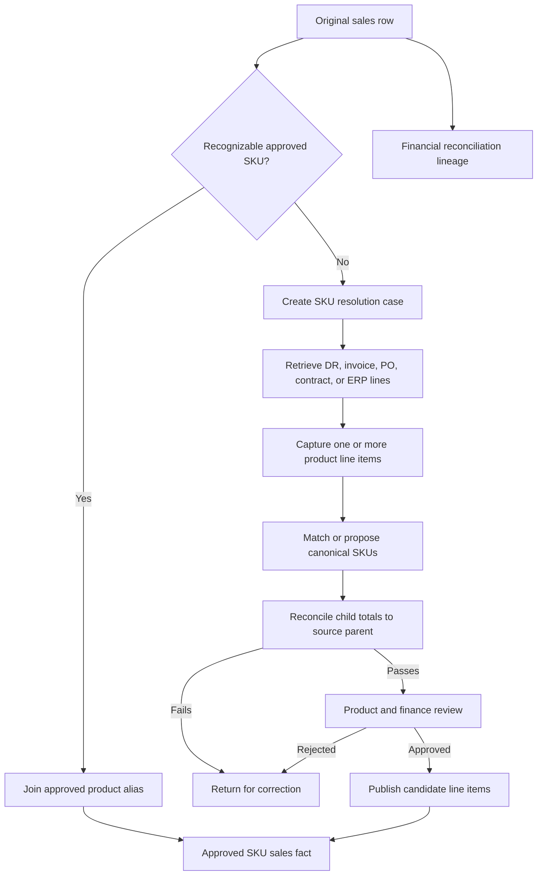

# SKU Line-Item Recovery Implementation Plan

## Document status

| Field | Value |
|---|---|
| Status | Proposed; implementation not started |
| Prepared | 2026-09-18 |
| Decision owner | MedShield project owner |
| Primary implementation owner | Data Analyst / Data Engineer |
| Reviewers | Product owner, Finance, Backend, BI, QA |
| Target system of record | Databricks Unity Catalog |

This document is an implementation proposal. It does not approve product mappings, change Databricks tables, or authorize estimated records to be published as actual SKU line items.

## 1. Objective

Ensure every sales record used in product-level analytics resolves to one or more identifiable, approved canonical SKUs.

Labels such as `PAGBILAO # ...`, `PESO # ...`, `QMC # ...`, delivery-receipt references, purchase-request references, blank product values, and invalid values such as `#REF!` cannot appear as products in final analytics. They must be linked to their actual invoice, delivery receipt, purchase order, contract schedule, or ERP line items.

## 2. Business rule

1. Every row included in product analytics must resolve to an approved canonical SKU.
2. A summarized source row may resolve to multiple SKU line items.
3. The original source row remains unchanged for lineage and financial reconciliation.
4. Recovered child lines must reconcile to the source parent before publication.
5. Historical product-mix estimates cannot be presented as recovered actual products.
6. Rows awaiting evidence use the workflow status `sku_resolution_pending`. This is a data-quality status, not a product classification.
7. Final product classes are limited to:
   - `medicine`
   - `medical_device`
   - `medical_supply`
   - `non_medical`
8. Pending rows remain visible in company-level financial reconciliation but are excluded from SKU ranking, product forecasting, and inventory recommendations.

## 3. Current evidence and limitations

The governed sales fact contains historical records from 2017 through 2025. Existing product-review evidence identifies contract/account summaries and document-reference strings among the product values. The source CSV examples contain a DR number, delivery date, customer or area, quantity, and financial totals, but the summarized rows do not contain the underlying product line items.

The repository also contains a historical backward-allocation process. That process deterministically estimates child products from prior product mixes and preserves additive totals. Its own documentation states that those children are estimates rather than recovered invoice details. Consequently, it cannot satisfy the actual-SKU requirement.

Before implementation, Phase 1 must reproduce and approve counts for:

- summary/account-label rows;
- DR/PR-only product descriptions;
- blank product descriptions;
- invalid product identities such as `#REF!`;
- affected net sales, acquisition cost, gross profit, and quantities by year; and
- source documents available for each affected record.

## 4. Scope

### Included

- Profile all 2017–2025 sales rows requiring SKU recovery.
- Preserve source-record lineage.
- Create a source-document recovery queue.
- Capture one-to-many verified product line items.
- Create or match canonical SKUs and product aliases.
- Require reviewer approval.
- Reconcile parent and child financial values.
- Publish approved lines to Databricks Silver and Gold candidate tables.
- Prevent parent-and-child double counting.
- Update backend queries and dashboards after publication.
- Add data-quality indicators for resolved and pending coverage.

### Excluded from initial implementation

- Treating estimated product mixes as actual invoice details.
- Automatically approving a product classification.
- Fabricating quantities or financial allocations when documents are missing.
- Training forecasts on unresolved summary/reference rows.
- Changing historical source files.
- Publishing directly to production tables without candidate validation.

## 5. Required source evidence

Use the strongest available evidence in this order:

1. Delivery receipt line items
2. Sales invoice line items
3. Purchase order line items
4. Contract or bid line-item schedule
5. ERP or accounting transaction export
6. Verified customer transaction register

Each evidence document must supply enough information to identify the product and reconcile the source parent. A filename alone is insufficient; the recovery record must retain the document reference and reviewer.

## 6. Proposed data model

All table names below are proposed candidate names and require schema-owner approval.

### 6.1 Source parent

Proposed table: `workspace.medshield_silver.sales_sku_resolution_parent_candidate`

| Column | Purpose |
|---|---|
| `source_record_id` | Stable identifier for the original sales record |
| `source_year` | Source reporting year |
| `source_file` | Original file or Databricks source reference |
| `source_row_number` | Original source row |
| `dr_number` | Delivery-receipt identifier |
| `invoice_number` | Invoice identifier when available |
| `date_delivered` | Source delivery date |
| `customer_label` | Original customer/account label |
| `source_product_label` | Original Product value |
| `source_quantity` | Original quantity |
| `source_net_sales` | Original Net CP value |
| `source_acquisition_cost` | Original Total TP value |
| `source_gross_profit` | Original gross-margin value |
| `resolution_reason` | Summary label, reference, blank, invalid identity, or other |
| `resolution_status` | Current recovery state |
| `source_checksum` | Lineage and change detection |

### 6.2 Verified recovered line item

Proposed table: `workspace.medshield_silver.sales_verified_line_item_candidate`

| Column | Purpose |
|---|---|
| `source_record_id` | Parent record reference |
| `line_number` | Line number within the recovered source document |
| `canonical_sku` | Approved product identifier |
| `raw_product_name` | Product wording from the evidence document |
| `canonical_product_name` | Approved display name |
| `product_class` | Medicine, device, supply, or non-medical |
| `product_subcategory` | Controlled detailed category |
| `quantity` | Verified line quantity |
| `unit_price` | Verified selling price per unit |
| `net_sales` | Verified line net sales |
| `acquisition_cost` | Verified line acquisition cost |
| `gross_profit` | Verified line gross profit |
| `evidence_document` | Source-document reference |
| `evidence_checksum` | Evidence version control |
| `reviewed_by` | Accountable reviewer |
| `reviewed_at` | Review timestamp |
| `approval_status` | Proposed, approved, rejected, or superseded |

### 6.3 Canonical product master

The existing product mapping process should be extended rather than replaced.

| Column | Purpose |
|---|---|
| `canonical_sku` | Unique approved SKU |
| `canonical_product_name` | Stable product name |
| `brand_name` | Brand name when available |
| `generic_name` | Generic medicine name when applicable |
| `strength` | Product strength |
| `dosage_form` | Tablet, capsule, vial, device, consumable, etc. |
| `pack_size` | Package or unit definition |
| `product_class` | Controlled top-level class |
| `product_subcategory` | Controlled subcategory |
| `is_medicine` | Controlled Boolean |
| `forecast_eligible` | Approved forecasting eligibility |
| `mapping_status` | Proposed, approved, rejected, or superseded |

## 7. Resolution workflow



### Resolution states

```text
needs_source_document
line_items_captured
sku_mapping_pending
reconciliation_failed
review_pending
approved
published
rejected
superseded
```

## 8. Implementation phases

### Phase 0 — Approval and baseline protection

Actions:

1. Approve this plan and the final terminology.
2. Record the Git commit and Databricks table versions used as the baseline.
3. Confirm that no pending local prototype is treated as implemented behavior.
4. Confirm owners for product, financial, and technical approval.

Exit criteria:

- Written plan approval
- Named reviewers
- Reproducible baseline

### Phase 1 — Read-only source audit

Actions:

1. Profile every raw sales row from 2017–2025.
2. Identify summary labels, document references, blanks, and invalid identities.
3. Measure affected financial value and quantity by year.
4. Produce a DR/document availability matrix.
5. Rank recovery cases by net-sales impact.

Deliverables:

- Source-resolution audit
- Financial exposure summary
- Prioritized recovery queue
- Document-availability report

Exit criteria:

- Source counts reconcile to the governed sales facts.
- Every recovery case has source lineage.
- No mappings or production tables have been changed.

### Phase 2 — Product master and recovery templates

Actions:

1. Approve the canonical SKU format.
2. Approve the four product classes and their subcategories.
3. Define alias uniqueness and strength/form/pack rules.
4. Create parent-case and verified-line-item templates.
5. Define required evidence and reviewer fields.

Exit criteria:

- Product master schema approved
- Templates approved by product and finance owners
- No automatic mapping can produce an approved status

### Phase 3 — Source-document recovery

Process cases in this order:

1. High-value 2024–2025 Pagbilao, PESO, QMC, and similar summaries
2. DR/PR-only descriptions
3. Blank 2023–2025 product records
4. High-value unresolved brands
5. Older blank and invalid records, including the 2017 population

Actions for each parent:

1. Retrieve the source document.
2. Enter every actual line item.
3. Match or propose a canonical SKU.
4. Record quantities and financial values.
5. Reconcile the child lines to the parent.
6. Obtain product and finance approval.

Exit criteria:

- Approved evidence for every published child line
- Parent-child reconciliation passes
- Unavailable documents remain explicitly pending

### Phase 4 — Databricks candidate pipeline

Actions:

1. Preserve original rows in Bronze.
2. Load resolution parents and verified children into Silver candidate tables.
3. Join approved product aliases and canonical products.
4. Mark resolved parents as replaced for product facts.
5. Build Gold candidate product facts from approved actual lines only.
6. Build an exception view for unresolved financial coverage.

Required safeguards:

- Never add children while leaving the parent additive in the same product fact.
- Reject unapproved SKUs.
- Reject children without evidence.
- Reject reconciliation differences above the approved tolerance.
- Preserve lineage from Gold line to source parent and evidence document.

### Phase 5 — Backend and dashboard integration

Actions:

1. Point product APIs to the approved Gold product fact.
2. Keep company financial totals reconciled to the complete source population.
3. Exclude pending records from product rankings and forecasts.
4. Add resolved and pending data-quality indicators.
5. Prevent source summary labels from appearing as products.
6. Document unavailable states when product coverage is incomplete.

### Phase 6 — Validation and publication

Actions:

1. Execute reconciliation, uniqueness, referential-integrity, and approval tests.
2. Compare dashboard product totals with the approved Gold fact.
3. Validate forecasting eligibility.
4. Run backend build and dashboard checks.
5. Publish candidate tables only after all required gates pass.
6. Record table versions, validation evidence, and rollback instructions.

## 9. Reconciliation rules

For each resolved parent:

```text
sum(child quantity)          = approved parent quantity rule
sum(child net sales)         = parent net sales
sum(child acquisition cost)  = parent acquisition cost
sum(child gross profit)      = parent gross profit
```

Financial reconciliation tolerance should default to PHP 0.01 unless Finance approves a different rounding rule. Quantity reconciliation may require unit conversion when the parent quantity is a contract count of `1`; in that case, parent quantity is not distributed as product units and the evidence document must supply actual child quantities.

## 10. Validation tests

### Data-quality tests

- Source-record identifiers are unique.
- Recovered child keys are unique within each parent.
- Every approved child has a canonical SKU.
- Every approved child has an evidence document and reviewer.
- Every canonical SKU has exactly one approved top-level product class.
- No final SKU uses Pagbilao, PESO, QMC, DR, PR, contract amount, blank, or `#REF!` as its identity.
- No unresolved parent contributes to SKU-level facts.
- Parent-child reconciliation passes.
- No parent-child double counting exists.
- Gold financial totals reconcile to the approved population and disclose pending coverage.

### Dashboard tests

- Summary/reference labels do not appear in Top Products or ABC charts.
- Product filters use canonical product names and SKUs.
- Company-level totals remain traceable to source sales.
- Coverage indicators show resolved and pending value.
- Forecast endpoints reject or omit non-approved SKUs.
- Empty or incomplete coverage produces an explicit unavailable state.

## 11. Acceptance criteria

The implementation is complete only when:

1. Final product facts contain no `non_product` class.
2. Every product-analytics row has an approved canonical SKU.
3. Every recovered line traces to a source parent and evidence document.
4. Parent-child financial reconciliation passes at the approved tolerance.
5. Parents and children are never counted together in additive product facts.
6. Pending cases remain visible in reconciliation and excluded from product modeling.
7. Product dashboards contain no contract/account/document labels as products.
8. Product forecasts use approved, forecast-eligible actual SKU lines only.
9. Databricks validation, backend build, and dashboard checks pass.
10. Product and finance owners approve the publication evidence.

## 12. Risks and controls

| Risk | Impact | Control |
|---|---|---|
| Original documents are unavailable | Actual SKUs cannot be recovered | Keep case pending and disclose excluded financial coverage |
| Estimated children are mistaken for actual lines | False product demand and forecasts | Store estimates separately and prohibit approval as actual |
| One parent contains multiple products | Incorrect one-to-one mapping | Require one-to-many recovered child records |
| Parent and children are both counted | Inflated financial totals | Publication test enforcing replacement semantics |
| Alias merges different strengths or packs | Invalid SKU demand history | Require strength, form, and pack review |
| Reviewer approves without evidence | Weak governance | Require evidence reference and reviewer identity |
| Large 2017 invalid-product population | Historical product analysis remains incomplete | Report coverage by year and prioritize recoverable periods |

## 13. Rollout and rollback

Rollout order:

1. Read-only audit
2. Candidate templates
3. Small high-value pilot batch
4. Reconciliation review
5. Silver candidate publication
6. Gold candidate publication
7. Backend integration
8. Dashboard validation
9. Controlled publication

Rollback must restore the prior Gold view or table version and API source without deleting Bronze records, resolution cases, review evidence, or audit results.

## 14. Dependencies

Required before actual conversion:

- Access to DRs, invoices, purchase orders, contracts, or an ERP line-item export
- Approved canonical SKU format
- Product-owner classification review
- Finance-approved reconciliation rules
- Databricks write permission for candidate tables
- Named publication reviewer

The technical pipeline can be built without all documents, but no missing product line may be labeled actual until its evidence is available and approved.

## 15. Estimated schedule

| Work | Estimate | Dependency |
|---|---:|---|
| Read-only audit and recovery queue | 1–2 working days | Current sales sources |
| Data model, templates, and tests | 1–2 working days | Plan approval |
| Databricks candidate pipeline | 2–3 working days | Approved schemas |
| Backend/dashboard integration | 1–2 working days | Validated Gold candidate |
| Source-document recovery | Variable | Availability and volume of documents |

The document-recovery workload controls the true completion date. Technical implementation cannot replace unavailable product evidence.

## 16. Approval gates

| Gate | Decision | Owner | Status |
|---|---|---|---|
| Plan | Approve this implementation approach | Project owner | Pending |
| Terminology | Approve `sku_resolution_pending` as a workflow status | Product owner | Pending |
| Product master | Approve SKU format and classifications | Product owner | Pending |
| Reconciliation | Approve tolerances and quantity rules | Finance | Pending |
| Databricks publication | Approve candidate-to-published promotion | Data owner | Pending |
| Dashboard release | Approve coverage disclosure and product outputs | Project owner / QA | Pending |

## 17. Related repository references

- [Business definitions](BUSINESS_DEFINITIONS.md)
- [Business-rules approval checklist](BUSINESS_RULES_APPROVAL_CHECKLIST.md)
- [Databricks architecture](ARCHITECTURE.md)
- [Product mapping template](../datasources/templates/product_master_mapping.csv)
- [Historical backward-allocation documentation](../databricks/docs/AREA_SUMMARY_BACKWARD_ALLOCATION.md)
- [Descriptive analytics logic](DESCRIPTIVE_ANALYTICS_LOGIC.md)
- [Testing guidance](TESTING.md)

