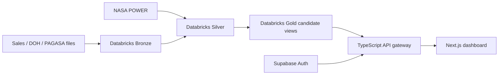

# MedShield Technical and Operational Overview

Last reviewed: 2026-09-25

MedShield is a historical pharmaceutical sales decision-support system for CALABARZON, MIMAROPA, Bicol, and other mapped commercial/national evidence in the supplied records. It explains historical performance, evaluates forecasting baselines, ranks products and territories, and supports reviewed planning scenarios.

It does not provide live disease surveillance, official PAGASA alerts, real inventory control, or automated procurement.

## System architecture

- Databricks is the analytical system of record.
- Supabase supplies authentication, linked roles, and audit persistence.
- Python code supports offline preparation and evaluation; it is not a dashboard runtime dependency.
- The frontend accesses data only through the gateway.
- A Databricks failure produces an explicit unavailable state.

## Data scope

| Source | Coverage | Status |
|---|---|---|
| Sales | 2017-2025 | Gold candidate; 37,728 accepted facts in the current checksum-bound snapshot |
| PAGASA | 2017-2024 | Official historical station observations; territory mapping candidate |
| NASA POWER | Requested provider-supported range | Historical weather proxy stored in Databricks |
| DOH | 2018-2026 declared | Historical context; 2026 partial; forecasting join not approved |

## Implemented analytics

- historical revenue, acquisition cost, gross-margin candidate, quantity, yearly/monthly trends, seasonality, area, product, and transaction views;
- filtered sales evidence, quality flags, and lineage;
- derived buyer-sector/channel and geographic classifications;
- deterministic Pareto/ABC and commercial prioritization;
- seasonal-naive and last-observation forecast baselines;
- PAGASA/NASA validation views;
- user-reviewed planning scenarios with explicit operational assumptions.

Prophet, XGBoost, external regressors, EOQ, ROP, safety stock, MILP, expiry reduction, and purchase execution are methodology or future-publication subjects unless a versioned Databricks model output and validation record proves otherwise.

## Operating sequence

1. Run and reconcile the appropriate Databricks Bronze-Silver-Gold pipeline.
2. Run its SQL bridge.
3. Validate the live gateway contract.
4. Complete named data/mapping approval.
5. Promote stable views.
6. Generate final analytics and capstone evidence from the frozen publication.

Use [CURRENT_STATE.md](CURRENT_STATE.md), [ARCHITECTURE.md](ARCHITECTURE.md), [API.md](API.md), and [SETUP.md](SETUP.md) for authoritative details.
