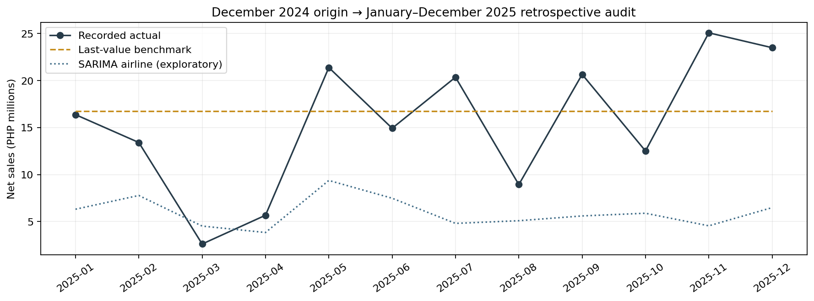

# MedShield Predictive Results and Conclusions

Predictive sections for Chapters 4 and 5

Evidence date 10 October 2026 Asia Manila

MedShield's predictive research compared monthly company sales forecasts using five model families. The evaluated challengers did not qualify to replace the last-value benchmark under the registered experimental rules. The retained benchmark has material historical errors, and business acceptance remains unassessed because the client has not supplied numerical error limits. These results provide supporting revenue research for the study; the original medicine quantity and territory demand objective remains open. [1, 2, 3, 5]

## Chapter 4 Predictive results

### Predictive target and analytical scope

The forecasting target is company monthly eligible recorded net sales in Philippine pesos. Financially eligible item kinds and signed adjustments are retained. Revenue does not measure normalized medicine quantities, unconstrained demand or customer stock requirements. Historical descriptive reporting supplies context about observed sales, while this comparison assesses predictions of the same company revenue target. [1, 2]

The frozen sales snapshot contains 37,728 records covering 2017–2025. Modeling uses the contiguous 72-month January 2020–December 2025 subset. Gold fact Delta version 20 and transformation policy sales_restart_gold_v7_independent_catalog identify the source. Training permission and completeness rely on the inherited user attestation; independent source completeness and historical availability vintages remain unverified. This modeling window extends beyond the paper's earlier 2021–2025 scope and needs consistent explanation in the methodology and academic scope record. [1, 2, 5]

### Model families and temporal comparison

Table 4 P1 Evaluated model families

| Family | Recipes | Approach |
| --- | --- | --- |
| Benchmarks | 4 | Last value seasonal naive and trailing 3 or 6 month means |
| ETS | 2 | Additive annual seasonality with no trend or damped trend |
| Prophet | 9 | Sales only annual seasonality and fixed prior grid |
| SARIMA | 2 | Seasonal AR and airline recipes with a 12 month season |
| Ridge regression | 4 | Direct and recursive lag forecasts at two penalties |

The original experiment evaluated fifteen configurations: four benchmarks, two ETS and nine Prophet recipes. Two SARIMA and four ridge configurations were added in a separate exploratory extension. That extension was registered before its fits but after inspection of the earlier 2025 audit. Twenty-one configurations are comparison recipes, not twenty-one fulfilled original paper requirements. External disease and weather regressors and an urgency or ABC classifier were not evaluated in this revenue comparison. [1, 2, 5]

Five development origins—December 2022 and March, June, September and December 2023—each predict calendar leads 1–12. All recipes use the same sixty origin–target pairs covering twenty-four distinct target months. The overlapping folds produce dependent errors. Each fit uses records dated through its origin in the frozen snapshot; learned preprocessing is restricted to training rows. Full-series centered STL is not supplied as a forecast feature. A revised snapshot is used, so these fits do not recreate the exact records available on each historical issue date. [2, 6]

A December 2024 origin predicts January–December 2025 for twelve retrospective audit targets. The audit had already been inspected and is not an untouched final test. Selection remains based on development evidence and the registered improvement, bias and horizon rules. The audit is retained for diagnosis and comparison; it does not support a new selection decision. [2, 6]

### Peso and percentage error measures

For an actual y, prediction ŷ and error e = ŷ − y, MAE is SUM(ABS(e)) / n; RMSE is SQRT(SUM(e²) / n); WAPE is 100 × SUM(ABS(e)) / SUM(ABS(y)); and normalized signed bias is 100 × SUM(e) / SUM(ABS(y)). Positive signed bias indicates net overforecasting. The formulas preserve signed records while the percentage denominator uses absolute actuals. Empty evaluation pairs leave metrics unavailable; a zero denominator leaves percentage metrics unavailable. [3, 6]

MAE and WAPE are the joint primary reporting measures. They share the absolute-error numerator and therefore rank models identically on the same eligible pairs with the same nonzero actual denominator. MAE expresses the average peso miss, while WAPE expresses its scale relative to recorded sales. WAPE is an error ratio and must not be subtracted from 100 to label an accuracy percentage. RMSE and signed bias are additional diagnostics. [3]

### Historical model comparison

Table 4 P2 All saved model configurations on common evaluation pairs

| Configuration | Dev MAE PHP | Dev WAPE % | Audit MAE PHP | Audit WAPE % |
| --- | --- | --- | --- | --- |
| Last value | 3,090,470.93 | 83.199360 | 5,834,383.00 | 37.763644 |
| Seasonal naive | 3,487,809.81 | 93.896222 | 11,261,458.43 | 72.890948 |
| Mean 3 months | 3,533,478.17 | 95.125671 | 9,212,416.36 | 59.628313 |
| Mean 6 months | 3,473,386.01 | 93.507915 | 10,526,958.88 | 68.136824 |
| ETS no trend | 3,445,030.30 | 92.744543 | 10,501,032.20 | 67.969011 |
| ETS damped trend | 3,725,795.38 | 100.303092 | 10,426,697.23 | 67.487871 |
| Prophet cp 0.01 sp 0.1 | 3,483,090.93 | 93.769183 | 11,196,043.74 | 72.467545 |
| Prophet cp 0.01 sp 1.0 | 3,504,558.43 | 94.347115 | 11,151,987.09 | 72.182384 |
| Prophet cp 0.01 sp 10.0 | 3,474,665.62 | 93.542363 | 11,140,059.96 | 72.105184 |
| Prophet cp 0.05 sp 0.1 | 3,511,337.42 | 94.529614 | 11,218,467.03 | 72.612682 |
| Prophet cp 0.05 sp 1.0 | 3,515,219.25 | 94.634118 | 11,148,853.27 | 72.162100 |
| Prophet cp 0.05 sp 10.0 | 3,522,034.02 | 94.817580 | 11,159,164.57 | 72.228841 |
| Prophet cp 0.1 sp 0.1 | 3,499,652.58 | 94.215044 | 11,211,532.50 | 72.567798 |
| Prophet cp 0.1 sp 1.0 | 3,523,434.78 | 94.855291 | 11,155,270.25 | 72.203635 |
| Prophet cp 0.1 sp 10.0 | 3,527,663.96 | 94.969146 | 11,181,552.74 | 72.373751 |
| SARIMA seasonal AR | 3,961,537.71 | 106.649572 | 10,419,009.70 | 67.438112 |
| SARIMA airline | 3,264,314.43 | 87.879445 | 9,791,473.91 | 63.376322 |
| Ridge direct alpha 1 | 4,465,265.44 | 120.210555 | 11,327,417.25 | 73.317874 |
| Ridge direct alpha 10 | 4,142,558.88 | 111.522889 | 11,226,510.27 | 72.664743 |
| Ridge recursive alpha 1 | 4,123,722.12 | 111.015780 | 10,876,676.33 | 70.400407 |
| Ridge recursive alpha 10 | 3,958,004.57 | 106.554455 | 10,784,789.51 | 69.805660 |

Table 4 P2 preserves registered recipe order rather than audit ranking. Development contains sixty common cases and the inspected 2025 audit contains twelve. The Prophet labels identify changepoint prior cp and seasonality prior sp; ridge labels identify regularization alpha. Exact model identifiers, configurations, full-precision values, source hashes and policy status are retained in the accompanying evidence. [2, 3]

The retained last-value benchmark has development MAE ₱3,090,470.93 and WAPE 83.199360%. Its retrospective-audit MAE is ₱5,834,383.00, RMSE ₱6,956,031.72 and WAPE 37.763644%, with normalized signed bias +8.383545%. No fitted challenger qualified under the frozen experimental criteria. This is a bounded finding about the evaluated data, recipes and origins, rather than a general conclusion about model families. [2, 3]

### Direction and magnitude of historical misses

The December 2024 last-value origin supplies a constant ₱16,744,970.51 prediction for all twelve audit months. The largest absolute miss occurs in March 2025: actual sales of ₱2,612,295.10 produce an overforecast of ₱14,132,675.41. November sales of ₱25,076,009.20 produce an underforecast of ₱8,331,038.69. These observed differences identify where the forecast misses; their business causes remain unconfirmed. [6]

Figure 4 P1 Fixed December 2024 origin predictions and recorded 2025 sales in PHP millions

The SARIMA airline recipe is shown as an exploratory comparator. The chart is inherited historical evidence, not a current operational forecast. Source [2].

Table 4 P3 Last value audit error decomposition

| Diagnostic | 2025 retrospective audit |
| --- | --- |
| Overforecast count | 7 |
| Overforecast magnitude PHP | 42,777,710.55 |
| Underforecast count | 5 |
| Underforecast magnitude PHP | 27,234,885.47 |
| Total absolute error PHP | 70,012,596.02 |
| Total signed error PHP | 15,542,825.08 |

Overforecast and underforecast magnitudes add to total absolute error and subtract to signed error. Opposing misses therefore cancel in net bias even when both directions contain substantial error. These are revenue forecast differences; they do not measure excess stock purchases, unmet unit demand, lost sales or expiry costs. [3, 6]

### Annual source releases and 2026 candidate projections

The client releases sales records annually, as reported in the implementation discussion. Annual release availability affects when actuals can be reviewed, while the model target remains monthly sales. A separate final-origin execution used the same 72 months through December 2025 and called all twenty-one inherited recipes once, producing 252 monthly candidate points for January–December 2026 at calendar leads 1–12. Generation occurred on 10 October 2026 at 13:42 Asia/Manila. The December 2025 data cutoff is not the generation or issue date. The client's next actual release date is unconfirmed. [4]

The inherited last-value candidate repeats ₱23,493,882.59 in each of the twelve months, totaling ₱281,926,591.08. These are unapproved research projections. January–September had elapsed when generated, October was current and November–December were future. All 2026 actuals and interval bounds remain null, so no 2026 accuracy or tolerance score is available. One SARIMA starting-parameter warning is retained, with no reported convergence failure. [4]

Only five dependent development errors exist at each lead, below the registered support required for uncertainty bands. Current October 2026 through September 2027 planning would require leads 10–21 from the December 2025 origin, beyond the evaluated leads 1–12. A complete six-month view would require leads 10–15. Date support in software does not establish validated longer-horizon forecasts. [4, 6]

### Error policy and verification status

The requesting user approved the supporting revenue presentation scope through this implementation discussion and then requested both peso and percentage error reporting. The record preserves this as user-reported scope acceptance without inventing client or adviser identities or a separate signed institutional decision. Forecast YoY percentage change is an accepted presentation specification against an eligible positive prior-year baseline; implementation of that derived display is separate from this chapter draft. Percentage growth is also distinct from WAPE error. [5]

The provisional research policy applies one unit of absolute-error weight for each peso overforecast and one for each peso underforecast. The 1:1 weights are a comparison convention, not measured business costs. Retained predictions are not deliberately raised or lowered. Both maximum acceptable cohort MAE and maximum acceptable cohort WAPE remain null, giving the status not_assessed_thresholds_missing. Future joint acceptance requires both valid limits, the intended decision, evaluation cohort and actual leads, and both metrics meeting their limits on the same pairs. Average or aggregate limits are not per-month maximum-error guarantees. [3, 5]

Separate independent error-policy QA passed 1,331 checks with zero failures across forty-two model/cohort summaries. The builder reconciled 210 previously reported metric values. The annual projection packet separately records 1,156 independent artifact and numerical checks, eleven fixture tests and three independent math tests. These are inherited technical verification results, not newly rerun application tests or evidence of business usefulness. The earlier scorecard's 1,126 passing checks were root-executed self-review with a separate numerical implementation, rather than a completed independent reviewer sign-off. [3, 4, 6]

Offline evaluation, candidate warehouse retention and approved operational serving remain separate states. Earlier evaluated candidates were retained without changing the empty publication pointer; the annual 2026 packet and this writing task introduce no warehouse publication. Technical correctness does not approve a model for replenishment or close the original demand target. [2, 4, 5]

## Chapter 5 Predictive discussion and conclusions

### Interpretation of model performance

The predictive comparison supports keeping transparent benchmarks visible throughout model development. The more complex fitted recipes did not satisfy the registered requirements to replace the last-value candidate. This result should guide the next experiment toward better target and source evidence rather than promotion based on a model's name. The tested benchmark itself still has substantial absolute errors and no agreed business tolerance. [2, 3]

The audit's smaller WAPE coexists with larger monthly peso error than development. Its actual-sales denominator is larger relative to the number of scored cases, so percentage and peso measures describe different aspects of the same errors. The change does not prove a stable increase in future reliability. The overlapping development folds and previously inspected audit also prevent the results from being treated as sixty independent months or an untouched final test. [3, 6]

The direction analysis gives the client a concrete basis for discussing consequences. Seven audit months overforecast and five underforecast, but the monetary magnitudes matter alongside the counts. Low net bias can hide opposing errors. The study cannot currently establish whether an overforecast costs more than an underforecast, because revenue misses are not linked to verified inventory, stockouts, supplier commitments, margins or expiry outcomes. Equal research weights remain provisional until those consequences are measured. [3]

### Use for the client and alignment with study objectives

The current predictive work can support review of historical company revenue patterns, comparison of candidate forecasts and discussion of forecast uncertainty and error tolerance. It has not established measured savings, reduced stockouts or improved client decisions. A client-use study would need a defined decision, participants and a before-and-after or comparative evaluation with accepted outcome measures. The present result therefore supports research review while operational usefulness remains to be demonstrated. [1, 3, 5]

Table 5 P1 Relationship of predictive evidence to the original study

| Study area | Contribution of this predictive component |
| --- | --- |
| Historical analysis | Uses the same recorded revenue context without proving daily unit demand |
| Product prioritization | Does not replace deterministic ABC or establish a predictive classifier |
| Original O3 demand forecast | Supporting company PHP research only; the SKU unit and territory target remains open |
| Procurement and expiry | Does not establish an operational optimum or measured wastage reduction |
| Integrated decision support | Provides reproducible candidate evaluation without operational publication approval |

Disease and weather candidates provide separate contextual evidence in the wider system. This sales-only comparison cannot determine whether accepted external features improve forecasts. It also cannot establish disease causality, clinical need, live official alerts or a validated urgency classifier. The original medicine quantity-by-territory objective remains open, even after acceptance of the narrower supporting revenue scope. [1, 5]

### Limitations of the predictive evidence

The available snapshot ends in December 2025 and historical issue-time availability is unverified. Modeling completeness relies on a user attestation, and no accepted 2026 actuals are present. The 2025 audit was previously inspected; the exploratory additions cannot turn it into a new untouched test. The comparison represents a single company revenue series, with overlapping origins and sparse lead-specific errors. These conditions limit generalization and prevent a supported uncertainty guarantee. [2, 4, 6]

Normalized SKU quantities, pack conversions and verified territory/account joins are not supplied by this revenue target. External-feature joins and future availability remain separate requirements. Verified stock positions, supplier lead times, ordering and holding costs, shelf-life and expiry evidence are also absent from this component. The results therefore do not calculate purchase quantities, safety stock, reorder triggers or achieved expiry reduction. [1, 5]

Business error acceptance cannot be inferred from a technical pass. The client has not specified maximum cohort MAE and WAPE, their evaluation scope or measured directional cost priorities. Formal academic scope changes, named review decisions and the remaining nonpredictive manuscript evidence require separate completion. [3, 5]

### Conclusions

MedShield has completed a reproducible research comparison of twenty-one configurations for company monthly recorded net sales. It reports peso and percentage errors together, makes direction and magnitude visible and retains the registered selection decision. The evaluated fitted challengers did not qualify to replace the last-value benchmark, whose material historical errors warrant continued review. [2, 3]

The annual-release constraint permits candidate projections to be generated from the latest available history, but it does not supply observed 2026 performance. The current component establishes research execution and technical verification. Operational forecast acceptance, medicine-unit and territorial demand modeling, and measured inventory benefits remain unresolved. [4, 5]

### Recommendations and next annual evaluation

First, obtain the client's maximum acceptable cohort MAE in pesos and WAPE in percent, together with the intended decision, period and forecast leads. Use the measured historical errors to explain the consequences without choosing thresholds simply to make a candidate pass. If the client establishes unequal costs, register a new scoped directional policy before its assessment. [3, 5]

Second, preserve the current frozen forecasts and their actual generation dates. When the next annual records are released, check source identity, completeness, adjustments and coverage before matching actuals to the retained target months. January–September 2026 had already elapsed at generation; November–December were future targets. Report errors with this timing distinction and do not relabel all twelve months as a prospective untouched holdout. Register any new recipe before inspecting the future observations used to judge it. [4]

Third, resolve the original demand target using reviewed medicine SKU identities, compatible quantities and packs, territory/account ownership and a defined planning cohort. Evaluate baseline and challenger models with origin-available inputs and common target keys. Introduce disease or weather features only after accepted joins, reporting vintages and future-input policies are available; test their incremental benefit against the sales-only comparison. [1, 5]

Finally, establish stock, supplier, lead-time and expiry contracts before replenishment use, and evaluate outcomes against an agreed operating baseline. Complete the named data, model and publication reviews before serving operational forecasts. Integrate these predictive sections into the wider Chapters 4 and 5 alongside verified descriptive, system and scenario evidence, following the institution's required numbering and citation format. [1, 5]

## Evidence references

[1] MedShield study overview and Chapter 4 and 5 evidence plan

[docs/STUDY_OVERVIEW.md](../../docs/STUDY_OVERVIEW.md)

[docs/CHAPTER_4_5_EVIDENCE_PLAN.md](../../docs/CHAPTER_4_5_EVIDENCE_PLAN.md)

[2] Retained model comparison and registered exploratory experiment

[outputs/predictive_completion_20261009/README.md](../../outputs/predictive_completion_20261009/README.md)

[3] Joint error policy all model review and independent QA

[outputs/predictive_error_policy_20261010/README.md](../../outputs/predictive_error_policy_20261010/README.md)

[4] Annual research projection and separate verification

[outputs/predictive_annual_release_20261010/README.md](../../outputs/predictive_annual_release_20261010/README.md)

[5] Objective scope and evidence register and paper revision guide

[docs/OBJECTIVE_EVIDENCE_REGISTER.md](../../docs/OBJECTIVE_EVIDENCE_REGISTER.md)

[docs/PAPER_REVISION_GUIDE.md](../../docs/PAPER_REVISION_GUIDE.md)

[6] Retained historical model scorecard and verification account

[outputs/predictive_explanation_20261010/SCORECARD.md](../../outputs/predictive_explanation_20261010/SCORECARD.md)

[outputs/predictive_explanation_20261010/README.md](../../outputs/predictive_explanation_20261010/README.md)
