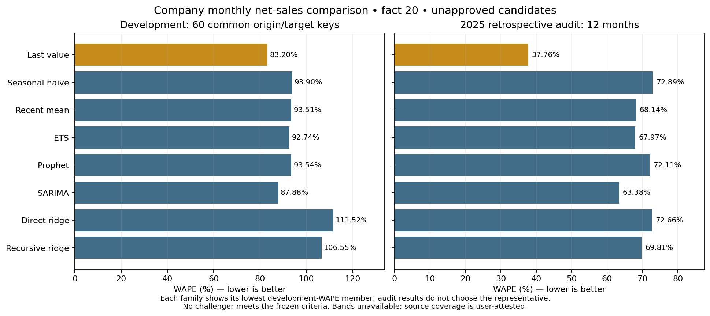
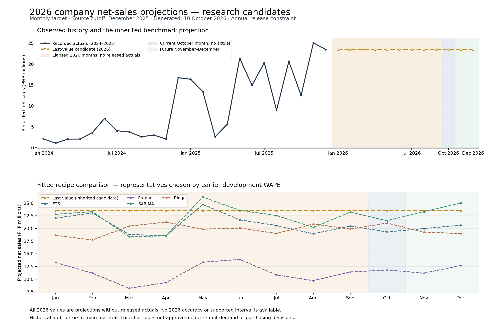

# Predictive Analytics Logic

This explanation supports the predictive methods and results sections of the
study. [Current state](../CURRENT_STATE.md) owns changing source, result and
acceptance status; [predictive operations](../PREDICTIVE_OPERATIONS.md) owns the
reproduction and release workflow. The evaluated comparison is research evidence,
and approved operational forecast serving remains pending.

## What the present models answer

The evaluated question is: **How well can historical company monthly net sales
predict later recorded monthly net sales, and do fitted models improve on simple
benchmarks?** The target is eligible recorded `net_sales`, from source Net CP,
in Philippine pesos. Financially eligible item kinds and signed adjustments remain
in the target. Revenue changes can reflect quantities, prices, discounts, product
mix and transaction timing; revenue is not verified medicine quantity demand.

The frozen Databricks candidate retains 2017–2025. Modeling uses contiguous
2020–2025 history under an inherited, training-only user completeness attestation.
That attestation is neither independent source verification nor publication
approval. Missing earlier months remain null. Original and adjusted allocation
provenance remains attached to the source. Current project reporting covers
2017–2025, while this modeling window is 2020–2025. If the paper still names its
original 2021–2025 scope, reconcile that wording with the recorded project-scope
change and academic requirements rather than silently changing its dates.

## Reporting pesos and percentages

The [guided target-review decision](../OBJECTIVE_EVIDENCE_REGISTER.md#predictive-target-review--10-october-2026)
records the user's reported approval of company monthly recorded net sales in
PHP as supporting research, with derived forecast YoY percentage presentation.
Peso forecasts and percentage interpretation can describe the same prediction;
they do not require separately fitting a percentage-target model.

The specified growth display is **forecast YoY change** against the same calendar
month in the previous year, using the same frozen eligible source population:
`100 × (forecast_net_sales − prior_year_month_net_sales) / prior_year_month_net_sales`.
Require a positive baseline and an eligible reviewed-complete comparison month.
Missing, zero, negative or ineligible baselines leave the percentage unavailable
with a reason; signed peso predictions remain intact. This is a presentation
specification, not a claim that new growth outputs or dashboard controls were
implemented. It also is not observed actual growth or an accuracy score. Scope
approval does not establish accepted operational inputs or 2026 accuracy.

Historical MAE/RMSE remain peso errors, and WAPE/normalized bias remain percentage
errors under their existing definitions below. Percentage presentation changes
neither the original predictions nor their measured errors. It does not establish
medicine quantities, fulfill original O3, amend the academic scope or approve
publication. The reported decision treats revenue forecasting as supporting
research while the original territory/quantity objective stays open. Guided
item 1 is complete on that reported scope decision; business error tolerance
under guided item 2 remains unset.

## Models evaluated

| Family | Configurations | Implemented approach |
|---|---:|---|
| Transparent benchmarks | 4 | Last observed month, same month in the previous year, and trailing 3/6-month means |
| ETS | 2 | Additive annual seasonality, with no trend or a damped additive trend |
| Prophet | 9 | Sales-only additive trend/annual seasonality with a restrained fixed prior grid |
| SARIMA | 2 | Seasonal autoregressive and seasonal differenced moving-average recipes with a 12-month season |
| Ridge regression | 4 | Direct and recursive lag forecasts at two regularization penalties, using past sales and calendar encoding |

The original comparison contains four benchmarks, two ETS and nine Prophet
configurations. SARIMA and ridge are a separately registered exploratory extension.
The [model adapters](../../services/analytics_service/predictive/models.py) define
the exact recipes. Registration preceded the extension's fitting but followed
inspection of the earlier audit; it does not make that audit untouched.

## How the comparison is evaluated

Training starts in January 2020. Five development origins—December 2022 and
March, June, September and December 2023—each predict actual calendar leads 1–12.
Every configuration is scored on the same 60 origin/target keys. The folds
overlap: those keys cover 24 distinct target months, not 60 independent months.
No random transaction split is used. A December 2024 origin supplies twelve
January–December 2025 retrospective-audit targets.

Each fit receives only history through its origin. Learned scaling uses training
rows, and recursive regression uses its own predictions for unknown future lags.
Centered full-series STL, future observed sales, and unapproved external joins
are not forecast features. Historical availability vintages remain unverified:
this evaluation uses a revised snapshot, so it is not a recreation of the exact
records available to the client on each historical issue date.

Selection uses development evidence and the existing experimental improvement,
bias and horizon rules. The already inspected 2025 audit is reported for diagnosis,
not used as a new untouched final test. A revised recipe needs later untouched
accepted actuals for a defensible promotion assessment.

## Reading the errors correctly

For comparable scored pairs, let `y` be actual recorded sales, `ŷ` the prediction,
`e = ŷ − y`, and `n` the number of pairs:

| Measure | Formula | Interpretation |
|---|---|---|
| MAE | `SUM(ABS(e)) / n` | Average absolute peso miss per scored forecast |
| RMSE | `SQRT(SUM(e²) / n)` | Peso error that gives larger misses more weight |
| WAPE (%) | `100 × SUM(ABS(e)) / SUM(ABS(y))` | Absolute error relative to the absolute actual-sales denominator |
| Normalized bias (%) | `100 × SUM(e) / SUM(ABS(y))` | Positive means net overforecasting; negative means net underforecasting |

A zero denominator makes the percentage measure unavailable. Signed actuals
remain intact. WAPE is **not an accuracy percentage**: do not describe a 37.76%
WAPE as 62.24% accuracy. A lower percentage error can coexist with a larger peso
miss when the actual-sales denominator increases. Aggregate signed bias also
allows overforecast and underforecast errors to cancel; inspect both separately.

## Joint error review and direction policy

The [guided error policy](../OBJECTIVE_EVIDENCE_REGISTER.md#predictive-error-policy--10-october-2026)
and [error review packet](../../outputs/predictive_error_policy_20261010/README.md)
formalize reporting MAE in pesos and WAPE in percent together. RMSE, signed bias
and separate over/underforecast counts and magnitude totals remain diagnostics.
The provisional research policy weights each peso of absolute error equally in
both directions (1:1). The user requested this approach; it is not evidence that
real business consequences are equal.

On the same common forecast/actual keys, MAE and WAPE share the absolute-error
numerator and model ordering whenever WAPE's denominator is nonzero. Reporting
both supplies peso and relative scale context, not independent performance
votes. Evaluate development and the inspected retrospective audit separately.
No model is reselected here, and no 2026 error is inferred from the old audit.

Both maximum acceptable cohort MAE and maximum acceptable cohort WAPE remain
null until supplied by the client with the intended decision, period and leads.
An unset limit yields **not assessed**, never a pass. A future joint assessment
requires both valid scoped limits and both measures meeting those limits.
These aggregate measures are not a guarantee or per-month maximum error cap.

The objective is to minimize absolute error without deliberately increasing or
decreasing the revenue forecast. Inspect direction and magnitude together:
large positive and negative errors can cancel signed bias while MAE remains
large. Revenue misses do not establish stockout/expiry costs. Different business
penalties require evidence and a newly registered decision policy; they do not
authorize changing retained predictions or the original frozen selection.

## Results and client interpretation

Use the [full model results](../../outputs/predictive_completion_20261009/models/fixed-origin-extended/eac9b508c8f1a28e7a3e3b967cf2189cc20ed0f16d3b70ca21eea0c243282f5a/RESULTS.md)
for every configuration and warning. The checked chart below displays benchmark
and fitted-model groups, choosing representatives by **development WAPE only**
where a group contains multiple recipes. The chart has eight display groups,
splitting the benchmarks and direct/recursive ridge; the scorecard uses the five
broader families in the methods table. Neither presentation approves a family
or chooses a model from audit performance.

In the original 21-configuration comparison, no fitted challenger qualifies under
the frozen experimental rules. Last value remains that unpublished benchmark candidate.
The current measured errors are recorded in [current state](../CURRENT_STATE.md).
They are substantial and have no agreed business tolerance. Naming a more complex
model does not establish better forecast performance or client usefulness.

The [recomputed scorecard](../../outputs/predictive_explanation_20261010/SCORECARD.md)
shows family representatives, all development rankings, lead-specific development
errors, and the twelve actual-versus-predicted audit months. It separates total
overforecasting and underforecasting, making the peso consequences visible.
The [audit chart](../../outputs/predictive_completion_20261009/audit-comparison.png)
shows how the fixed-origin predictions miss changing 2025 sales. These are
historical evaluated predictions, not a current operational forecast.

The reconciled source review finds accounting contributions to large errors but
no confirmed business explanation. Government-labelled concentrations do not
prove order timing, seasonality or disease effects. See the
[source-owner review](../../outputs/predictive_readiness_20261010/SOURCE_OWNER_REVIEW.md).

Predictive product classification is a separate task. Current Pareto/ABC describes
observed revenue contribution. A future ABC or demand-spike classifier needs a
reviewed forward target and temporal evaluation; this revenue comparison does
not establish a trained or approved XGBoost classifier.

## Later bounded error reduction experiment

The [six fixed additional trials](../../outputs/predictive_error_optimization_20261010/RESULTS.md)
test whether medians or conservative calibration reduce sensitivity to the last
observed month. They keep the same signed company revenue data, evaluation keys
and original experimental gates. Origin-local fitting uses only values known by
each historical cutoff. MAE and WAPE compare the same absolute misses in pesos
and percent, respectively.

The development winner passes those experimental gates but performs materially
worse in the 2025 retrospective audit. The unselected calibration trial gives a
small improvement in both periods, without audit-driven reselection. This is
mixed exploratory evidence, not dependable future performance or operational
model acceptance. [Current state](../CURRENT_STATE.md) records the exact results.
Keep this supplement separate from the original 21-model manuscript wording
below; later accepted untouched observations are needed to confirm a revision.

## Projections with annual source releases

The [annual projection packet](../../outputs/predictive_annual_release_20261010/README.md)
fits every retained recipe to January 2020–December 2025 and produces monthly
January–December 2026 candidate values. Annual release frequency controls actual
availability and refresh; it does not change the monthly prediction target.
The real generation date is 10 October 2026. January–September are elapsed
periods, October is current, and November–December are future, all without
accepted actuals in this input. These are unverified projections, not forecasts
issued at the December 2025 cutoff.

The inherited last-value candidate repeats December 2025 sales each month. The
other curves show fitted family representatives chosen using the earlier
development WAPE for display. Their shape does not prove greater accuracy.
Existing development and retrospective-audit errors accompany the packet;
none measures these new 2026 values. Null bands reflect insufficient calibration
support. [Independent QA](../../outputs/predictive_annual_release_20261010/qa/REPORT.md)
verifies identities, temporal contracts and separate benchmark/ridge calculations;
it does not approve a model or independently refit ETS/Prophet/SARIMA.

At the next annual release, first reconcile and approve the source population
and period closure. Compare retained candidates with accepted actuals while
preserving their real issue dates and whether targets were elapsed at generation.
Any model revision requires a new frozen evaluation protocol. The annual release
date remains unconfirmed. Current results and values are in
[current state](../CURRENT_STATE.md).

## What remains before use in planning

| Requirement | Present boundary |
|---|---|
| Business error policy | The client must specify acceptable peso/percentage error and the consequences of overforecasting versus underforecasting; the experimental thresholds are not that agreement |
| Current source and required leads | History ends December 2025; the current October 2026 3/6/12-month display requires leads 10–12 / 10–15 / 10–21, while evaluation covers only 1–12 |
| Original December 2026 demand objective | A twelve-month display starting December 2026 from that same origin would require leads 12–23, plus the original SKU/territory target contracts |
| Uncertainty | Five development errors per lead are below the documented 20/40 support requirements; 80%/95% empirical bands remain unavailable |
| Medicine units and territories | Reviewed SKU, pack, unit and territory identities and accepted quantity observations are required; financial category approval does not supply them |
| Disease/weather features | Approved geography/period joins and documented issue-time feature availability are required before an augmented comparison |
| Release and operational benefit | Data/model review and a scoped versioned release are separate from storage; stock, suppliers, lead time, expiry and measured outcomes are needed for inventory claims |

The client can inspect historical forecast errors and help resolve the source and
decision requirements. The present results do not establish dependable budgeting,
order quantities, reduced stockouts or reduced expiry losses. Do not activate a
candidate merely to fill a chart. The dashboard obtains analytical values through
the gateway from Databricks; requests do not train models or substitute local
research artifacts when an approved source is unavailable.

## Suggested paper wording

> The predictive component compared transparent benchmarks, ETS, Prophet, SARIMA
> and regularized lag regression for company monthly recorded net sales in pesos.
> Models were evaluated on common time-ordered origin/target pairs, with selection
> based on development performance. No fitted challenger satisfied the frozen
> experimental criteria, so the last-observed-value benchmark remained an
> unpublished candidate. The 2025 assessment was a retrospective audit because it
> had already been inspected; it was not an untouched final test. The measured
> errors demonstrate the limits of this revenue series and do not establish
> medicine-unit demand accuracy or operational inventory benefit.

Pair this wording with the scorecard's actual metric table and source limitations.
Preserve the original medicine-demand objective in the objective register unless
the client and academic owners explicitly accept an amendment. Reproduction and
publication remain governed by [predictive operations](../PREDICTIVE_OPERATIONS.md).
