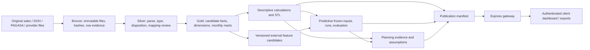

# MedShield completion workflow

Prepared 1 October 2026 from the verified system audit. This is an implementation plan; none of the planned application, warehouse, configuration or approval changes below has been executed by creating this document.

Accountable owner: project lead (Adrian/team). Developer, analyst and operator describe responsibilities and can be performed by the same team member. The CEO remains the sole business approver; academic scope changes require the adviser/panel's agreement.

Use the existing Next.js/TypeScript/Chart.js frontend, Express/TypeScript gateway, Supabase authentication, and Databricks analytical pipeline. Keep Supabase storage/control records separate from analytical measures. Correct stale architecture/stack documentation rather than adding a second analytical warehouse to follow outdated text.

## Verified input inventory, 2 October 2026

This is the starting inventory for execution, not a declaration that every input is valid. The read-only warehouse profile is `layer_profile_20261002.json`; `live.json` was refreshed from the same project on 2 October local time. The earlier point-in-time copy is `live_20261001.json`.

| Source | Observed content | Required treatment |
|---|---|---|
| Nine local annual sales CSVs, 2017–2025 | All nine files exist under `databricks/medshield_project_csv/medshield_project_csv`. They contain report preambles and differing column counts, so line count is not transaction count. | Preserve byte hash and exact row/line disposition. Validate the source year from both file manifest and parsed dates. Do not infer missing sales from physical line-count differences alone. |
| Latest Databricks Gold | Fact version 17, policy v7, 37,728 records, eligible net revenue ₱626,946,741.81, last delivery 2025-12-31. App pin remains 16/v6. | Bind every validation, API and export to one chosen version. Preserve candidate status until a version-specific business release. |
| Adjusted sales sources | Entire 2020, 2024 and 2025 Gold source groups: **11,355 rows, ₱299,249,415.55** eligible revenue. Review status in source identities remains estimated allocation. | Reconcile original annual and period totals; mark estimated product identity/quantity. A numeric quantity eligibility flag alone does not confer approved medical demand eligibility. |
| Negative net revenue | −₱1,622,699.58 in latest fact across 2017–2024. | Retain signed returns in net revenue; show separate positive contribution and returns for product ranking. |
| Calendar history | Ten months have no records in 2017–2019; 2020–2025 have twelve observed months each. | Missing is unknown, not zero. Observed monthly presence does not independently prove completeness of all submitted sales. |
| Catalog review files | `product_master_review.csv` and `transaction_evidence_review.csv` contain headers only. Latest fact: all 37,728 rows have category and identity status `needs_review`; canonical SKU and unit values are null. | Build reviewed entries with evidence. Retain Unclassified/unknown and source-label financial reports until then. |
| Area master | 35 mapping entries; Government and Hospital are nongeographic and together account for ₱475,750,341.11, 75.88% of all-period revenue. | Never allocate them to a province by assumption. Preserve buyer-sector and geographic dimensions separately. |
| DOH files | Two local XLSX workbooks exist. The inspected 2021–2025 workbooks contain disease sheets with weekly cases and a separate daily/onset-date breakdown for some diseases. | Inventory sheet-by-sheet grain, disease definition, geography, case count and final observation date; normalize weeks/dates without inventing precision. Remove duplicate copies from analytical counting by source hash and declared version. |
| PAGASA local station files | Some station CSVs have 1,461 daily rows; Port Area has 1,034; Iloilo is header-only; the file called `NAIA_Daily_Data.csv` is actually an HTML 404 response. A small PAR typhoon workbook also exists. | Validate MIME/content, header and bounds before ingest. Quarantine empty/error files and disclose coverage. Do not assign distant stations to client provinces merely because a file exists. |
| Warehouse external signals | Disease 1,787 rows, 2018-01–2025-12; weather 384 rows, 2017-01–2024-12. Both families currently have **zero join-ready and zero forecast-eligible rows**. | Treat as historical candidate context until mapping, time alignment, available-at-time checks and validation pass. |
| NASA POWER warehouse view | 540 monthly rows, 2021-01–2025-12. | Label as provider-derived weather proxy. Verify coordinates, area map, variable/unit and missingness; never label it official PAGASA. |
| Forecast warehouse | 1 candidate run, 1,092 points, 15 evaluations; **zero** reviews, release manifests and active pointers. | Maintain unpublished experiment status. The observed best retained benchmark is company monthly net revenue in PHP, not verified SKU units. |
| Operational inventory | No approved stock/expiry/purchases/supplier-cost feed was found in the current analytical contract. | User-entered values remain scenario assumptions; operational claims require new data and measured outcomes. |

The exact local station XLSX/CSV inspection was a format and first-row check, not a full data-quality certification. Follow the source-profile tasks below before model training. Do not treat the local prepared `datasources/clean` forecast/summary files as dashboard sources or as proof of accepted models.

## One end-to-end analytical contract



Each output has a separate status: `candidate`, `validated`, `business-reviewed`, `published`, `superseded`, or `unavailable`. Validation success does not automatically move business-reviewed or published status. A downstream capability may remain unavailable while historical finance is published.

## Delivery order

**Milestone A:** scoped descriptive release, steps 1–8.  
**Milestone B:** client upload and operational handover, steps 9–11.  
**Milestone C:** remaining predictive/prescriptive capstone objectives and final evaluation, steps 12–14.

A descriptive milestone can finish while later milestones remain open. Do not call the full capstone DSS complete at Milestone A.

## 1. Agree on the actual deliverable

Step 1 document prepared on 3 October 2026: [objective and evidence register](../../docs/OBJECTIVE_EVIDENCE_REGISTER.md). It contains the five original objectives, FR1–FR10/NFR acceptance matrix, existing and pending decisions, claim corrections and implementation ownership. Document preparation is complete; business release and any academic scope changes remain pending. Use this register rather than creating another competing scope checklist.

Owner: project lead, with CEO and adviser for their respective decisions.

- Use the audit to create an objective matrix: original paper objective, measurable output, available data, implementation status, evidence needed and owner.
- Preserve the original 2021–2025 study scope; document 2017–2020 as additional historical context unless the academic scope is formally changed.
- Define the first release as historical sales reporting: eligible revenue/gross profit/margin, matched YoY, contribution ranking, coverage and monthly company STL.
- Identify SKU/territory demand, inventory outcomes, client upload, external features and optimization as separate capabilities with separate completion gates.
- Preserve previously confirmed financial definitions and conditional acceptance of historical allocations. Record remaining dataset-release and mapping decisions separately.

Files: `docs/REQUIREMENTS.md`, `docs/ANALYTICS.md`, `docs/BUSINESS_DEFINITIONS.md`, `docs/DESCRIPTIVE_PUBLICATION_ACCEPTANCE.md`; paper objective matrix referencing original pp11–12.

Done: every promised capability has a testable outcome or an explicitly agreed scope change. “All charts finished” is not an acceptance criterion.

## 2. Establish one reproducible candidate

Progress 2026-10-03 Manila: candidate **17/v7** has passing live warehouse,
calculation, catalog and authenticated browser evidence; local preview now pins
17. See [the candidate receipt and run instructions](../candidate_release_20261003/README.md).
Current-candidate recovery preparation is captured. Complete historical version-16
rollback and exact deployed notebook bytes remain unverified; production release
gates are open. This checkpoint does not mark the full analytics workflow finished.

Owner: developer/operator. Tools: Git, PowerShell, Databricks SQL, existing validation scripts.

- Preserve current working-tree changes; record application revision plus hashes of uncommitted delivered files. Do not reset the checkout.
- Inspect current fact history, policy, publication outputs and STL identity. The audit observed **17/v7**, while the local backend was pinned to **16**; recheck before selecting a version.
- Save the candidate receipt: dataset ID, source hashes, policy, mapping/helper hashes, versions of each dependent Delta table, bridge definitions, notebook/application identities and validation hashes.
- Validate the candidate in a separate shell without activating the serving application. Example only if the recheck still identifies version 17:

```powershell
Set-Location C:\Users\Adrian\projects\medshield1\medshield\backend
$env:DATABRICKS_DESCRIPTIVE_FACT_VERSION = '17'
node --import tsx scripts/publication-readiness.ts
node --import tsx scripts/validate-descriptive.ts
node --import tsx scripts/validate-catalog.ts
```

Close that validation shell afterward. Review the generated receipts, not just the exit code. A changed version requires newly bound evidence. Configure a separately identified candidate preview for browser validation; this is not public release approval.

Do not rerun notebooks 01–06 just to repair the app pin. Existing coherent warehouse outputs do not need rebuilding for a configuration-only change. Gold/catalog changes require a newly bound package and predecessor checks, then 03 → 04 → 05 → 06. Source/parsing changes require assessment of 01/02 and all downstream dependencies. The old catalog runbook's hard-coded predecessor 16 must be reviewed before reuse.

Done: API, charts, tables, exports and STL can all identify the same complete candidate. Rollback captures the complete prior release, including STL and bridge dependencies.

## 3. Finalize the metric contract

Owner: analyst; developer implements the contract.

For each measure, record name, business question, unit, grain, eligible population, formula, missing/zero rule, filters and export behavior.

- Revenue: eligible net sales, with negative returns retained.
- Gross profit: eligible sales less the approved cost basis; before operating expenses.
- Margin: gross profit divided by net sales from the same margin-eligible population; unavailable for invalid/nonpositive denominators. Display revenue coverage next to the KPI.
- YoY: matched periods with explicit coverage and comparable date ranges; no invented zero baseline.
- Product ranking: positive sales contribution with separate returns and net revenue. Category/cohort filters apply before computing the denominator; Top N is a display operation afterward. Preserve the documented boundary-crossing ABC rule and deterministic tie-breaks.
- Quantities: compatible product units only; separate original-source observations from allocated estimates.
- Seasonality: published monthly STL with its full fitting scope and missing-data rules. A sliced chart is not a newly fitted decomposition.
- Missing-period chart estimates: optional scenario display, explicitly labelled, excluded from actual KPIs; version and publish analytical estimates through Databricks if used for decisions.

Files: `backend/src/descriptiveMetrics.ts`, `backend/src/databricksDashboard.ts`, relevant Gold calculations, `docs/BUSINESS_DEFINITIONS.md`, `docs/DESCRIPTIVE_ANALYTICS_LOGIC.md`.

Done: hand-calculated examples cover a return, zero baseline, missing month, partial month, missing cost and category filter. Each matches SQL, API and export.

## 4. Resolve catalog and geography in controlled batches

Owner: analyst prepares; CEO confirms supported business identities/mappings; operator publishes.

Prepare a review queue ordered by revenue contribution, retaining original titles and evidence. Product review fields: category, item kind, canonical identity, brand, strength, form, package unit, pack quantity, unit of measure, alias evidence, reviewer and mapping version. These are independent fields/statuses.

Examples: KN95 Box and KN95 Piece remain separate. An unspecified KN95 mask remains unresolved until packaging/rating evidence exists. KLOPIDO and KLOPIDO 75MG are not automatically identical. A medical category approval does not prove the unit or transform an adjusted allocation into observed demand. A proposed alias match is not approval.

Separate geographic province/region from buyer type. “Government” and “Hospital” remain unallocated geographically until evidence establishes location. Hospital does not automatically mean private ownership. Show mapped and unallocated contribution within every selected scope.

Files: `databricks/medshield_project/product_catalog.py`, `catalog_interchange.py`, `review_catalog.py`, `03_sales_gold.py`, `backend/src/catalogContract.ts`; existing reference masters and their versioned hashes.

Done: one-to-one mapping joins, unchanged financial totals, reviewed aliases, packaging separation, complete category partitions and visible unresolved coverage. Partial catalog review may support a restricted descriptive release; verified SKU-demand features remain gated.

## 5. Design the client tasks and screens before CSS changes

Owner: frontend/BI designer with the CEO as task reviewer. Use low-fidelity wireframes in the existing app; an additional design platform is optional.

| Screen | Client question | Primary design |
|---|---|---|
| Overview | What changed and what can I trust? | Three core financial KPIs, coverage, monthly sales, concise change explanation and link to detail |
| Sales Diagnostics | When did sales change? | Revenue/gross-profit trend, matched YoY, margin coverage, separate STL panel and exact values |
| Product Prioritization | Which products contribute most? | Search, category and identity filters; horizontal ranking, Pareto/ABC, returns and source aliases |
| Area Prioritization | Where are recorded sales attributed? | Province and buyer-type views kept distinct; visible unallocated revenue; coverage table |
| Upload & History | Did my new file process correctly? | File selection, period/mode, validation, progress, candidate review and publication history |
| Data Review | What requires a decision? | Affected records/metrics, source evidence, suggested correction and tracked review status |
| Forecast / Planning | Is this usable for a decision? | Target/unit, evidence status and limitations; unavailable state until capability gates pass |

Common order: page title → source freshness/release status → filters → KPIs → main chart → detail table/export → methodology. Show last sales date separately from last successful refresh. Advanced version/hash details belong in a disclosure, while candidate/approved status stays visible.

Use dynamic year and comparison dropdowns. Show active filters clearly and provide Reset filters. Export exactly the selected scope. Use the same measure label, unit and period in KPI, chart, tooltip, table and CSV.

Done: the CEO can find annual revenue, explain margin coverage, distinguish a return from missing data, identify an estimated product quantity and export the selected period in a prototype walkthrough.

## 6. Apply a restrained, readable visual system

Reuse the existing navy identity, amber emphasis, white cards and light-gray canvas. Use consistent spacing, borders and standard icons. Avoid decorative gradients, glow, oversized empty cards and repetitive “AI insights” banners. Meaningful titles such as “Monthly net sales” are preferable to broad disease-readiness claims in a sales-only view.

Project defaults, not claims that WCAG mandates font sizes: body 16px, secondary text 14px, chart/table labels normally at least 12px, 8px spacing increments, 16–24px panel padding, and approximately 44px primary controls. Use tabular numerals for money and right-align numeric columns.

Target WCAG 2.2 AA: normal text contrast at least 4.5:1, large text at least 3:1; meet non-text contrast and keyboard/focus requirements; never encode status only by color. Meet the 24×24 CSS-pixel target-size rule or its allowed exceptions; the larger project control target improves usability. Test zoom/reflow and provide an accessible table for each important chart. [W3C contrast](https://www.w3.org/WAI/WCAG22/Understanding/contrast-minimum.html), [target size](https://www.w3.org/WAI/WCAG22/Understanding/target-size-minimum.html).

Design each state: initial/loading, valid data, no records, unknown observations, partial coverage, unresolved mapping, unauthorized access, warehouse failure and export failure. Never substitute zero or a local file when Databricks is unavailable.

Files: `frontend/lib/medshieldReference.ts`, `frontend/app/overrides.css`, `frontend/services/api/dashboard-filter-panel.ts`, existing page runtimes. Keep shared styles scoped. Any inline handler must be registered and bridged through `dashboard-engine.ts`; prefer existing event-listener patterns. Preserve the sidebar indicator isolation and real UTF-8 currency characters.

Done: desktop/narrow viewport, keyboard, zoom, contrast and loading/error checks pass on real rendered pages.

## 7. Implement and verify one screen at a time

Order: common status/filters → Overview → Sales → Products → Areas → exports/review states. Resolve metric/API contracts before connecting charts. Reuse Chart.js and existing runtimes rather than switching frameworks or chart libraries.

Each screen requires one identical selected scope reconciled across warehouse, API, KPI/chart, table and CSV. Save a receipt and screenshot. Include negative values, unknowns and estimates; distinguish fixture tests from authenticated live validation.

Verification tools: Node test runner, Python unittest, TypeScript type checks, Playwright and manual accessibility/client task checks. Run only relevant checks while iterating; at the release gate run the integrated suite. Stop Next.js development before a production build to avoid cache conflicts.

Done: all descriptive screens pass calculations and client tasks on the same candidate; no unresolved required publication test is called a pass.

## 8. Release the scoped descriptive layer

Owner: developer prepares the complete review package; CEO accepts the exact business scope; operator activates.

Prepare dataset/versions, source and mapping hashes, application/notebook identities, reconciliation, passing checks, limitations, client walkthrough results and rollback receipt. Preserve earlier financial-definition decisions; record a new decision only for the particular release or newly proposed rule.

After actual version-bound acceptance, activate the coherent release and verify through the authenticated application. Runtime status must derive from the acceptance/release record, not a hard-coded green badge. If a required dependent output fails, keep the previous coherent release active or show the affected capability unavailable.

Done: **Milestone A—descriptive reporting released within its accepted scope.** This does not close client-upload or predictive/prescriptive objectives.

## 9. Agree the future upload contract before implementing ingestion

Owner: project lead/analyst with the CEO confirming the export and correction workflow.

The current source has a DR number but no stable line ID. Prefer the existing specification's **complete-period replacement** contract. Example: a full September 2026 export replaces September only after review. A corrected September file replaces that same period as a new version; other periods remain unchanged.

Specify source/account namespace, date field, timezone, period boundaries, currency/precision, return convention, required columns and coverage declaration. DR numbers may repeat across years; never assume they are globally unique. Preserve legitimate identical lines. File SHA-256 identifies a retry; source line position identifies an occurrence within that file, not a stable business line across corrected files.

If the client cannot supply a complete period, do not enable automatic period replacement. Define a supported complete-document correction flow or obtain stable line identifiers before enabling incremental corrections. A late-arriving sale can be supplied in a corrected complete-period export.

Files: update the existing `docs/SALES_DATA_PIPELINE_SPECIFICATION.md` and `docs/API.md`; do not maintain a competing ingestion specification.

Done: client sample exports demonstrate new period, exact retry, corrected period, overlapping scope, return, future year and incomplete file handling.

## 10. Implement upload-to-Databricks orchestration

Proposed integration, not currently operational:

```text
Client uploads CSV
  → Express validates identity, scope and submission metadata
  → private original file + durable batch record
  → backend worker copies verified bytes to Databricks landing volume
  → Databricks job: Bronze → Silver → candidate Gold → reconciliation/STL
  → client reviews candidate totals and affected-record report
  → CEO accepts exact candidate
  → publication job verifies predecessor and activates release manifest
  → gateway/dashboard read that complete Databricks release
```

Tools: existing Next.js/Express/Supabase Auth; proposed private Supabase Storage and PostgreSQL batch/event/work-request records; durable TypeScript worker; Unity Catalog volume; Databricks Files and Jobs APIs; Python/PySpark/Spark SQL/Delta; existing SQL Statement Execution gateway. No separate analytics database or orchestration platform is necessary for this scope.

Extend the existing upload route and `frontend/services/api/upload-pipeline.ts` with a typed batch contract. Define status/history/review/activation endpoints in `docs/API.md` before implementation. Use the existing pipeline specification for exact schema naming. Implement authentication, authorization, bounded uploads, safe CSV parsing, private error downloads and audit trails.

The historical restart notebooks overwrite candidate tables and validate a specific historical snapshot. Build a separate batch path using reusable cleaning rules; do not simply trigger all historical notebooks for every client file. Candidate construction must not alter the active release. Bind every output to dataset identity and a publication manifest; switch one active release reference only after all outputs pass. Reject activation if the predecessor changed while review was pending.

Proposed batch states: uploaded → validating → processing → needs review/ready for acceptance → publishing → published, with failed/superseded alternatives. Store batch ID, file hash, attempted job runs, reconciliation and event history. Report actual stages rather than invented completion percentages.

Permissions preflight: verify the workspace edition supports the intended worker identity and APIs. The job trigger needs permission to manage runs on that job; the job's run-as identity separately needs input/output privileges. Separate dashboard SELECT access from ingestion writes. Grant required catalog/schema, volume and table privileges only in the intended namespaces; provide notebook/job/environment permissions to the operator. Keep credentials server-side. [Databricks job and run-as permissions](https://docs.databricks.com/aws/en/jobs/privileges).

Done: an authenticated upload survives browser closure/worker restart and produces an isolated, reconciled candidate with no automatic activation.

## 11. Prove recovery and hand over the client workflow

Test identical retry, concurrent retry, worker crash after job submission, rejected rows, unavailable warehouse, invalid mapping, unknown product, failed reconciliation, rejected approval, stale predecessor and rollback. Unknown product classification alone should not block valid financial reporting. Integrity or conflicting replacement scope can block the whole submission. A partial-period candidate must never replace a complete period silently.

The CEO's routine is: sign in → upload complete-period CSV → confirm period → see progress → review totals/limitations → accept for publication → view updated dashboard/export. The technical operator handles infrastructure, credentials, failed jobs and recovery.

Deliver a short illustrated client guide, supported CSV template, correction guide, operator runbook, backup/retention policy, hosting/billing ownership, monitoring and support contact. Demonstrate the workflow with the CEO, including one recoverable error.

Done: **Milestone B—client-operated updates and support are demonstrated without requiring the CEO to operate Databricks.**

## 12. Complete forecasting only for a defensible target

Owner: analyst/developer; business usefulness reviewed by CEO and academic method by adviser.

Decide company revenue versus verified SKU-unit demand by territory. The latter requires resolved identity/units/geography and sufficient history. Refresh observations: the audited data ends December 2025. Define forecast origin, supported horizon, training cutoff and how missing/adjusted observations are treated.

Retain benchmark, ETS and Prophet comparisons. Use temporal folds, training-only feature preparation, fixed selection criteria and truly future/as-of external inputs. Validate DII/RSI source units, geography, publication lag and future availability before using them. External features must demonstrate benefit; their presence is not accuracy evidence. Define an observed target for any urgency model. Keep current ABC deterministic; future ABC classification is a different target.

Publish model identity, input dataset, fold predictions, metrics, limitations and calibrated intervals where supported through Databricks. Keep the model release pointer empty until its own gates pass. UI must display PHP for revenue forecasts and the verified unit for quantity forecasts.

Done: a reproducible model beats the relevant acceptance criterion or transparently remains an experiment; the published scope exactly matches the evaluated scope.

## 13. Complete procurement planning and outcome evaluation

Obtain stock by SKU/batch, expiry dates, purchases, supplier lead times, pack units, ordering/holding costs, capacity and service priorities. Validate these before computing EOQ/ROP or claiming expiry reduction.

Choose whether to retain the current fulfillment heuristic as a scenario tool or implement the paper's weighted optimizer. For the latter, specify SKU/territory variables, weights, stock, demand, budget, capacity, supplier, pack-size and expiry constraints. Integer pack decisions may require mixed-integer optimization rather than a purely continuous LP. Select a solver only after this formulation is agreed and deployment availability verified.

Test small known optima, infeasibility, conflicting constraints and sensitivity to assumptions. CEO reviews a concrete recommendation with costs, assumptions, limits and alternatives; the system does not automatically order stock. Official PAGASA warnings and internal scenario triggers remain distinct.

Measure expiry wastage with an agreed numerator/denominator and comparison period. Simulation results are labelled simulation; observed client outcomes require actual operational evidence.

Done: the implemented method matches the paper and its business claims are supported by the appropriate evidence.

## 14. Update the manuscript and conduct final acceptance

Update the objective matrix and methods as each stage finishes; prepare final tables/screenshots only from the release being defended. Correct the original paper's product-count inconsistency, unreproduced Antizoal claim, STL granularity, DII evaluation leakage risk, RSI units, LP objective, safety-stock/expiry assertion, weather-warning attribution and analytical architecture.

Maintain one traceability chain: objective → requirement → implementation → dataset/model version → test → business/academic acceptance. Preserve proposal history and record scope amendments explicitly. Never invent results to fill a chapter.

Final walkthrough covers all accepted objectives, uploads, corrections, filters, exports, limitations, model/scenario status and recovery. Separate technical sign-off, CEO business acceptance and adviser/panel academic acceptance.

Done: **Milestone C—the agreed full system and paper correspond to demonstrated capabilities.** Remaining unimplemented original objectives are either completed or formally amended, not silently omitted.

## Detailed execution contracts for all analytical layers

The fourteen stages above set the order. The following contracts specify what each job, calculation and screen must do. The accountable owner should turn each row into a tracked ticket with the stated evidence; a successful notebook run without its downstream reconciliation is incomplete.

### A. Source register and Bronze

**Owner:** Databricks/data operator. **Inputs:** the nine sales CSVs, reviewed reference masters, later client submissions, and separately registered DOH/PAGASA/NASA files. **Affected code:** `databricks/medshield_project/01_sales_bronze.py` for historical reconstruction, `external_restart/00_external_setup.py` through `01_external_bronze.py` for external sources, plus a distinct future-upload job.

1. Create a manifest record per actual file: source family, logical period, original filename, byte SHA-256, received time, submitter/provider, format, size, encoding, declared completeness, version/replaces ID, and storage location. Keep originals immutable.
2. Reject/hold an HTML error page saved as `.csv`, a header-only file where data was expected, wrong encoding, oversized file, unexpected workbook structure, mismatched hash, or unknown replacement source. The local NAIA/Iloilo station examples are required test cases.
3. Preserve every physical source record with file ID, sheet, original line/row and raw field bytes or parsed text. Count report preambles, headers, blank rows, duplicates and transaction candidates separately. The historical CSV first row is the MedShield report title, not the actual transaction header.
4. Treat corrected 2020/2024/2025 files as identified adjusted sources; retain the original-to-adjusted relationship, method and human review. Never infer medicine identity from the replaced label merely because totals match.

**Gate:** source files, manifest hashes, archived bytes and row-disposition counts reconcile. A parser must explain the gap between 59,039 source lines and 37,728 final fact transactions, rather than simply asserting those totals are equal. Exact number of transaction candidates and every excluded row must come from the Bronze/Silver audit, not from a CSV line counter.

### B. Silver cleaning, identity and exception policy

**Owner:** data analyst and engineer. **Affected code:** `02_sales_silver.py`, product and geographic masters, Silver assessment/audit tables.

1. Parse delivery date, document/DR number, product title, area/client field, quantity, CP/TP, discount and workbook profit with explicit type/precision rules. Preserve raw values alongside standardized fields. Handle null versus numeric zero independently.
2. Normalize harmless spacing, case and known spelling aliases deterministically. Do not infer pack contents, medical rating, ownership or province from a suggestive title alone. Use exact reviewed aliases for canonical matching.
3. Assign one primary disposition per row: accepted for specific metrics, needs review, excluded nontransaction (header/preamble/blank), duplicate snapshot, or rejected invalid financial/document evidence. Warnings are secondary flags; they cannot inflate disposition counts.
4. Evaluate duplicated DR numbers within source system, period and document context. Legitimate same-document product lines remain. A future corrected file is an explicit replacement candidate; no first-match merge by DR number.
5. Evaluate contract parent and children on the approved financial basis. Count a valid parent or reconciled children once. If no itemized evidence exists, keep the contract-level financial amount with product detail unavailable; an estimated allocation stays estimated.
6. Keep metric eligibility distinct: reliable finance can remain reportable while product identity/quantity/geography is unresolved. An unreadable amount, ambiguous parent-child overlap, missing required currency or failed period reconciliation blocks the affected financial scope. If the affected rows cannot be isolated, hold the batch.

**Gate:** exact counts and financial effect by disposition/year/source; no silent drops; unique source occurrence IDs; rejected-row export contains reasons. Later zero missing sales is a client assumption, not an automatic cleaning result.

### C. Gold dimensional and financial contract

**Owner:** data engineer with finance/CEO review of changed business meaning. **Affected code/tables:** `03_sales_gold.py`; `workspace.medshield_gold.sales_restart_fact_candidate`, product/area dimensions, monthly/yearly/product/area candidate outputs, publication audits; 04/05 bridge files.

At the transaction grain, require dataset ID, source record ID, source file hash/year/row, date, DR, raw/normalized/canonical product fields, raw/mapped buyer/geography, original and eligible measures, adjusted/transaction evidence, eligibility flags, rule codes and mapping/policy versions. Make product category, canonical identity, item kind, pack and unit independent approval fields. A category of Medical alone cannot set `is_approved_medical_demand_eligible`.

Reconcile in three directions: original source annual amount → cleaned transaction amount with documented adjustments → eligible dashboard amount with documented exclusions. Repeat by month, source file, region/buyer dimension, product grouping and API response. Use decimal-safe exact comparisons/tolerances agreed in the metric contract; never accept offsetting period errors simply because annual totals match. Compare source-record fields/eligibility against predecessor versions when doing a catalog-only rebuild.

Flag names must be explained in the data dictionary. In current v7, some adjusted records have `is_quantity_observation_eligible=true` because a numeric source quantity exists; that flag does **not** prove independently observed product units. Approved medicine-demand eligibility requires original or independently verified transaction detail plus approved physical item identity, unit and quantity rules. The UI/export must show this distinction.

**Gate:** unique fact keys and one-to-one mapping joins; 37,728 current-candidate rows remain an identity check only for the frozen historical dataset; no duplicated parent/child revenue; product, buyer and geography partitions add back to the eligible company total; all dependent tables share dataset/policy/hash versions.

### D. Descriptive metric and chart contract

**Owner:** BI specialist/developer. **Affected components:** `backend/src/descriptiveMetrics.ts`, `databricksDashboard.ts`, monthly bridge and the five dashboard descriptive runtimes; `/api/summary`, `/api/monthly`, `/api/products`, `/api/by_area`, `/api/sales/*`, `/api/seasonality/stl`.

| Question and main view | Calculation / visual | Crucial disclosure and test |
|---|---|---|
| Company performance | Net sales and gross-profit cards; monthly line; annual table | Gross profit is before operating expenses. Reconcile ₱626.95m eligible revenue and ₱288.49m gross profit for the current frozen dataset. |
| Margin | Weighted percentage: eligible profit ÷ revenue on the same margin-eligible rows | Current 60.262177% covers 76.35747% of all-period revenue; 2025 coverage is about 51.28%. Show denominator/coverage, and unavailable where invalid. |
| Growth | Matched month/day YoY amount and percentage; diverging bar for gains/losses | Compare equivalent observed periods; disclose count matched/available. Zero/negative base yields an unavailable percentage with peso difference retained. |
| Product performance | Horizontal positive-sales ranking, Pareto curve, deterministic ABC table | Denominator is full positive contribution in selected category/period before Top N/cohort display; signed returns visible separately. Source-label ranking is not canonical medicine ranking. |
| Quantity | One product and compatible unit per trend/heatmap; observed vs adjusted/estimated strata | Unknown unit/pack prevents cross-SKU totals. Negative quantity/return remains visible. Source numeric quantity does not imply approved medicine demand. |
| Geography and buyer | Geographic revenue bars/maps only for mapped areas; separate buyer-sector view; unallocated row | Government/Hospital do not become provinces. Display mapped share and unallocated contribution for each selected period. |
| Seasonality | Full-history warehouse STL trend/seasonal/residual and explanatory calendar-month mean separately | STL currently covers 2020–2025 monthly company revenue, 72 periods. No claim of daily territorial/clinical seasonality or re-fitting upon date filter. |
| Source evidence | Paginated transaction table and filtered CSV | Same period, filters, units, status and release ID as displayed charts. Exported rows disclose raw/adjusted, mapping and eligibility. |

The default All Time view should use observed annual history. Missing-month interpolation is a separate opt-in estimate/scenario view; derive it from a governed/versioned method if decision-use continues. Render selected-period actuals without local analytical fallback when the warehouse is unavailable.

**Gate:** a filter matrix (year, custom dates, category, buyer, territory, product, All Time, future empty year) reconciles warehouse → API → chart → table → CSV for positive, negative, missing and partially eligible values.

### E. External data and feature contract

**Owner:** data analyst with source/data steward. **Affected notebooks/services:** `databricks/medshield_project/external_restart/00_external_setup.py` through `03_external_gold.py` and `06_external_restart_system_bridge.sql`; `services/analytics_service/external_regression.py`; weather refresh and external API routes.

1. DOH: inventory each sheet and disease definition, weekly versus onset-date grain, province/region code, case and death units, publication/revision dates, duplicated source copies and final complete period. Preserve partial 2026 as partial. Build DII using a training-window baseline, avoiding later-period information in earlier forecast folds.
2. PAGASA: preserve official provider, station, coordinates, daily variable/unit, missing days and mapped territory evidence. Quarantine NAIA HTML and empty Iloilo; do not turn 2025 absence into a complete official series. PAR typhoon tracks do not automatically supply province-level Signal-2 status.
3. NASA POWER: profile all 540 current monthly rows by coordinate/area/period/variable and missingness. It is a separate proxy; compare it with mapped PAGASA observations only over overlapping validated locations and periods.
4. Define one temporal join contract: sales target period, signal period, geography grain, lag, observed-as-of date, publication delay, missing-data treatment and allowed provider. A province-weather proxy cannot be joined to Government/Hospital sales whose province is unknown.
5. Treat RSI defined as a probability in the paper separately from actual rainfall millimetres. Define source and calibration before using any rainfall-related demand multiplier.

**Gate:** zero duplicate feature keys, versioned geography and calendar maps, coverage table by disease/station/province/year, no future information in historical folds, and demonstrable gain over sales-only benchmarks. Today the warehouse says join-ready=0 and forecast-eligible=0 for both disease and weather, so an external-adjusted model remains unavailable.

### F. Predictive modeling, evaluation and publication

**Owner:** analyst/model developer. **Affected files/tables:** `services/analytics_service/predictive/`, `07_predictive_contracts.sql`, `08_predictive_frozen_input.py`, `backend/src/predictiveRelease.ts`, `/api/forecasts` and `/api/model_evaluation`.

Define a model card before training: target, unit, population, grain, issue date, maximum lead, training cutoff, missing/adjusted eligibility, features available at issue time, evaluation metric and business decision supported. The current experiment target is `company:net_sales:PHP`; it does not answer medicine-unit procurement demand. Different targets require separate experiments and releases.

Workflow: freeze accepted data and hashes → build as-of features inside each training fold → compare last value, seasonal naive and moving means → ETS/Prophet challengers → rolling-origin development → reserve later audit periods → select from development rules only → compute WAPE, MAE, RMSE and bias plus subgroup/lead diagnostics → check calibrated interval support → review error causes → record model and input identity → publish a coherent manifest/pointer only after model-specific approval. An XGBoost urgency or future ABC classifier additionally needs a genuinely future target and as-of labels; training it on current ABC features that define the label only reproduces the rule.

Current independent evidence: 15 configurations and 30 recomputed development/audit metric groups match stored results. Retained last-value benchmark development WAPE is 83.20%; retrospective 2025 WAPE is 37.76%. Prophet audit WAPE is roughly 72.11–72.61%. There are only five development errors per lead; publish no empirical 80/95% intervals with insufficient support. The latest actual sale is December 2025, so refresh accepted data before claiming a current long forecast horizon. The warehouse has one candidate run and no model review/release/pointer.

That candidate experiment's frozen input was bound to fact version 16. If the descriptive release moves to 17, either produce a newly frozen version-17 input and rerun the model contract, or prove and record allowed equivalence across all model inputs under the same publication policy. A matching company revenue total alone is insufficient to claim the whole model input is identical.

**Gate:** repeated training from the frozen input produces the same hashes/metrics; published point, actual, evaluation, limitations and release all reference one input and model. `unpublished` remains a valid final state when thresholds or business review fail.

### G. Prioritization and prescriptive planning

**Owner:** analyst, operations reviewer and developer. **Affected implementations:** commercial ranking in `backend/src/databricksDashboard.ts`, offline `services/analytics_service/prescriptive_planning.py`, `/api/sales/planning-shortlist`, `/api/sales/planning-solve`, planning UI and any future published planning tables.

Keep three distinct products:

1. **Descriptive product ABC:** rule-based historical positive contribution, with returns and uncertainty shown. No machine learning required.
2. **Commercial area priority:** mapped geographic areas ranked on current governed sales-value scale and active-period coverage, baseline weights 60/40 with sensitivity. Buyer clusters are filters/composition, not geographical regions. Outbreak risk enters only after reviewed external joins and a revised weighting decision.
3. **Allocation scenario:** historical shortlist plus entered demand, stock, protected stock, pack, cost, supplier cap, budget, horizon and minimum fulfillment. Show assumptions, infeasibility reasons and alternative sensitivities; never execute purchases automatically.

There are two current implementations to reconcile: the **live TypeScript planning solver is greedy**, while `services/analytics_service/prescriptive_planning.py` contains an offline SciPy mixed-integer model. A Python solver file does not mean the dashboard is using or has validated that optimizer. Choose one governed method and expose its algorithm/version accurately. The paper's `Max Z=x+y` requires revision if the actual business goal is weighted territorial fulfillment. Integer packs and supplier caps may require mixed-integer, rather than continuous linear, optimization.

EOQ needs ordering and holding costs; ROP/safety stock need demand uncertainty and lead time; expiry claims need batch age, shelf life, stock use and measured wastage. If inputs are entered by a user, mark every resulting number scenario. No current sales-only output proves ≤5% expiry wastage.

**Gate:** test small hand-solvable cases, solver optimality or truthful heuristic labeling, infeasible cases, units/pack integrity, sensitivity, source freshness and human decision record. Operational effectiveness requires an agreed before/after outcome measure.

### H. Publication, UI and scientific traceability

**Owner:** project lead/integrator. One release packet connects source hash → Bronze batch → Silver dispositions → Gold version and mapping hashes → descriptive tables/STL → model or scenario version → API response → displayed chart/export → CEO decision → paper claim.

For each dashboard tile, store a specification with: question answered; target user action; source/table; formula; filters; evidence status; uncertainty; empty/error copy; API field; CSV column; test; paper section. The screen design in steps 5–7 is the rendering of these specifications. Do not insert unsupported medical or weather conclusions into captions to make a chart seem more useful.

For the paper, create a claim register: page, exact quantitative/method claim, reproducible query/artifact, dataset/model version, result, and disposition (`supported`, `revise`, `remove`, `await data`). Prioritize original pp11–12 objectives; p93 Antizoal; pp95/115 ABC counts; pp92–93 STL; pp97–99 DII/RSI; p103 optimization; p105 expiry; p107 warning source; p119 architecture. An adviser-approved scope change is distinct from CEO business approval.

**Gate:** every claimed number, model comparison and screenshot can be reproduced from the exact release; no caption claims causality from correlation or completeness from observed-calendar presence.

## Acceptance matrix and failure handling

| Gate | Evidence that passes | Failure disposition |
|---|---|---|
| Source integrity | Original bytes/hash, format and row manifest, reviewed replacements | Quarantine bad source or hold its batch; retain prior release |
| Cleaning | Explained disposition counts and exact financial effect | Isolate affected records/metrics; whole-batch hold if boundaries or finances cannot be trusted |
| Historical finance | Annual, monthly, source and dashboard reconciliation; matched eligibility | Do not publish affected measure; investigate source/overlap |
| Catalog and geography | Approved evidence or visible unresolved coverage, no join duplication | Keep valid company finance; withhold affected SKU/territory inference |
| Descriptive | Same identity and numbers in SQL, API, chart, table and export; passing version-bound checks | Keep candidate/previous release; show unavailable for failed dependency |
| External features | Approved location/time/source joins and as-of reproducibility | Historical context only, no external-adjusted forecast |
| Predictive | Frozen folds, evaluated improvement, supported horizon/intervals, review and coherent release | Unpublished experiment; dashboard explains target/status |
| Prescriptive | Inputs, objective, method proof, constraints and outcome evidence | Clearly labelled scenario or unavailable, no stock action |
| Handover | CEO succeeds in upload/correction/review/export; operator performs recovery | Do not claim client-operable pipeline |

## Practical delivery backlog

| Order | Work package and owner | Exact completion evidence |
|---|---|---|
| 1 | Project lead: objective/claim register and accepted release scope | Each paper objective and current business decision mapped to a gate; no duplicated CEO approval request |
| 2 | Operator/developer: rebind candidate 17/v7 or a newly observed successor | Three version-bound validation receipts; dependent output manifest; authenticated candidate smoke test |
| 3 | Data analyst: source and metric dictionary | Bronze/Silver counts, source adjustment reconciliation, margin/ABC/YoY examples, exact missing/zero policy |
| 4 | BI/frontend: descriptive contract and screen cleanup | Selected-filter SQL/API/UI/export matrix; accessible states; CEO task walkthrough |
| 5 | Catalog/geography reviewer: prioritized evidence batches | Versioned review master, impact and unresolved coverage; downstream identity/quantity guards |
| 6 | Developer/operator: controlled descriptive release | CEO acceptance of exact dataset and limitations; coherent activation/rollback receipt |
| 7 | Backend/data engineer: complete-period upload workflow | Retry/correction/recovery tests; candidate isolation and publication history |
| 8 | Analyst: external mapping and source quality | Invalid station files quarantined; coverage/join/as-of evidence; approved feature contract or explicit ineligible state |
| 9 | Model developer: frozen target-specific experiments and release | Model card, folds, metrics, horizon, intervals, review, pointer and UI status; valid unpublished outcome allowed |
| 10 | Operations analyst: inventory inputs and planning method | Scenario/optimizer tests, real-input provenance, measured outcome protocol |
| 11 | Team/adviser: final manuscript and defense packet | Claim register completed; system demonstration and paper use identical accepted evidence |

## Documentation conflicts to correct during implementation

These are verified current-file conflicts, not instructions to pretend a future feature exists:

| File | Conflict to resolve | Moment to update |
|---|---|---|
| `docs/CURRENT_STATE.md` | Still leads with version 16/v6 and the old 70-check receipt; live latest is 17/v7 with a 72-check candidate receipt. Its predictive section contains an earlier blocked-training status even though an actual 15-model experiment was completed. | After the chosen descriptive candidate/release is fixed, update the snapshot with dated evidence and retain old receipts as history. |
| `docs/CATALOG_DEPLOYMENT.md` and `databricks/medshield_project/README.md` | Describe v7 as a prepared, not deployed package and assume predecessor 16. v7/17 is present in the warehouse. | Rewrite as an executed deployment record plus a forward-looking runbook before any further catalog revision. Rebind assertions to the actual predecessor. |
| `docs/BUSINESS_DEFINITIONS.md` | Broad wording such as quantity “approved for modeling” and generic margin formula can be read beyond the eligible observed/canonical population. | Alongside metric contract: distinguish source numeric quantity, product identity, approved medical demand and shared margin denominator. |
| `docs/REQUIREMENTS.md` | The phrase “demand uses quantity sold” and paper territory-demand target do not match the existing company revenue experiment. Its external-source requirements reference weather-provider variants beyond the currently verified NASA POWER view. | At objective/target decision and later model implementation. Record exact target/units and actual provider. |
| `docs/SECURITY.md` | Says the upload route accepts and processes CSV/XLSX with a 30 MB limit, while the current route returns HTTP 409. | Before the client upload is demonstrated. Preserve security requirements as future controls until implemented and verified. |
| `docs/ARCHITECTURE.md`, `docs/API.md`, `docs/DATABASE.md` | These give the main warehouse boundary, but candidate versus active release, newer catalog/model status and proposed upload control tables need the same release contract. | When corresponding implementation is released. |
| Original `references/CapstonePaper_1.pdf` | Contains the exact quantitative/method conflicts listed in the audit. | Update an editable successor manuscript through the adviser; retain the original PDF unchanged as the proposal evidence. |

Update canonical docs after behavior is verified. The output of this planning task is not itself a release receipt or academic amendment.

## Immediate next work packet

Start with steps 1–3: confirm the objective matrix, verify the complete 17/v7 candidate against the current warehouse, and finalize the metric/coverage contract. Then prepare the screen wireframes and resolve the highest-impact catalog/geography entries. Do not begin by rerunning every notebook or redesigning every screen.

This workflow is based on [the audit](C:/Users/Adrian/projects/medshield1/medshield/outputs/system_audit_20261001/REVIEW.md). It adds implementation order and design acceptance criteria; the canonical requirements and pipeline specification remain the places to record agreed product contracts.
